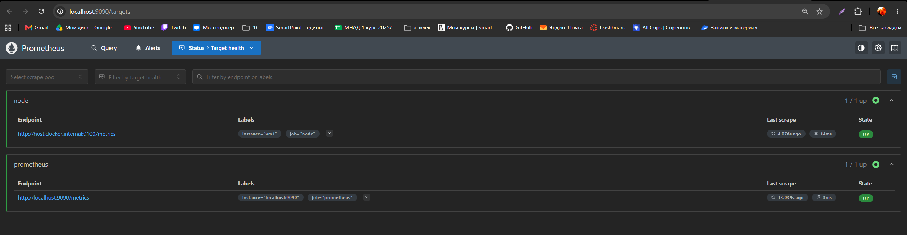
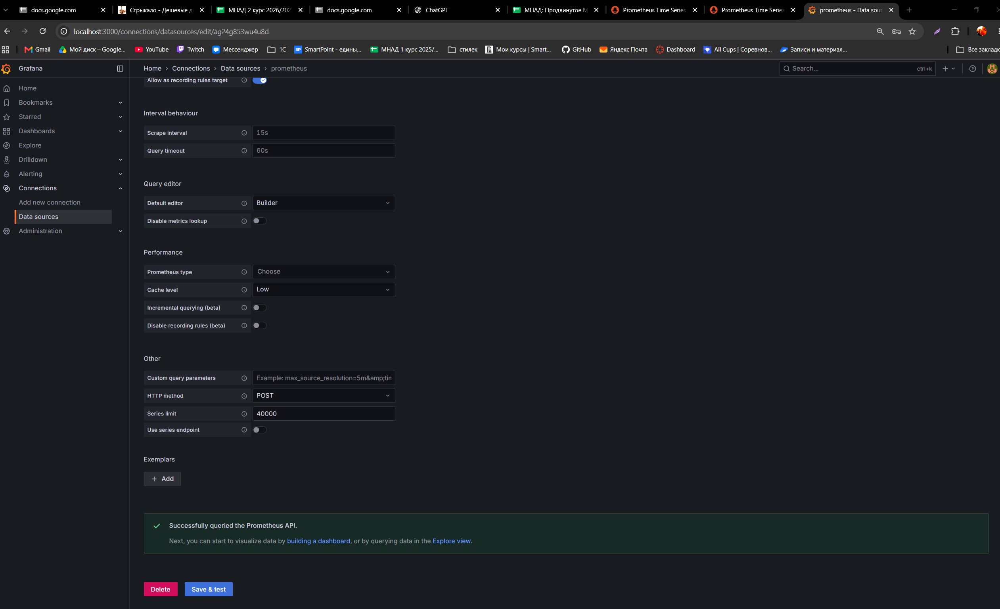
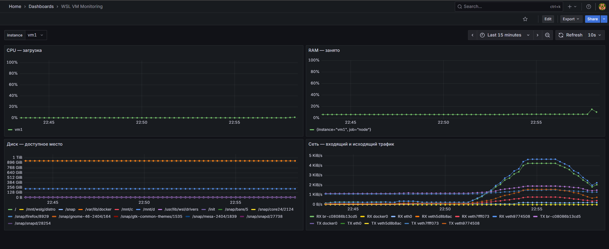

# Домашнее задание № 3. Отчёт: мониторинг WSL и Docker-образы counter-backend

## Задание 1. Результат и подтверждающие материалы

В Ubuntu внутри WSL развёрнут стенд Node Exporter → Prometheus → Grafana. Node Exporter отдаёт системные метрики, Prometheus успешно опрашивает цель с меткой `instance="vm1"`, а в Grafana настроен источник данных и создан дашборд `WSL VM Monitoring` с четырьмя панелями: CPU, RAM, диск и сеть.

Отчёт составлен по фактически переданным материалам:

- [исходная запись терминальной сессии](logs/task1-session.txt);
- [Prometheus Targets](screen/1.png);
- [проверка источника данных Grafana](screen/2.png);
- [готовый дашборд](screen/3.png);
- [экспорт дашборда Grafana](dashbord.json).

Начало записи терминала: **23.10.2026, 21:41:20, UTC+03:00**. Рабочий каталог в WSL: `/home/rkart/projects/hw3`; команды управления стендом выполнялись из `~/projects/hw3/monitoring`. В выводе обновления пакетов указаны репозитории Ubuntu `resolute`. Точная версия дистрибутива отдельной командой в этой записи не проверялась.

| Компонент | Версия или параметр | Основание |
|---|---|---|
| Docker Engine | 29.1.3, Linux amd64 | Вывод `docker version` |
| Go, которым собран Docker | go1.24.13 | Вывод `docker version` |
| containerd | 2.2.2 | Вывод `docker version` |
| Prometheus | prom/prometheus:v3.5.0 | `docker compose config` и `docker compose ps` |
| Node Exporter | prom/node-exporter:v1.9.1 | `docker compose config` и `docker compose ps` |
| Grafana | grafana/grafana:12.1.0 | `docker compose ps` и JSON дашборда |
| Интервал сбора метрик | 15 секунд | Экран редактирования конфигурации в исходном логе |
| Интервал обновления дашборда | 10 секунд | Экспорт JSON и скриншот дашборда |
| Временной диапазон дашборда | Последние 15 минут | Экспорт JSON и скриншот дашборда |

**Граница подтверждения:** результаты ниже подтверждены логом, скриншотами и экспортом JSON. Стенд при подготовке отчёта заново не запускался.

## 1. Настройка конфигурации Prometheus

В начале сессии файл `monitoring/prometheus/prometheus.yml` был открыт в nano. Ввод команды в сырой записи содержит следы исправления опечаток; правильный путь подтверждён заголовком открытого редактора.

Команда в нормализованном виде:

```bash
nano monitoring/prometheus/prometheus.yml
```

В записи редактора присутствует результат сохранения:

```text
[ Wrote 18 lines ]
```

После редактирования выполнен переход в каталог стенда:

```bash
cd monitoring/
```

Вывод для `cd` отсутствует; следующее приглашение терминала содержит путь `~/projects/hw3/monitoring`, что подтверждает переход.

Рабочая цель, подтверждённая экраном редактирования и страницей Targets, соответствует следующему заданию сбора. Ниже приведено восстановленное описание цели, а не результат выполнения `cat`:

```yaml
scrape_configs:
  - job_name: prometheus
    static_configs:
      - targets: [localhost:9090]

  - job_name: node
    static_configs:
      - targets: ["host.docker.internal:9100"]
        labels:
          instance: vm1
```

Node Exporter работает в сети хоста. В конфигурации Compose у Prometheus задано соответствие `host.docker.internal=host-gateway`. Для доступа Node Exporter к корневой файловой системе используется read-only монтирование `/:/host:ro`; параметр `--path.rootfs=/host` передан в командной строке контейнера.

## 2. Проверка конфигурации Compose

Выполнена команда:

```bash
docker compose config
```

Команда напечатала разобранную конфигурацию проекта `monitoring`: три сервиса, порты, сеть, bind mount и именованные тома. Полный вывод сохранён в исходной записи терминала задания 1. В нём, в частности, зафиксированы:

```yaml
name: monitoring
# Сервис Grafana:
image: grafana/grafana:12.1.0
# Сервис Node Exporter:
image: prom/node-exporter:v1.9.1
network_mode: host
pid: host
# Сервис Prometheus:
image: prom/prometheus:v3.5.0
extra_hosts:
  - host.docker.internal=host-gateway
```

Этот фрагмент сгруппирован для пояснения; исходная структура YAML сохранена в записи терминала без такого перегруппирования.

## 3. Успешная загрузка и запуск стенда

Загрузка образов выполнена командой:

```bash
docker compose --parallel 1 pull
```

Итоговые строки вывода; полный список скачанных слоёв сохранён в исходной записи терминала задания 1:

```text
[+] Pulling 24/24
 ✔ node-exporter Pulled                                                                          3.1s
 ✔ grafana Pulled                                                                               16.1s
 ✔ prometheus Pulled                                                                            11.6s
```

После этого выполнены:

```bash
docker compose up -d
docker compose ps
```

При первом успешном запуске созданы сеть, тома и контейнеры:

```text
[+] Running 6/6
 ✔ Network monitoring_default            Created                                                 0.0s
 ✔ Volume monitoring_grafana-data        Created                                                 0.0s
 ✔ Volume monitoring_prometheus-data     Created                                                 0.0s
 ✔ Container monitoring-grafana-1        Started                                                 0.5s
 ✔ Container monitoring-prometheus-1     Started                                                 0.6s
 ✔ Container monitoring-node-exporter-1  Started                                                 0.4s
```

Повторный запуск подтвердил состояние `Running` всех трёх контейнеров:

```text
[+] Running 3/3
 ✔ Container monitoring-prometheus-1     Running                                                 0.0s
 ✔ Container monitoring-node-exporter-1  Running                                                 0.0s
 ✔ Container monitoring-grafana-1        Running                                                 0.0s
```

В фактическом выводе `docker compose ps` указано:

| Контейнер | Образ | Состояние | Опубликованный порт |
|---|---|---|---|
| monitoring-grafana-1 | grafana/grafana:12.1.0 | Up 2 minutes | 127.0.0.1:3000 → 3000/tcp |
| monitoring-node-exporter-1 | prom/node-exporter:v1.9.1 | Up 2 minutes | Отдельный проброс не указан; используется сеть хоста |
| monitoring-prometheus-1 | prom/prometheus:v3.5.0 | Up 2 minutes | 127.0.0.1:9090 → 9090/tcp |

Полные таблицы состояния, включая первый запуск, сохранены в исходной записи терминала задания 1.

## 4. Проверка Node Exporter и конфигурации Prometheus

### 4.1. Получение метрик

Выполнено:

```bash
curl -fsS http://localhost:9100/metrics \
  | grep '^node_' \
  | sed -n '1,10p'
```

Фактический вывод:

```text
node_arp_entries{device="br-c08086b13cd5"} 2
node_arp_entries{device="eth0"} 1
node_boot_time_seconds 1.792780494e+09
node_context_switches_total 1.480277e+06
node_cooling_device_cur_state{name="0",type="Processor"} 0
node_cooling_device_cur_state{name="1",type="Processor"} 0
node_cooling_device_cur_state{name="10",type="Processor"} 0
node_cooling_device_cur_state{name="11",type="Processor"} 0
node_cooling_device_cur_state{name="12",type="Processor"} 0
node_cooling_device_cur_state{name="13",type="Processor"} 0
```

Node Exporter отдаёт метрики с префиксом `node_`. В ответе есть сведения о сетевых интерфейсах, времени загрузки, переключениях контекста и устройствах охлаждения процессора.

### 4.2. Проверка синтаксиса конфигурации

Выполнено:

```bash
docker compose exec prometheus \
  promtool check config /etc/prometheus/prometheus.yml
```

Фактический вывод:

```text
Checking /etc/prometheus/prometheus.yml
 SUCCESS: /etc/prometheus/prometheus.yml is valid prometheus config file syntax
```

После запуска проверка конфигурации выполнена успешно.

### 4.3. Проверка сбора метрик в интерфейсе Prometheus

Открыта страница `http://localhost:9090/targets`. На скриншоте видны:

- задание `node`: цель `http://host.docker.internal:9100/metrics`, метки `instance="vm1"` и `job="node"`, состояние **UP**;
- задание `prometheus`: цель `http://localhost:9090/metrics`, состояние **UP**;
- для каждого задания показано `1 / 1 up`.



## 5. Источник данных Grafana

В Grafana настроен источник данных с именем `prometheus`. Его UID, совпадающий с экспортом дашборда: `ag24g853wu4u8d`.

На скриншоте страницы источника после `Save & test` отображается сообщение:

```text
Successfully queried the Prometheus API.
```

Это подтверждает успешное обращение Grafana к API Prometheus. На том же экране задан интервал сбора `15s`. Поле URL в область снимка не попало; по одному этому скриншоту его значение не устанавливается.



## 6. Дашборд WSL VM Monitoring

Настройки дашборда подтверждены [экспортом JSON](dashbord.json) и скриншотом:

- название: `WSL VM Monitoring`;
- четыре панели типа `timeseries`, расположенные в два ряда;
- временной диапазон: `now-15m` → `now`;
- автообновление: `10s`;
- источник панелей: Prometheus с UID `ag24g853wu4u8d`;
- переменная `instance` имеет выбранное значение `vm1`.

На скриншоте все четыре панели содержат данные. Для проверки структуры панелей и их запросов приложен экспорт дашборда; история действий по его созданию в браузере в терминальном логе не записывается.



### 6.1. Переменная instance

В JSON указана переменная типа `query`:

```text
name: instance
definition: label_values(node_uname_info{job="node"}, instance)
current.text: vm1
current.value: vm1
```

В верхней части скриншота виден выпадающий список `instance` с выбранной целью `vm1`. Во всех пяти выражениях панелей используется фильтр `instance=~"$instance"`.

### 6.2. CPU — загрузка

Единица измерения в JSON: проценты, код `percent`. Тип визуализации: `timeseries`.

```promql
100 * (
  1 - avg by (instance) (
    rate(node_cpu_seconds_total{
      job="node",
      instance=~"$instance",
      mode="idle"
    }[5m])
  )
)
```

Из единицы вычитается усреднённая по ядрам доля простоя; результат умножается на 100.

### 6.3. RAM — занято

Единица измерения в JSON: проценты, код `percent`. Тип визуализации: `timeseries`.

```promql
100 * (
  1 -
  node_memory_MemAvailable_bytes{
    job="node",
    instance=~"$instance"
  }
  /
  node_memory_MemTotal_bytes{
    job="node",
    instance=~"$instance"
  }
)
```

Из общего объёма памяти вычитается доля доступной памяти; показана занятая память в процентах.

### 6.4. Диск — доступное место

Единица измерения в JSON: байты IEC, код `bytes`. Тип визуализации: `timeseries`.

```promql
node_filesystem_avail_bytes{
  job="node",
  instance=~"$instance",
  fstype!~"tmpfs|overlay|squashfs"
}
```

Показано доступное место по файловым системам. Из выборки исключены tmpfs, overlay и squashfs; легенда — `{{mountpoint}}`.

### 6.5. Сеть — входящий и исходящий трафик

Единица измерения в JSON: байты в секунду с двоичными приставками, код `binBps`. Тип визуализации: `timeseries`.

Запрос A, легенда `RX {{device}}`:

```promql
rate(node_network_receive_bytes_total{
  job="node",
  instance=~"$instance",
  device!="lo"
}[5m])
```

Запрос B, легенда `TX {{device}}`:

```promql
rate(node_network_transmit_bytes_total{
  job="node",
  instance=~"$instance",
  device!="lo"
}[5m])
```

На одной панели показаны входящий и исходящий трафик по интерфейсам. `rate` вычисляет скорость изменения счётчика байтов; интерфейс `lo` исключён.

## 7. Экспорт дашборда и соответствие требованиям

Экспорт находится в файле [dashbord.json](dashbord.json). Имя сохранено ровно так, как оно присутствует в переданных материалах. В файле находятся настройки четырёх панелей, пять выражений PromQL и переменная `instance`.

Отдельной терминальной команды копирования или проверки JSON в предоставленном логе нет. Наличие экспорта подтверждается самим приложенным файлом; действия в браузере подтверждаются скриншотами.

| Требование задания 1 | Подтверждение |
|---|---|
| Node Exporter запущен и отдаёт node_* | Вывод `docker compose ps` и десять строк ответа `/metrics` |
| В Prometheus есть задание node и понятная метка instance | Скриншот Targets: `job="node"`, `instance="vm1"` |
| Цель находится в состоянии UP | Скриншот `screen/1.png` |
| Источник Prometheus в Grafana успешно проверен | Сообщение `Successfully queried the Prometheus API.` на `screen/2.png` |
| Есть панели CPU, RAM, диск и сеть с единицами | Скриншот `screen/3.png` и настройки панелей в JSON |
| Запросы фильтруются по instance | Фильтр присутствует во всех пяти выражениях экспорта |
| Есть переменная instance и экспорт JSON | `templating.list`, `current.value="vm1"` и файл `dashbord.json` |


## 8. Задание 2. Docker-образы для counter-backend

### 8.1. Результат и исходные материалы

Для одного и того же Python-бэкенда собраны и проверены три образа:

| Dockerfile | Тег образа | Схема сборки | Пользователь процесса |
|---|---|---|---|
| [Dockerfile.single](counter-backend/Dockerfile.single) | `hw3-counter:single` | Одна стадия | `uid=0(root)` |
| [Dockerfile.multistage](counter-backend/Dockerfile.multistage) | `hw3-counter:multistage` | Стадия сборки и финальная стадия | `uid=0(root)` |
| [Dockerfile.nonroot](counter-backend/Dockerfile.nonroot) | `hw3-counter:nonroot` | Две стадии и создание отдельного пользователя | `uid=1001(appuser)` |

Для каждого образа в записи терминала есть запуск контейнера, первый GET с `{"count": 0}`, POST с `{"count": 1}`, повторный GET с `{"count": 1}` и результат `docker exec ... id`. После проверки контейнеры остановлены.

Источник фактических команд и вывода: [дамп терминала задания 2](logs/task2-session.txt). Начало сессии — **24.10.2026, 00:27:17, UTC+03:00**, окончание — **24.10.2026, 00:46:40, UTC+03:00**. В HTTP-заголовках и логах aiohttp время указано в GMT/UTC, поэтому там ещё стоит дата 23 октября.

Рабочий каталог: `~/projects/hw3/counter-backend`. В начале записи выполнен переход:

```text
rkart@TIRoman:~/projects/hw3$ cd counter-backend/
```

Исходные Dockerfile и [.dockerignore](counter-backend/.dockerignore) приложены к проекту. Их содержимое ниже приведено по переданным файлам; факты сборки и проверки подтверждены терминальным дампом. При подготовке отчёта образы повторно не собирались и контейнеры не запускались.

В основной текст включены подготовка окружения, успешные сборки и проверки. Неудачные попытки и повторные отображения ввода без нового результата не включены. В сворачиваемых блоках сохранён полный содержательный вывод успешных сборок; управляющие коды терминала и перерисовка прогресса обработаны для читаемости. Исходный дамп не изменён.

### 8.2. Подготовка сборочного окружения

Базовый образ для всех вариантов — `python:3.11.6-slim-bookworm`. Выполнена загрузка:

```text
rkart@TIRoman:~/projects/hw3/counter-backend$ docker pull python:3.11.6-slim-bookworm
3.11.6-slim-bookworm: Pulling from library/python
848d19a36773: Pull complete
1f7ce2fa46ab: Pull complete
c3aa3af0d581: Pull complete
4bfbe15b3e01: Pull complete
442c5d63eafd: Pull complete
Digest: sha256:cc758519481092eb5a4a5ab0c1b303e288880d59afc601958d19e95b300bc86b
Status: Downloaded newer image for python:3.11.6-slim-bookworm
docker.io/library/python:3.11.6-slim-bookworm
```

Строка `Status: Downloaded newer image` и digest подтверждают получение базового образа.

Для сборки с BuildKit установлен компонент Buildx из репозиториев Ubuntu. Фактические команды и вывод:

```text
rkart@TIRoman:~/projects/hw3/counter-backend$ sudo apt update
[sudo: authenticate] Password:
Hit:1 http://security.ubuntu.com/ubuntu resolute-security InRelease
Hit:2 http://archive.ubuntu.com/ubuntu resolute InRelease
Hit:3 http://archive.ubuntu.com/ubuntu resolute-updates InRelease
Hit:4 http://archive.ubuntu.com/ubuntu resolute-backports InRelease
33 packages can be upgraded. Run 'apt list --upgradable' to see them.
```

```text
rkart@TIRoman:~/projects/hw3/counter-backend$ sudo apt install -y docker-buildx
Installing:
  docker-buildx

Summary:
  Upgrading: 0, Installing: 1, Removing: 0, Not Upgrading: 33
  Download size: 16.8 MB
  Space needed: 71.0 MB / 1018 GB available

Get:1 http://archive.ubuntu.com/ubuntu resolute/universe amd64 docker-buildx amd64 0.30.1-0ubuntu1 [16
.8 MB]
Fetched 16.8 MB in 2s (7604 kB/s)
Selecting previously unselected package docker-buildx.
(Reading database ... 69311 files and directories currently installed.)
Preparing to unpack .../docker-buildx_0.30.1-0ubuntu1_amd64.deb ...
Unpacking docker-buildx (0.30.1-0ubuntu1) ...
Setting up docker-buildx (0.30.1-0ubuntu1) ...
```

Установлен пакет `docker-buildx` версии `0.30.1-0ubuntu1`. В последующих успешных сборках используется экземпляр `default` с драйвером `docker`.

### 8.3. Исключение лишних файлов из контекста сборки

Файл создан в редакторе:

```bash
nano .dockerignore
```

В терминальной записи nano подтвердил сохранение: `Wrote 7 lines`.

Содержимое [.dockerignore](counter-backend/.dockerignore):

```text
.git
.venv
__pycache__
*.pyc
.pytest_cache
.mypy_cache
dist
```

Из контекста исключены Git, локальное виртуальное окружение, кэши Python и локальная папка `dist`. Артефакты `dist` создаются заново внутри стадии сборки.

### 8.4. Одноступенчатый образ: Dockerfile.single

Файл создан командой:

```bash
nano Dockerfile.single
```

В записи nano есть подтверждение `Wrote 39 lines`. Содержимое [Dockerfile.single](counter-backend/Dockerfile.single):

```dockerfile
FROM python:3.11.6-slim-bookworm

SHELL ["/bin/sh", "-eu", "-c"]

USER root
WORKDIR /build

RUN python -m pip install --no-cache-dir \
    "poetry==1.8.5" \
    "poetry-plugin-export==1.8.0" \
    setuptools wheel

COPY pyproject.toml poetry.lock README.md ./
COPY src/ ./src/

RUN mkdir -p dist \
    && poetry export \
        --without-hashes \
        --format constraints.txt \
        --output dist/constraints.txt \
    && poetry run python -m pip wheel \
        --isolated \
        --requirement dist/constraints.txt \
        --wheel-dir dist/vendor \
    && poetry build --format wheel

RUN python -m pip install \
    --isolated \
    --no-index \
    --no-cache-dir \
    --no-deps \
    dist/*.whl dist/vendor/*.whl

ENV HOST=0.0.0.0
ENV PORT=8080

EXPOSE 8080

CMD ["python", "-m", "counter_backend"]
```

В образе одна инструкция `FROM`. Poetry и плагин экспорта устанавливаются в тот же образ, где затем собирается и запускается приложение. Команды `poetry export`, `pip wheel` и `poetry build` формируют зависимости и wheel-пакет проекта. Установка выполняется из локальных wheel-файлов с `--no-index` и `--no-deps`. Инструкция `USER root` задаёт пользователя запуска.

#### Сборка

Выполнена команда, приведённая без технических переносов строки терминала:

```bash
docker build --progress=plain \
  -f Dockerfile.single \
  -t hw3-counter:single .
```

Итог успешной сборки:

```text
#12 naming to docker.io/library/hw3-counter:single done
#12 DONE 3.4s
```

<details>
<summary>Полный вывод успешной сборки Dockerfile.single</summary>

```text
#0 building with "default" instance using docker driver

#1 [internal] load build definition from Dockerfile.single
#1 transferring dockerfile: 863B done
#1 DONE 0.1s

#2 [internal] load metadata for docker.io/library/python:3.11.6-slim-bookworm
#2 DONE 0.0s

#3 [internal] load .dockerignore
#3 transferring context: 100B done
#3 DONE 0.1s

#4 [internal] load build context
#4 DONE 0.0s

#5 [1/7] FROM docker.io/library/python:3.11.6-slim-bookworm@sha256:cc758519481092eb5a4a5ab0c1b303e2888
80d59afc601958d19e95b300bc86b
#5 resolve docker.io/library/python:3.11.6-slim-bookworm@sha256:cc758519481092eb5a4a5ab0c1b303e288880d
59afc601958d19e95b300bc86b 0.0s done
#5 ...

#4 [internal] load build context
#4 transferring context: 91.22kB done
#4 DONE 0.1s

#5 [1/7] FROM docker.io/library/python:3.11.6-slim-bookworm@sha256:cc758519481092eb5a4a5ab0c1b303e2888
80d59afc601958d19e95b300bc86b
#5 DONE 0.3s

#6 [2/7] WORKDIR /build
#6 DONE 0.1s

#7 [3/7] RUN python -m pip install --no-cache-dir     "poetry==1.8.5"     "poetry-plugin-export==1.8.0
"     setuptools wheel
#7 1.374 Collecting poetry==1.8.5
#7 1.374   Obtaining dependency information for poetry==1.8.5 from https://files.pythonhosted.org/pack
ages/45/8e/5e6cbfd7654c93b08423fc62be737a79121fb30ad44e3d9c00292c93fcbb/poetry-1.8.5-py3-none-any.whl.
metadata
#7 1.505   Downloading poetry-1.8.5-py3-none-any.whl.metadata (6.9 kB)
#7 1.551 Collecting poetry-plugin-export==1.8.0
#7 1.551   Obtaining dependency information for poetry-plugin-export==1.8.0 from https://files.pythonh
osted.org/packages/de/55/1dd7c8c955d71f58a9202c37bf8e037d697dc9f11a9a2ade65663251ee44/poetry_plugin_ex
port-1.8.0-py3-none-any.whl.metadata
#7 1.585   Downloading poetry_plugin_export-1.8.0-py3-none-any.whl.metadata (2.8 kB)
#7 1.587 Requirement already satisfied: setuptools in /usr/local/lib/python3.11/site-packages (65.5.1)
#7 1.587 Requirement already satisfied: wheel in /usr/local/lib/python3.11/site-packages (0.42.0)
#7 1.643 Collecting build<2.0.0,>=1.0.3 (from poetry==1.8.5)
#7 1.643   Obtaining dependency information for build<2.0.0,>=1.0.3 from https://files.pythonhosted.or
g/packages/ad/9b/9fb3585dabcd73a1b2a6267f63f62649347c9e6d072c9fde365b105abb2c/build-1.6.1-py3-none-any
.whl.metadata
#7 1.678   Downloading build-1.6.1-py3-none-any.whl.metadata (5.6 kB)
#7 1.723 Collecting cachecontrol[filecache]<0.15.0,>=0.14.0 (from poetry==1.8.5)
#7 1.724   Obtaining dependency information for cachecontrol[filecache]<0.15.0,>=0.14.0 from https://f
iles.pythonhosted.org/packages/ef/79/c45f2d53efe6ada1110cf6f9fca095e4ff47a0454444aefdde6ac4789179/cach
econtrol-0.14.4-py3-none-any.whl.metadata
#7 1.758   Downloading cachecontrol-0.14.4-py3-none-any.whl.metadata (3.1 kB)
#7 1.805 Collecting cleo<3.0.0,>=2.1.0 (from poetry==1.8.5)
#7 1.805   Obtaining dependency information for cleo<3.0.0,>=2.1.0 from https://files.pythonhosted.org
/packages/2d/f5/6bbead8b880620e5a99e0e4bb9e22e67cca16ff48d54105302a3e7821096/cleo-2.1.0-py3-none-any.w
hl.metadata
#7 1.839   Downloading cleo-2.1.0-py3-none-any.whl.metadata (12 kB)
#7 1.883 Collecting crashtest<0.5.0,>=0.4.1 (from poetry==1.8.5)
#7 1.883   Obtaining dependency information for crashtest<0.5.0,>=0.4.1 from https://files.pythonhoste
d.org/packages/b0/5c/3ba7d12e7a79566f97b8f954400926d7b6eb33bcdccc1315a857f200f1f1/crashtest-0.4.1-py3-
none-any.whl.metadata
#7 1.922   Downloading crashtest-0.4.1-py3-none-any.whl.metadata (1.1 kB)
#7 2.232 Collecting dulwich<0.22.0,>=0.21.2 (from poetry==1.8.5)
#7 2.234   Obtaining dependency information for dulwich<0.22.0,>=0.21.2 from https://files.pythonhoste
d.org/packages/d3/42/4f9d76a5d6dc9a952553418379d17364c161c0d3da6e5dfff6d5e455c666/dulwich-0.21.7-cp311
-cp311-manylinux_2_17_x86_64.manylinux2014_x86_64.whl.metadata
#7 2.268   Downloading dulwich-0.21.7-cp311-cp311-manylinux_2_17_x86_64.manylinux2014_x86_64.whl.metad
ata (4.3 kB)
#7 2.312 Collecting fastjsonschema<3.0.0,>=2.18.0 (from poetry==1.8.5)
#7 2.312   Obtaining dependency information for fastjsonschema<3.0.0,>=2.18.0 from https://files.pytho
nhosted.org/packages/49/82/2755c7c982086f00d4dab85bc120ec35045a9fc2191893a6ce79afe94443/fastjsonschema
-2.22.2-py3-none-any.whl.metadata
#7 2.362   Downloading fastjsonschema-2.22.2-py3-none-any.whl.metadata (2.1 kB)
#7 2.407 Collecting installer<0.8.0,>=0.7.0 (from poetry==1.8.5)
#7 2.407   Obtaining dependency information for installer<0.8.0,>=0.7.0 from https://files.pythonhoste
d.org/packages/e5/ca/1172b6638d52f2d6caa2dd262ec4c811ba59eee96d54a7701930726bce18/installer-0.7.0-py3-
none-any.whl.metadata
#7 2.440   Downloading installer-0.7.0-py3-none-any.whl.metadata (936 bytes)
#7 2.504 Collecting keyring<25.0.0,>=24.0.0 (from poetry==1.8.5)
#7 2.504   Obtaining dependency information for keyring<25.0.0,>=24.0.0 from https://files.pythonhoste
d.org/packages/7c/23/d557507915181687e4a613e1c8a01583fd6d7cb7590e1f039e357fe3b304/keyring-24.3.1-py3-n
one-any.whl.metadata
#7 2.541   Downloading keyring-24.3.1-py3-none-any.whl.metadata (20 kB)
#7 2.597 Collecting packaging>=23.1 (from poetry==1.8.5)
#7 2.598   Obtaining dependency information for packaging>=23.1 from https://files.pythonhosted.org/pa
ckages/63/34/ba1c580383c9eada3711951fef0795c80b829a078d72188184bcab9dd527/packaging-26.3-py3-none-any.
whl.metadata
#7 2.633   Downloading packaging-26.3-py3-none-any.whl.metadata (3.5 kB)
#7 2.671 Collecting pexpect<5.0.0,>=4.7.0 (from poetry==1.8.5)
#7 2.671   Obtaining dependency information for pexpect<5.0.0,>=4.7.0 from https://files.pythonhosted.
org/packages/9e/c3/059298687310d527a58bb01f3b1965787ee3b40dce76752eda8b44e9a2c5/pexpect-4.9.0-py2.py3-
none-any.whl.metadata
#7 2.705   Downloading pexpect-4.9.0-py2.py3-none-any.whl.metadata (2.5 kB)
#7 2.755 Collecting pkginfo<2.0,>=1.12 (from poetry==1.8.5)
#7 2.755   Obtaining dependency information for pkginfo<2.0,>=1.12 from https://files.pythonhosted.org
/packages/f3/8f/3e29b55ad92de525931a5683ca245af58d50d5756f35cd74555aaf859427/pkginfo-1.13.3-py3-none-a
ny.whl.metadata
#7 2.809   Downloading pkginfo-1.13.3-py3-none-any.whl.metadata (14 kB)
#7 2.889 Collecting platformdirs<5,>=3.0.0 (from poetry==1.8.5)
#7 2.889   Obtaining dependency information for platformdirs<5,>=3.0.0 from https://files.pythonhosted
.org/packages/6c/8a/1d8cb3842909dc193a73835adedf412e32e18f8ffd59f43983949622fe6f/platformdirs-4.13.5-p
y3-none-any.whl.metadata
#7 2.923   Downloading platformdirs-4.13.5-py3-none-any.whl.metadata (5.5 kB)
#7 2.978 Collecting poetry-core==1.9.1 (from poetry==1.8.5)
#7 2.978   Obtaining dependency information for poetry-core==1.9.1 from https://files.pythonhosted.org
/packages/f7/b4/ae500aaba6e003ff80889e3dee449b154d2dd70d520dc0402f23535a5995/poetry_core-1.9.1-py3-non
e-any.whl.metadata
#7 3.032   Downloading poetry_core-1.9.1-py3-none-any.whl.metadata (3.5 kB)
#7 3.074 Collecting pyproject-hooks<2.0.0,>=1.0.0 (from poetry==1.8.5)
#7 3.074   Obtaining dependency information for pyproject-hooks<2.0.0,>=1.0.0 from https://files.pytho
nhosted.org/packages/85/11/044d1ae1b4ec0d7af88ee5bc91e081be1022533032b906a7bdabdbb60977/pyproject_hook
s-1.3.3-py3-none-any.whl.metadata
#7 3.107   Downloading pyproject_hooks-1.3.3-py3-none-any.whl.metadata (1.3 kB)
#7 3.163 Collecting requests<3.0,>=2.26 (from poetry==1.8.5)
#7 3.163   Obtaining dependency information for requests<3.0,>=2.26 from https://files.pythonhosted.or
g/packages/a0/f4/c67b0b3f1b9245e8d266f0f112c500d50e5b4e83cb6f3b71b6528104182a/requests-2.34.2-py3-none
-any.whl.metadata
#7 3.197   Downloading requests-2.34.2-py3-none-any.whl.metadata (4.8 kB)
#7 3.239 Collecting requests-toolbelt<2.0.0,>=1.0.0 (from poetry==1.8.5)
#7 3.239   Obtaining dependency information for requests-toolbelt<2.0.0,>=1.0.0 from https://files.pyt
honhosted.org/packages/3f/51/d4db610ef29373b879047326cbf6fa98b6c1969d6f6dc423279de2b1be2c/requests_too
lbelt-1.0.0-py2.py3-none-any.whl.metadata
#7 3.273   Downloading requests_toolbelt-1.0.0-py2.py3-none-any.whl.metadata (14 kB)
#7 3.322 Collecting shellingham<2.0,>=1.5 (from poetry==1.8.5)
#7 3.322   Obtaining dependency information for shellingham<2.0,>=1.5 from https://files.pythonhosted.
org/packages/e0/f9/0595336914c5619e5f28a1fb793285925a8cd4b432c9da0a987836c7f822/shellingham-1.5.4-py2.
py3-none-any.whl.metadata
#7 3.355   Downloading shellingham-1.5.4-py2.py3-none-any.whl.metadata (3.5 kB)
#7 3.411 Collecting tomlkit<1.0.0,>=0.11.4 (from poetry==1.8.5)
#7 3.411   Obtaining dependency information for tomlkit<1.0.0,>=0.11.4 from https://files.pythonhosted
.org/packages/da/46/7d84138a60a8bd796825b2d38ebe92d0d16501ca57d501b7c5d677401bbc/tomlkit-0.15.2-py3-no
ne-any.whl.metadata
#7 3.444   Downloading tomlkit-0.15.2-py3-none-any.whl.metadata (3.4 kB)
#7 3.503 Collecting trove-classifiers>=2022.5.19 (from poetry==1.8.5)
#7 3.503   Obtaining dependency information for trove-classifiers>=2022.5.19 from https://files.python
hosted.org/packages/30/81/0da8afb52a71d0a4f2bd3152357b1a441e393b286374802b9d3addab4ab5/trove_classifie
rs-2026.9.21.13-py3-none-any.whl.metadata
#7 3.539   Downloading trove_classifiers-2026.9.21.13-py3-none-any.whl.metadata (2.4 kB)
#7 3.640 Collecting virtualenv<21.0.0,>=20.26.6 (from poetry==1.8.5)
#7 3.640   Obtaining dependency information for virtualenv<21.0.0,>=20.26.6 from https://files.pythonh
osted.org/packages/f6/7f/89d7e8a397752826dbbb81127dfb8feab8286f4f1f91a820f646f04368fb/virtualenv-20.39
.1-py3-none-any.whl.metadata
#7 3.673   Downloading virtualenv-20.39.1-py3-none-any.whl.metadata (3.5 kB)
#7 3.863 Collecting msgpack<2.0.0,>=0.5.2 (from cachecontrol[filecache]<0.15.0,>=0.14.0->poetry==1.8.5
)
#7 3.863   Obtaining dependency information for msgpack<2.0.0,>=0.5.2 from https://files.pythonhosted.
org/packages/aa/83/800570e6a22376eb8d599920f70aead4779a63611696f567477c4e85a70f/msgpack-1.2.3-cp311-cp
311-manylinux2014_x86_64.manylinux_2_17_x86_64.manylinux_2_28_x86_64.whl.metadata
#7 3.898   Downloading msgpack-1.2.3-cp311-cp311-manylinux2014_x86_64.manylinux_2_17_x86_64.manylinux_
2_28_x86_64.whl.metadata (8.3 kB)
#7 3.961 Collecting filelock>=3.8.0 (from cachecontrol[filecache]<0.15.0,>=0.14.0->poetry==1.8.5)
#7 3.961   Obtaining dependency information for filelock>=3.8.0 from https://files.pythonhosted.org/pa
ckages/e0/1b/5e74289a1878e666bb4b65fe5805a04cafcac2aa5f519ef1ead67ef91c56/filelock-4.2.4-py3-none-any.
whl.metadata
#7 4.000   Downloading filelock-4.2.4-py3-none-any.whl.metadata (2.0 kB)
#7 4.789 Collecting rapidfuzz<4.0.0,>=3.0.0 (from cleo<3.0.0,>=2.1.0->poetry==1.8.5)
#7 4.789   Obtaining dependency information for rapidfuzz<4.0.0,>=3.0.0 from https://files.pythonhoste
d.org/packages/11/ae/a781ec62825990319483c82ef962b509e9ce22a67a9f97d63d70b2b175b9/rapidfuzz-3.14.6-cp3
11-cp311-manylinux_2_27_x86_64.manylinux_2_28_x86_64.whl.metadata
#7 4.828   Downloading rapidfuzz-3.14.6-cp311-cp311-manylinux_2_27_x86_64.manylinux_2_28_x86_64.whl.me
tadata (12 kB)
#7 4.894 Collecting urllib3>=1.25 (from dulwich<0.22.0,>=0.21.2->poetry==1.8.5)
#7 4.894   Obtaining dependency information for urllib3>=1.25 from https://files.pythonhosted.org/pack
ages/92/9d/c4e665119135114480843e7ab388fa94d8480650450e6f8e26b70d323a4c/urllib3-2.8.0-py3-none-any.whl
.metadata
#7 4.927   Downloading urllib3-2.8.0-py3-none-any.whl.metadata (7.4 kB)
#7 4.982 Collecting jaraco.classes (from keyring<25.0.0,>=24.0.0->poetry==1.8.5)
#7 4.982   Obtaining dependency information for jaraco.classes from https://files.pythonhosted.org/pac
kages/7f/66/b15ce62552d84bbfcec9a4873ab79d993a1dd4edb922cbfccae192bd5b5f/jaraco.classes-3.4.0-py3-none
-any.whl.metadata
#7 5.017   Downloading jaraco.classes-3.4.0-py3-none-any.whl.metadata (2.6 kB)
#7 5.086 Collecting importlib-metadata>=4.11.4 (from keyring<25.0.0,>=24.0.0->poetry==1.8.5)
#7 5.086   Obtaining dependency information for importlib-metadata>=4.11.4 from https://files.pythonho
sted.org/packages/12/75/17a894e35a7dc1335a6d353650a007434ee8f276463873a3d02c5ff9928b/importlib_metadat
a-10.0.0-py3-none-any.whl.metadata
#7 5.119   Downloading importlib_metadata-10.0.0-py3-none-any.whl.metadata (4.5 kB)
#7 5.166 Collecting SecretStorage>=3.2 (from keyring<25.0.0,>=24.0.0->poetry==1.8.5)
#7 5.166   Obtaining dependency information for SecretStorage>=3.2 from https://files.pythonhosted.org
/packages/b7/46/f5af3402b579fd5e11573ce652019a67074317e18c1935cc0b4ba9b35552/secretstorage-3.5.0-py3-n
one-any.whl.metadata
#7 5.199   Downloading secretstorage-3.5.0-py3-none-any.whl.metadata (4.0 kB)
#7 5.238 Collecting jeepney>=0.4.2 (from keyring<25.0.0,>=24.0.0->poetry==1.8.5)
#7 5.238   Obtaining dependency information for jeepney>=0.4.2 from https://files.pythonhosted.org/pac
kages/b2/a3/e137168c9c44d18eff0376253da9f1e9234d0239e0ee230d2fee6cea8e55/jeepney-0.9.0-py3-none-any.wh
l.metadata
#7 5.272   Downloading jeepney-0.9.0-py3-none-any.whl.metadata (1.2 kB)
#7 5.314 Collecting ptyprocess>=0.5 (from pexpect<5.0.0,>=4.7.0->poetry==1.8.5)
#7 5.314   Obtaining dependency information for ptyprocess>=0.5 from https://files.pythonhosted.org/pa
ckages/22/a6/858897256d0deac81a172289110f31629fc4cee19b6f01283303e18c8db3/ptyprocess-0.7.0-py2.py3-non
e-any.whl.metadata
#7 5.348   Downloading ptyprocess-0.7.0-py2.py3-none-any.whl.metadata (1.3 kB)
#7 5.565 Collecting charset_normalizer<4,>=2 (from requests<3.0,>=2.26->poetry==1.8.5)
#7 5.565   Obtaining dependency information for charset_normalizer<4,>=2 from https://files.pythonhost
ed.org/packages/e4/ed/cf505d3011ffceb12c2067a7a5d3cfe92b875d4d44bb0ff0d69375e2c184/charset_normalizer-
3.5.2-cp311-cp311-manylinux2014_x86_64.manylinux_2_17_x86_64.manylinux_2_28_x86_64.whl.metadata
#7 5.601   Downloading charset_normalizer-3.5.2-cp311-cp311-manylinux2014_x86_64.manylinux_2_17_x86_64
.manylinux_2_28_x86_64.whl.metadata (46 kB)
#7 5.614      ━━━━━━━━━━━━━━━━━━━━━━━━━━━━━━━━━━━━━━━━ 46.4/46.4 kB 4.2 MB/s eta 0:00:00
#7 5.659 Collecting idna<4,>=2.5 (from requests<3.0,>=2.26->poetry==1.8.5)
#7 5.659   Obtaining dependency information for idna<4,>=2.5 from https://files.pythonhosted.org/packa
ges/58/a2/bb081bab032533a855d44de1d56f8e8426114ff1ba5d1f07a438a0a654f8/idna-3.20-py3-none-any.whl.meta
data
#7 5.694   Downloading idna-3.20-py3-none-any.whl.metadata (7.2 kB)
#7 5.752 Collecting certifi>=2023.5.7 (from requests<3.0,>=2.26->poetry==1.8.5)
#7 5.753   Obtaining dependency information for certifi>=2023.5.7 from https://files.pythonhosted.org/
packages/32/d1/a3652fe2c19134d0d15922177821d863cbd7e842d53a21bbe7e8e3a1b5ac/certifi-2026.10.23-py3-non
e-any.whl.metadata
#7 5.786   Downloading certifi-2026.10.23-py3-none-any.whl.metadata (2.5 kB)
#7 5.849 Collecting distlib<1,>=0.3.7 (from virtualenv<21.0.0,>=20.26.6->poetry==1.8.5)
#7 5.849   Obtaining dependency information for distlib<1,>=0.3.7 from https://files.pythonhosted.org/
packages/c1/2b/238f02a4927fa2e27aa995371d240a468b52e42eae44a678434aff736b38/distlib-0.4.4-py2.py3-none
-any.whl.metadata
#7 5.883   Downloading distlib-0.4.4-py2.py3-none-any.whl.metadata (5.3 kB)
#7 5.892 Collecting filelock>=3.8.0 (from cachecontrol[filecache]<0.15.0,>=0.14.0->poetry==1.8.5)
#7 5.892   Obtaining dependency information for filelock>=3.8.0 from https://files.pythonhosted.org/pa
ckages/15/df/31098c5aeb4d966b553641472bd55fcf5fdfac953549894b8a765ba44e91/filelock-3.32.7-py3-none-any
.whl.metadata
#7 5.927   Downloading filelock-3.32.7-py3-none-any.whl.metadata (2.0 kB)
#7 6.005 Collecting zipp>=3.20 (from importlib-metadata>=4.11.4->keyring<25.0.0,>=24.0.0->poetry==1.8.
5)
#7 6.006   Obtaining dependency information for zipp>=3.20 from https://files.pythonhosted.org/package
s/b8/44/7bd2007260da11cccca29ba2d4c345f1287aa663db38ee7cefeabf6386a5/zipp-4.1.2-py3-none-any.whl.metad
ata
#7 6.042   Downloading zipp-4.1.2-py3-none-any.whl.metadata (3.6 kB)
#7 6.419 Collecting cryptography>=2.0 (from SecretStorage>=3.2->keyring<25.0.0,>=24.0.0->poetry==1.8.5
)
#7 6.420   Obtaining dependency information for cryptography>=2.0 from https://files.pythonhosted.org/
packages/d3/69/2c833a049475e0a3444e94c7d0aca0aa51d166374a449b09e92ac98138de/cryptography-50.0.2-cp311-
abi3-manylinux_2_34_x86_64.whl.metadata
#7 6.454   Downloading cryptography-50.0.2-cp311-abi3-manylinux_2_34_x86_64.whl.metadata (4.4 kB)
#7 6.528 Collecting more-itertools (from jaraco.classes->keyring<25.0.0,>=24.0.0->poetry==1.8.5)
#7 6.528   Obtaining dependency information for more-itertools from https://files.pythonhosted.org/pac
kages/5d/57/3c4b1c6f2e0cc29ba023802458ea3d2a996f87085559e4a5f2192d549532/more_itertools-11.2.1-py3-non
e-any.whl.metadata
#7 6.564   Downloading more_itertools-11.2.1-py3-none-any.whl.metadata (42 kB)
#7 6.572      ━━━━━━━━━━━━━━━━━━━━━━━━━━━━━━━━━━━━━━━━ 42.7/42.7 kB 9.9 MB/s eta 0:00:00
#7 6.758 Collecting cffi>=2.0.0 (from cryptography>=2.0->SecretStorage>=3.2->keyring<25.0.0,>=24.0.0->
poetry==1.8.5)
#7 6.758   Obtaining dependency information for cffi>=2.0.0 from https://files.pythonhosted.org/packag
es/f7/a4/4399daaf8f7dfee9d7c3327fdb0426ee041cc63edc358b93911ceb2bfc7a/cffi-2.1.1-cp311-cp311-manylinux
2014_x86_64.manylinux_2_17_x86_64.whl.metadata
#7 6.793   Downloading cffi-2.1.1-cp311-cp311-manylinux2014_x86_64.manylinux_2_17_x86_64.whl.metadata
(2.5 kB)
#7 6.853 Collecting pycparser (from cffi>=2.0.0->cryptography>=2.0->SecretStorage>=3.2->keyring<25.0.0
,>=24.0.0->poetry==1.8.5)
#7 6.853   Obtaining dependency information for pycparser from https://files.pythonhosted.org/packages
/b6/ae/315bbeee126a769cbde43cf4908acb4b40408d8bf8bbf334dd7368d8dadf/pycparser-3.12-py3-none-any.whl.me
tadata
#7 6.890   Downloading pycparser-3.12-py3-none-any.whl.metadata (9.7 kB)
#7 6.944 Downloading poetry-1.8.5-py3-none-any.whl (249 kB)
#7 6.992    ━━━━━━━━━━━━━━━━━━━━━━━━━━━━━━━━━━━━━━━━ 250.0/250.0 kB 5.1 MB/s eta 0:00:00
#7 7.028 Downloading poetry_plugin_export-1.8.0-py3-none-any.whl (10 kB)
#7 7.064 Downloading poetry_core-1.9.1-py3-none-any.whl (309 kB)
#7 7.078    ━━━━━━━━━━━━━━━━━━━━━━━━━━━━━━━━━━━━━━━━ 309.5/309.5 kB 22.5 MB/s eta 0:00:00
#7 7.115 Downloading build-1.6.1-py3-none-any.whl (31 kB)
#7 7.163 Downloading cleo-2.1.0-py3-none-any.whl (78 kB)
#7 7.170    ━━━━━━━━━━━━━━━━━━━━━━━━━━━━━━━━━━━━━━━━ 78.7/78.7 kB 14.0 MB/s eta 0:00:00
#7 7.202 Downloading crashtest-0.4.1-py3-none-any.whl (7.6 kB)
#7 7.238 Downloading dulwich-0.21.7-cp311-cp311-manylinux_2_17_x86_64.manylinux2014_x86_64.whl (516 kB
)
#7 7.265    ━━━━━━━━━━━━━━━━━━━━━━━━━━━━━━━━━━━━━━━━ 516.4/516.4 kB 24.0 MB/s eta 0:00:00
#7 7.300 Downloading fastjsonschema-2.22.2-py3-none-any.whl (27 kB)
#7 7.334 Downloading installer-0.7.0-py3-none-any.whl (453 kB)
#7 7.385    ━━━━━━━━━━━━━━━━━━━━━━━━━━━━━━━━━━━━━━━━ 453.8/453.8 kB 9.1 MB/s eta 0:00:00
#7 7.420 Downloading keyring-24.3.1-py3-none-any.whl (38 kB)
#7 7.457 Downloading packaging-26.3-py3-none-any.whl (129 kB)
#7 7.463    ━━━━━━━━━━━━━━━━━━━━━━━━━━━━━━━━━━━━━━━━ 130.0/130.0 kB 30.2 MB/s eta 0:00:00
#7 7.498 Downloading pexpect-4.9.0-py2.py3-none-any.whl (63 kB)
#7 7.502    ━━━━━━━━━━━━━━━━━━━━━━━━━━━━━━━━━━━━━━━━ 63.8/63.8 kB 37.7 MB/s eta 0:00:00
#7 7.536 Downloading pkginfo-1.13.3-py3-none-any.whl (35 kB)
#7 7.573 Downloading platformdirs-4.13.5-py3-none-any.whl (32 kB)
#7 7.636 Downloading pyproject_hooks-1.3.3-py3-none-any.whl (10 kB)
#7 7.671 Downloading requests-2.34.2-py3-none-any.whl (73 kB)
#7 7.674    ━━━━━━━━━━━━━━━━━━━━━━━━━━━━━━━━━━━━━━━━ 73.1/73.1 kB 42.5 MB/s eta 0:00:00
#7 7.712 Downloading requests_toolbelt-1.0.0-py2.py3-none-any.whl (54 kB)
#7 7.714    ━━━━━━━━━━━━━━━━━━━━━━━━━━━━━━━━━━━━━━━━ 54.5/54.5 kB 506.1 MB/s eta 0:00:00
#7 7.749 Downloading shellingham-1.5.4-py2.py3-none-any.whl (9.8 kB)
#7 7.785 Downloading tomlkit-0.15.2-py3-none-any.whl (52 kB)
#7 7.788    ━━━━━━━━━━━━━━━━━━━━━━━━━━━━━━━━━━━━━━━━ 52.2/52.2 kB 19.6 MB/s eta 0:00:00
#7 7.827 Downloading trove_classifiers-2026.9.21.13-py3-none-any.whl (14 kB)
#7 7.867 Downloading virtualenv-20.39.1-py3-none-any.whl (5.8 MB)
#7 8.139    ━━━━━━━━━━━━━━━━━━━━━━━━━━━━━━━━━━━━━━━━ 5.8/5.8 MB 21.9 MB/s eta 0:00:00
#7 8.174 Downloading certifi-2026.10.23-py3-none-any.whl (135 kB)
#7 8.182    ━━━━━━━━━━━━━━━━━━━━━━━━━━━━━━━━━━━━━━━━ 135.1/135.1 kB 20.2 MB/s eta 0:00:00
#7 8.216 Downloading charset_normalizer-3.5.2-cp311-cp311-manylinux2014_x86_64.manylinux_2_17_x86_64.m
anylinux_2_28_x86_64.whl (269 kB)
#7 8.231    ━━━━━━━━━━━━━━━━━━━━━━━━━━━━━━━━━━━━━━━━ 270.0/270.0 kB 20.0 MB/s eta 0:00:00
#7 8.265 Downloading distlib-0.4.4-py2.py3-none-any.whl (472 kB)
#7 8.291    ━━━━━━━━━━━━━━━━━━━━━━━━━━━━━━━━━━━━━━━━ 472.1/472.1 kB 19.1 MB/s eta 0:00:00
#7 8.326 Downloading filelock-3.32.7-py3-none-any.whl (100 kB)
#7 8.333    ━━━━━━━━━━━━━━━━━━━━━━━━━━━━━━━━━━━━━━━━ 100.2/100.2 kB 35.5 MB/s eta 0:00:00
#7 8.369 Downloading idna-3.20-py3-none-any.whl (69 kB)
#7 8.371    ━━━━━━━━━━━━━━━━━━━━━━━━━━━━━━━━━━━━━━━━ 69.6/69.6 kB 41.6 MB/s eta 0:00:00
#7 8.406 Downloading importlib_metadata-10.0.0-py3-none-any.whl (31 kB)
#7 8.443 Downloading jeepney-0.9.0-py3-none-any.whl (49 kB)
#7 8.445    ━━━━━━━━━━━━━━━━━━━━━━━━━━━━━━━━━━━━━━━━ 49.0/49.0 kB 40.3 MB/s eta 0:00:00
#7 8.483 Downloading msgpack-1.2.3-cp311-cp311-manylinux2014_x86_64.manylinux_2_17_x86_64.manylinux_2_
28_x86_64.whl (477 kB)
#7 8.508    ━━━━━━━━━━━━━━━━━━━━━━━━━━━━━━━━━━━━━━━━ 477.8/477.8 kB 19.9 MB/s eta 0:00:00
#7 8.543 Downloading ptyprocess-0.7.0-py2.py3-none-any.whl (13 kB)
#7 8.577 Downloading rapidfuzz-3.14.6-cp311-cp311-manylinux_2_27_x86_64.manylinux_2_28_x86_64.whl (3.2
 MB)
#7 8.748    ━━━━━━━━━━━━━━━━━━━━━━━━━━━━━━━━━━━━━━━━ 3.2/3.2 MB 18.9 MB/s eta 0:00:00
#7 8.783 Downloading secretstorage-3.5.0-py3-none-any.whl (15 kB)
#7 8.818 Downloading urllib3-2.8.0-py3-none-any.whl (135 kB)
#7 8.825    ━━━━━━━━━━━━━━━━━━━━━━━━━━━━━━━━━━━━━━━━ 135.7/135.7 kB 22.3 MB/s eta 0:00:00
#7 8.861 Downloading cachecontrol-0.14.4-py3-none-any.whl (22 kB)
#7 8.896 Downloading jaraco.classes-3.4.0-py3-none-any.whl (6.8 kB)
#7 8.931 Downloading cryptography-50.0.2-cp311-abi3-manylinux_2_34_x86_64.whl (4.8 MB)
#7 9.140    ━━━━━━━━━━━━━━━━━━━━━━━━━━━━━━━━━━━━━━━━ 4.8/4.8 MB 22.9 MB/s eta 0:00:00
#7 9.177 Downloading zipp-4.1.2-py3-none-any.whl (10 kB)
#7 9.213 Downloading more_itertools-11.2.1-py3-none-any.whl (74 kB)
#7 9.221    ━━━━━━━━━━━━━━━━━━━━━━━━━━━━━━━━━━━━━━━━ 74.4/74.4 kB 9.1 MB/s eta 0:00:00
#7 9.256 Downloading cffi-2.1.1-cp311-cp311-manylinux2014_x86_64.manylinux_2_17_x86_64.whl (217 kB)
#7 9.278    ━━━━━━━━━━━━━━━━━━━━━━━━━━━━━━━━━━━━━━━━ 217.8/217.8 kB 10.0 MB/s eta 0:00:00
#7 9.313 Downloading pycparser-3.12-py3-none-any.whl (62 kB)
#7 9.321    ━━━━━━━━━━━━━━━━━━━━━━━━━━━━━━━━━━━━━━━━ 62.6/62.6 kB 10.5 MB/s eta 0:00:00
#7 9.454 Installing collected packages: trove-classifiers, ptyprocess, distlib, zipp, urllib3, tomlkit
, shellingham, rapidfuzz, pyproject-hooks, pycparser, poetry-core, platformdirs, pkginfo, pexpect, pac
kaging, msgpack, more-itertools, jeepney, installer, idna, filelock, fastjsonschema, crashtest, charse
t_normalizer, certifi, virtualenv, requests, jaraco.classes, importlib-metadata, dulwich, cleo, cffi,
build, requests-toolbelt, cryptography, cachecontrol, SecretStorage, keyring, poetry-plugin-export, po
etry
#7 11.29 Successfully installed SecretStorage-3.5.0 build-1.6.1 cachecontrol-0.14.4 certifi-2026.10.23
 cffi-2.1.1 charset_normalizer-3.5.2 cleo-2.1.0 crashtest-0.4.1 cryptography-50.0.2 distlib-0.4.4 dulw
ich-0.21.7 fastjsonschema-2.22.2 filelock-3.32.7 idna-3.20 importlib-metadata-10.0.0 installer-0.7.0 j
araco.classes-3.4.0 jeepney-0.9.0 keyring-24.3.1 more-itertools-11.2.1 msgpack-1.2.3 packaging-26.3 pe
xpect-4.9.0 pkginfo-1.13.3 platformdirs-4.13.5 poetry-1.8.5 poetry-core-1.9.1 poetry-plugin-export-1.8
.0 ptyprocess-0.7.0 pycparser-3.12 pyproject-hooks-1.3.3 rapidfuzz-3.14.6 requests-2.34.2 requests-too
lbelt-1.0.0 shellingham-1.5.4 tomlkit-0.15.2 trove-classifiers-2026.9.21.13 urllib3-2.8.0 virtualenv-2
0.39.1 zipp-4.1.2
#7 11.29 WARNING: Running pip as the 'root' user can result in broken permissions and conflicting beha
viour with the system package manager. It is recommended to use a virtual environment instead: https:/
/pip.pypa.io/warnings/venv
#7 11.48
#7 11.48 [notice] A new release of pip is available: 23.2.1 -> 26.2.2
#7 11.48 [notice] To update, run: pip install --upgrade pip
#7 DONE 11.9s

#8 [4/7] COPY pyproject.toml poetry.lock README.md ./
#8 DONE 0.1s

#9 [5/7] COPY src/ ./src/
#9 DONE 0.3s

#10 [6/7] RUN mkdir -p dist     && poetry export         --without-hashes         --format constraints
.txt         --output dist/constraints.txt     && poetry run python -m pip wheel         --isolated
      --requirement dist/constraints.txt         --wheel-dir dist/vendor     && poetry build --format
wheel
#10 0.498 Warning: poetry-plugin-export will not be installed by default in a future version of Poetry
.
#10 0.498 In order to avoid a breaking change and make your automation forward-compatible, please inst
all poetry-plugin-export explicitly. See https://python-poetry.org/docs/plugins/#using-plugins for det
ails on how to install a plugin.
#10 0.498 To disable this warning run 'poetry config warnings.export false'.
#10 0.805 Creating virtualenv counter-backend-XDF0t07c-py3.11 in /root/.cache/pypoetry/virtualenvs
#10 1.440 Ignoring colorama: markers 'python_version >= "3.11" and python_version < "4.0" and sys_plat
form == "win32"' don't match your environment
#10 2.087 Collecting aiohttp==3.8.5 (from -r dist/constraints.txt (line 1))
#10 2.231   Downloading aiohttp-3.8.5-cp311-cp311-manylinux_2_17_x86_64.manylinux2014_x86_64.whl.metad
ata (7.7 kB)
#10 2.308 Collecting aiosignal==1.3.1 (from -r dist/constraints.txt (line 2))
#10 2.346   Downloading aiosignal-1.3.1-py3-none-any.whl.metadata (4.0 kB)
#10 2.416 Collecting async-timeout==4.0.3 (from -r dist/constraints.txt (line 3))
#10 2.450   Downloading async_timeout-4.0.3-py3-none-any.whl.metadata (4.2 kB)
#10 2.516 Collecting attrs==23.1.0 (from -r dist/constraints.txt (line 4))
#10 2.550   Downloading attrs-23.1.0-py3-none-any.whl.metadata (11 kB)
#10 2.684 Collecting charset-normalizer==3.2.0 (from -r dist/constraints.txt (line 5))
#10 2.719   Downloading charset_normalizer-3.2.0-cp311-cp311-manylinux_2_17_x86_64.manylinux2014_x86_6
4.whl.metadata (31 kB)
#10 2.826 Collecting frozenlist==1.4.0 (from -r dist/constraints.txt (line 7))
#10 2.861   Downloading frozenlist-1.4.0-cp311-cp311-manylinux_2_5_x86_64.manylinux1_x86_64.manylinux_
2_17_x86_64.manylinux2014_x86_64.whl.metadata (5.2 kB)
#10 2.944 Collecting idna==3.4 (from -r dist/constraints.txt (line 8))
#10 2.976   Downloading idna-3.4-py3-none-any.whl.metadata (9.8 kB)
#10 3.040 Collecting iniconfig==2.0.0 (from -r dist/constraints.txt (line 9))
#10 3.073   Downloading iniconfig-2.0.0-py3-none-any.whl.metadata (2.6 kB)
#10 3.309 Collecting multidict==6.0.4 (from -r dist/constraints.txt (line 10))
#10 3.346   Downloading multidict-6.0.4-cp311-cp311-manylinux_2_17_x86_64.manylinux2014_x86_64.whl.met
adata (4.1 kB)
#10 3.411 Collecting packaging==23.2 (from -r dist/constraints.txt (line 11))
#10 3.444   Downloading packaging-23.2-py3-none-any.whl.metadata (3.2 kB)
#10 3.505 Collecting pluggy==1.3.0 (from -r dist/constraints.txt (line 12))
#10 3.539   Downloading pluggy-1.3.0-py3-none-any.whl.metadata (4.3 kB)
#10 3.607 Collecting pytest-aiohttp==1.0.5 (from -r dist/constraints.txt (line 13))
#10 3.643   Downloading pytest_aiohttp-1.0.5-py3-none-any.whl.metadata (2.6 kB)
#10 3.710 Collecting pytest-asyncio==0.21.1 (from -r dist/constraints.txt (line 14))
#10 3.746   Downloading pytest_asyncio-0.21.1-py3-none-any.whl.metadata (4.0 kB)
#10 3.816 Collecting pytest==7.4.3 (from -r dist/constraints.txt (line 15))
#10 3.850   Downloading pytest-7.4.3-py3-none-any.whl.metadata (7.9 kB)
#10 4.099 Collecting yarl==1.9.2 (from -r dist/constraints.txt (line 16))
#10 4.138   Downloading yarl-1.9.2-cp311-cp311-manylinux_2_17_x86_64.manylinux2014_x86_64.whl.metadata
 (23 kB)
#10 4.197 Downloading aiohttp-3.8.5-cp311-cp311-manylinux_2_17_x86_64.manylinux2014_x86_64.whl (1.1 MB
)
#10 4.344    ━━━━━━━━━━━━━━━━━━━━━━━━━━━━━━━━━━━━━━━━ 1.1/1.1 MB 10.8 MB/s  0:00:00
#10 4.380 Downloading async_timeout-4.0.3-py3-none-any.whl (5.7 kB)
#10 4.433 Downloading charset_normalizer-3.2.0-cp311-cp311-manylinux_2_17_x86_64.manylinux2014_x86_64.
whl (199 kB)
#10 4.492 Downloading multidict-6.0.4-cp311-cp311-manylinux_2_17_x86_64.manylinux2014_x86_64.whl (117
kB)
#10 4.556 Downloading yarl-1.9.2-cp311-cp311-manylinux_2_17_x86_64.manylinux2014_x86_64.whl (282 kB)
#10 4.659 Downloading aiosignal-1.3.1-py3-none-any.whl (7.6 kB)
#10 4.707 Downloading attrs-23.1.0-py3-none-any.whl (61 kB)
#10 4.754 Downloading frozenlist-1.4.0-cp311-cp311-manylinux_2_5_x86_64.manylinux1_x86_64.manylinux_2_
17_x86_64.manylinux2014_x86_64.whl (250 kB)
#10 4.820 Downloading idna-3.4-py3-none-any.whl (61 kB)
#10 4.866 Downloading iniconfig-2.0.0-py3-none-any.whl (5.9 kB)
#10 4.919 Downloading packaging-23.2-py3-none-any.whl (53 kB)
#10 4.968 Downloading pluggy-1.3.0-py3-none-any.whl (18 kB)
#10 5.039 Downloading pytest_aiohttp-1.0.5-py3-none-any.whl (8.5 kB)
#10 5.095 Downloading pytest_asyncio-0.21.1-py3-none-any.whl (13 kB)
#10 5.145 Downloading pytest-7.4.3-py3-none-any.whl (325 kB)
#10 5.184 Saved ./dist/vendor/aiohttp-3.8.5-cp311-cp311-manylinux_2_17_x86_64.manylinux2014_x86_64.whl
#10 5.184 Saved ./dist/vendor/async_timeout-4.0.3-py3-none-any.whl
#10 5.185 Saved ./dist/vendor/charset_normalizer-3.2.0-cp311-cp311-manylinux_2_17_x86_64.manylinux2014
_x86_64.whl
#10 5.185 Saved ./dist/vendor/multidict-6.0.4-cp311-cp311-manylinux_2_17_x86_64.manylinux2014_x86_64.w
hl
#10 5.185 Saved ./dist/vendor/yarl-1.9.2-cp311-cp311-manylinux_2_17_x86_64.manylinux2014_x86_64.whl
#10 5.186 Saved ./dist/vendor/aiosignal-1.3.1-py3-none-any.whl
#10 5.186 Saved ./dist/vendor/attrs-23.1.0-py3-none-any.whl
#10 5.186 Saved ./dist/vendor/frozenlist-1.4.0-cp311-cp311-manylinux_2_5_x86_64.manylinux1_x86_64.many
linux_2_17_x86_64.manylinux2014_x86_64.whl
#10 5.186 Saved ./dist/vendor/idna-3.4-py3-none-any.whl
#10 5.187 Saved ./dist/vendor/iniconfig-2.0.0-py3-none-any.whl
#10 5.187 Saved ./dist/vendor/packaging-23.2-py3-none-any.whl
#10 5.187 Saved ./dist/vendor/pluggy-1.3.0-py3-none-any.whl
#10 5.187 Saved ./dist/vendor/pytest_aiohttp-1.0.5-py3-none-any.whl
#10 5.187 Saved ./dist/vendor/pytest_asyncio-0.21.1-py3-none-any.whl
#10 5.188 Saved ./dist/vendor/pytest-7.4.3-py3-none-any.whl
#10 5.418
#10 5.418 [notice] A new release of pip is available: 26.0.1 -> 26.2.2
#10 5.418 [notice] To update, run: pip install --upgrade pip
#10 5.893 Building counter-backend (0.1.0)
#10 5.896   - Building wheel
#10 5.901   - Built counter_backend-0.1.0-py3-none-any.whl
#10 DONE 6.0s

#11 [7/7] RUN python -m pip install     --isolated     --no-index     --no-cache-dir     --no-deps
 dist/*.whl dist/vendor/*.whl
#11 0.524 Processing ./dist/counter_backend-0.1.0-py3-none-any.whl
#11 0.527 Processing ./dist/vendor/aiohttp-3.8.5-cp311-cp311-manylinux_2_17_x86_64.manylinux2014_x86_6
4.whl
#11 0.531 Processing ./dist/vendor/aiosignal-1.3.1-py3-none-any.whl
#11 0.534 Processing ./dist/vendor/async_timeout-4.0.3-py3-none-any.whl
#11 0.537 Processing ./dist/vendor/attrs-23.1.0-py3-none-any.whl
#11 0.540 Processing ./dist/vendor/charset_normalizer-3.2.0-cp311-cp311-manylinux_2_17_x86_64.manylinu
x2014_x86_64.whl
#11 0.542 Processing ./dist/vendor/frozenlist-1.4.0-cp311-cp311-manylinux_2_5_x86_64.manylinux1_x86_64
.manylinux_2_17_x86_64.manylinux2014_x86_64.whl
#11 0.545 Processing ./dist/vendor/idna-3.4-py3-none-any.whl
#11 0.547 Processing ./dist/vendor/iniconfig-2.0.0-py3-none-any.whl
#11 0.550 Processing ./dist/vendor/multidict-6.0.4-cp311-cp311-manylinux_2_17_x86_64.manylinux2014_x86
_64.whl
#11 0.553 Processing ./dist/vendor/packaging-23.2-py3-none-any.whl
#11 0.556 Processing ./dist/vendor/pluggy-1.3.0-py3-none-any.whl
#11 0.558 Processing ./dist/vendor/pytest-7.4.3-py3-none-any.whl
#11 0.561 Processing ./dist/vendor/pytest_aiohttp-1.0.5-py3-none-any.whl
#11 0.564 Processing ./dist/vendor/pytest_asyncio-0.21.1-py3-none-any.whl
#11 0.566 Processing ./dist/vendor/yarl-1.9.2-cp311-cp311-manylinux_2_17_x86_64.manylinux2014_x86_64.w
hl
#11 0.582 Installing collected packages: yarl, pytest-asyncio, pytest-aiohttp, pytest, pluggy, packagi
ng, multidict, iniconfig, idna, frozenlist, counter-backend, charset-normalizer, attrs, async-timeout,
 aiosignal, aiohttp
#11 0.816   Attempting uninstall: packaging
#11 0.819     Found existing installation: packaging 26.3
#11 0.821     Uninstalling packaging-26.3:
#11 0.828       Successfully uninstalled packaging-26.3
#11 0.904   Attempting uninstall: idna
#11 0.908     Found existing installation: idna 3.20
#11 0.909     Uninstalling idna-3.20:
#11 0.919       Successfully uninstalled idna-3.20
#11 1.020   Attempting uninstall: charset-normalizer
#11 1.027     Found existing installation: charset-normalizer 3.5.2
#11 1.029     Uninstalling charset-normalizer-3.5.2:
#11 1.040       Successfully uninstalled charset-normalizer-3.5.2
#11 1.257 Successfully installed aiohttp-3.8.5 aiosignal-1.3.1 async-timeout-4.0.3 attrs-23.1.0 charse
t-normalizer-3.2.0 counter-backend-0.1.0 frozenlist-1.4.0 idna-3.4 iniconfig-2.0.0 multidict-6.0.4 pac
kaging-23.2 pluggy-1.3.0 pytest-7.4.3 pytest-aiohttp-1.0.5 pytest-asyncio-0.21.1 yarl-1.9.2
#11 1.257 WARNING: Running pip as the 'root' user can result in broken permissions and conflicting beh
aviour with the system package manager. It is recommended to use a virtual environment instead: https:
//pip.pypa.io/warnings/venv
#11 DONE 1.3s

#12 exporting to image
#12 exporting layers
#12 exporting layers 2.1s done
#12 exporting manifest sha256:6ef2e4c734a7f567afd8e6355afbdc2aa4e4c4ae409d814eddf62d28c23ea3ae 0.0s do
ne
#12 exporting config sha256:eaae2248ff2ed32cb83657809221f5eff3e538b35ba3d64ab62cfbb19560cdf0 0.0s done
#12 exporting attestation manifest sha256:0b209a1431ef61e994665659085732e9b2e7dbe088efba9d2d1b776e012b
46f6 0.1s done
#12 exporting manifest list sha256:36c3fbe15ea993bbc5fe6e0d1ec25eace2013dbd6ecb560807d816f3888156f6
#12 exporting manifest list sha256:36c3fbe15ea993bbc5fe6e0d1ec25eace2013dbd6ecb560807d816f3888156f6 0.
0s done
#12 naming to docker.io/library/hw3-counter:single done
#12 unpacking to docker.io/library/hw3-counter:single
#12 unpacking to docker.io/library/hw3-counter:single 1.1s done
#12 DONE 3.4s
```

</details>

#### Запуск контейнера

```text
rkart@TIRoman:~/projects/hw3/counter-backend$ docker run -d \
  --name hw3-single \
  -p 127.0.0.1:8081:8080 \
  hw3-counter:single
a6db64b368b407ad3b90183fbf902ed6a69ceeb4ed68bd6bb4f9eeb888eae65b
```

Docker вернул ID созданного контейнера. Порт `8081` на loopback-интерфейсе WSL направлен на порт `8080` контейнера.

#### Проверка API

Первый GET:

```text
rkart@TIRoman:~/projects/hw3/counter-backend$ curl --retry 15 --retry-connrefused --retry-delay 1 \
  --max-time 3 -i \
  http://localhost:8081/api/counter
HTTP/1.1 200 OK
Content-Type: application/json; charset=utf-8
Content-Length: 12
Date: Fri, 23 Oct 2026 21:37:56 GMT
Server: Python/3.11 aiohttp/3.8.5

{"count": 0}
```

POST увеличивает счётчик:

```text
rkart@TIRoman:~/projects/hw3/counter-backend$ curl -i -X POST http://localhost:8081/api/counter
HTTP/1.1 201 Created
Content-Type: application/json; charset=utf-8
Content-Length: 12
Date: Fri, 23 Oct 2026 21:38:18 GMT
Server: Python/3.11 aiohttp/3.8.5

{"count": 1}
```

Повторный GET подтверждает сохранение нового значения:

```text
rkart@TIRoman:~/projects/hw3/counter-backend$ curl -i http://localhost:8081/api/counter
HTTP/1.1 200 OK
Content-Type: application/json; charset=utf-8
Content-Length: 12
Date: Fri, 23 Oct 2026 21:38:31 GMT
Server: Python/3.11 aiohttp/3.8.5

{"count": 1}
```

Получена требуемая последовательность: `200 / count=0` → `201 / count=1` → `200 / count=1`.

#### Проверка пользователя, логов и остановка

```text
rkart@TIRoman:~/projects/hw3/counter-backend$ docker exec hw3-single id
uid=0(root) gid=0(root) groups=0(root)
```

Получен `uid=0(root)`, как требуется для одноступенчатого варианта.

Записи приложения подтверждают обработку всех трёх HTTP-запросов:

```text
rkart@TIRoman:~/projects/hw3/counter-backend$ docker logs --tail=20 hw3-single
[INFO] 172.17.0.1 [23/Oct/2026:21:37:56 +0000] "GET /api/counter HTTP/1.1" 200 170 "-" "curl/8.18.0"
[INFO] 172.17.0.1 [23/Oct/2026:21:38:18 +0000] "POST /api/counter HTTP/1.1" 201 175 "-" "curl/8.18.0"
[INFO] 172.17.0.1 [23/Oct/2026:21:38:31 +0000] "GET /api/counter HTTP/1.1" 200 170 "-" "curl/8.18.0"
```

После проверки контейнер остановлен:

```text
rkart@TIRoman:~/projects/hw3/counter-backend$ docker stop hw3-single
hw3-single
```

### 8.5. Многоступенчатый образ: Dockerfile.multistage

Файл создан командой:

```bash
nano Dockerfile.multistage
```

В записи nano есть подтверждение `Wrote 48 lines`. Содержимое [Dockerfile.multistage](counter-backend/Dockerfile.multistage):

```dockerfile
FROM python:3.11.6-slim-bookworm AS build

SHELL ["/bin/sh", "-eu", "-c"]

WORKDIR /build

RUN python -m pip install --no-cache-dir \
    "poetry==1.8.5" \
    "poetry-plugin-export==1.8.0" \
    setuptools wheel

COPY pyproject.toml poetry.lock README.md ./
COPY src/ ./src/

RUN mkdir -p dist \
    && poetry export \
        --without-hashes \
        --format constraints.txt \
        --output dist/constraints.txt \
    && poetry run python -m pip wheel \
        --isolated \
        --requirement dist/constraints.txt \
        --wheel-dir dist/vendor \
    && poetry build --format wheel


FROM python:3.11.6-slim-bookworm AS final

SHELL ["/bin/sh", "-eu", "-c"]

USER root
WORKDIR /app

COPY --from=build /build/dist/ /dist/

RUN python -m pip install \
    --isolated \
    --no-index \
    --no-cache-dir \
    --no-deps \
    /dist/*.whl /dist/vendor/*.whl

ENV HOST=0.0.0.0
ENV PORT=8080

EXPOSE 8080

CMD ["python", "-m", "counter_backend"]
```

В стадии `build` установлены инструменты и выполнены экспорт зависимостей, сборка wheel-файлов зависимостей и сборка проекта. Финальная стадия начинается с того же базового Python-образа и получает из стадии сборки **только каталог dist**: `COPY --from=build /build/dist/ /dist/`. Пакеты устанавливаются в финальной стадии из `/dist`. Исходники сборочного каталога и установленный в стадии `build` Poetry в финальную стадию не копируются. Процесс запускается от root.

#### Сборка

Выполнена команда, приведённая без технических переносов строки терминала:

```bash
docker build --progress=plain \
  -f Dockerfile.multistage \
  -t hw3-counter:multistage .
```

Итог успешной сборки:

```text
#14 naming to docker.io/library/hw3-counter:multistage done
#14 DONE 1.4s
```

<details>
<summary>Полный вывод успешной сборки Dockerfile.multistage</summary>

```text
#0 building with "default" instance using docker driver

#1 [internal] load build definition from Dockerfile.multistage
#1 DONE 0.0s

#1 [internal] load build definition from Dockerfile.multistage
#1 transferring dockerfile: 1.01kB done
#1 DONE 0.0s

#2 [internal] load metadata for docker.io/library/python:3.11.6-slim-bookworm
#2 DONE 0.0s

#3 [internal] load .dockerignore
#3 transferring context: 100B done
#3 DONE 0.0s

#4 [internal] load build context
#4 DONE 0.0s

#5 [build 1/6] FROM docker.io/library/python:3.11.6-slim-bookworm@sha256:cc758519481092eb5a4a5ab0c1b30
3e288880d59afc601958d19e95b300bc86b
#5 resolve docker.io/library/python:3.11.6-slim-bookworm@sha256:cc758519481092eb5a4a5ab0c1b303e288880d
59afc601958d19e95b300bc86b
#5 resolve docker.io/library/python:3.11.6-slim-bookworm@sha256:cc758519481092eb5a4a5ab0c1b303e288880d
59afc601958d19e95b300bc86b 0.0s done
#5 CACHED

#4 [internal] load build context
#4 transferring context: 500B done
#4 DONE 0.0s

#6 [build 2/6] WORKDIR /build
#6 DONE 0.1s

#7 [final 2/4] WORKDIR /app
#7 DONE 0.1s

#8 [build 3/6] RUN python -m pip install --no-cache-dir     "poetry==1.8.5"     "poetry-plugin-export=
=1.8.0"     setuptools wheel
#8 1.495 Collecting poetry==1.8.5
#8 1.495   Obtaining dependency information for poetry==1.8.5 from https://files.pythonhosted.org/pack
ages/45/8e/5e6cbfd7654c93b08423fc62be737a79121fb30ad44e3d9c00292c93fcbb/poetry-1.8.5-py3-none-any.whl.
metadata
#8 1.624   Downloading poetry-1.8.5-py3-none-any.whl.metadata (6.9 kB)
#8 1.669 Collecting poetry-plugin-export==1.8.0
#8 1.669   Obtaining dependency information for poetry-plugin-export==1.8.0 from https://files.pythonh
osted.org/packages/de/55/1dd7c8c955d71f58a9202c37bf8e037d697dc9f11a9a2ade65663251ee44/poetry_plugin_ex
port-1.8.0-py3-none-any.whl.metadata
#8 1.705   Downloading poetry_plugin_export-1.8.0-py3-none-any.whl.metadata (2.8 kB)
#8 1.706 Requirement already satisfied: setuptools in /usr/local/lib/python3.11/site-packages (65.5.1)
#8 1.706 Requirement already satisfied: wheel in /usr/local/lib/python3.11/site-packages (0.42.0)
#8 1.761 Collecting build<2.0.0,>=1.0.3 (from poetry==1.8.5)
#8 1.762   Obtaining dependency information for build<2.0.0,>=1.0.3 from https://files.pythonhosted.or
g/packages/ad/9b/9fb3585dabcd73a1b2a6267f63f62649347c9e6d072c9fde365b105abb2c/build-1.6.1-py3-none-any
.whl.metadata
#8 1.796   Downloading build-1.6.1-py3-none-any.whl.metadata (5.6 kB)
#8 1.844 Collecting cachecontrol[filecache]<0.15.0,>=0.14.0 (from poetry==1.8.5)
#8 1.844   Obtaining dependency information for cachecontrol[filecache]<0.15.0,>=0.14.0 from https://f
iles.pythonhosted.org/packages/ef/79/c45f2d53efe6ada1110cf6f9fca095e4ff47a0454444aefdde6ac4789179/cach
econtrol-0.14.4-py3-none-any.whl.metadata
#8 1.879   Downloading cachecontrol-0.14.4-py3-none-any.whl.metadata (3.1 kB)
#8 1.928 Collecting cleo<3.0.0,>=2.1.0 (from poetry==1.8.5)
#8 1.928   Obtaining dependency information for cleo<3.0.0,>=2.1.0 from https://files.pythonhosted.org
/packages/2d/f5/6bbead8b880620e5a99e0e4bb9e22e67cca16ff48d54105302a3e7821096/cleo-2.1.0-py3-none-any.w
hl.metadata
#8 1.960   Downloading cleo-2.1.0-py3-none-any.whl.metadata (12 kB)
#8 2.006 Collecting crashtest<0.5.0,>=0.4.1 (from poetry==1.8.5)
#8 2.006   Obtaining dependency information for crashtest<0.5.0,>=0.4.1 from https://files.pythonhoste
d.org/packages/b0/5c/3ba7d12e7a79566f97b8f954400926d7b6eb33bcdccc1315a857f200f1f1/crashtest-0.4.1-py3-
none-any.whl.metadata
#8 2.039   Downloading crashtest-0.4.1-py3-none-any.whl.metadata (1.1 kB)
#8 2.362 Collecting dulwich<0.22.0,>=0.21.2 (from poetry==1.8.5)
#8 2.362   Obtaining dependency information for dulwich<0.22.0,>=0.21.2 from https://files.pythonhoste
d.org/packages/d3/42/4f9d76a5d6dc9a952553418379d17364c161c0d3da6e5dfff6d5e455c666/dulwich-0.21.7-cp311
-cp311-manylinux_2_17_x86_64.manylinux2014_x86_64.whl.metadata
#8 2.397   Downloading dulwich-0.21.7-cp311-cp311-manylinux_2_17_x86_64.manylinux2014_x86_64.whl.metad
ata (4.3 kB)
#8 2.443 Collecting fastjsonschema<3.0.0,>=2.18.0 (from poetry==1.8.5)
#8 2.443   Obtaining dependency information for fastjsonschema<3.0.0,>=2.18.0 from https://files.pytho
nhosted.org/packages/49/82/2755c7c982086f00d4dab85bc120ec35045a9fc2191893a6ce79afe94443/fastjsonschema
-2.22.2-py3-none-any.whl.metadata
#8 2.475   Downloading fastjsonschema-2.22.2-py3-none-any.whl.metadata (2.1 kB)
#8 2.518 Collecting installer<0.8.0,>=0.7.0 (from poetry==1.8.5)
#8 2.518   Obtaining dependency information for installer<0.8.0,>=0.7.0 from https://files.pythonhoste
d.org/packages/e5/ca/1172b6638d52f2d6caa2dd262ec4c811ba59eee96d54a7701930726bce18/installer-0.7.0-py3-
none-any.whl.metadata
#8 2.551   Downloading installer-0.7.0-py3-none-any.whl.metadata (936 bytes)
#8 2.615 Collecting keyring<25.0.0,>=24.0.0 (from poetry==1.8.5)
#8 2.615   Obtaining dependency information for keyring<25.0.0,>=24.0.0 from https://files.pythonhoste
d.org/packages/7c/23/d557507915181687e4a613e1c8a01583fd6d7cb7590e1f039e357fe3b304/keyring-24.3.1-py3-n
one-any.whl.metadata
#8 2.650   Downloading keyring-24.3.1-py3-none-any.whl.metadata (20 kB)
#8 2.705 Collecting packaging>=23.1 (from poetry==1.8.5)
#8 2.705   Obtaining dependency information for packaging>=23.1 from https://files.pythonhosted.org/pa
ckages/63/34/ba1c580383c9eada3711951fef0795c80b829a078d72188184bcab9dd527/packaging-26.3-py3-none-any.
whl.metadata
#8 2.739   Downloading packaging-26.3-py3-none-any.whl.metadata (3.5 kB)
#8 2.781 Collecting pexpect<5.0.0,>=4.7.0 (from poetry==1.8.5)
#8 2.781   Obtaining dependency information for pexpect<5.0.0,>=4.7.0 from https://files.pythonhosted.
org/packages/9e/c3/059298687310d527a58bb01f3b1965787ee3b40dce76752eda8b44e9a2c5/pexpect-4.9.0-py2.py3-
none-any.whl.metadata
#8 2.816   Downloading pexpect-4.9.0-py2.py3-none-any.whl.metadata (2.5 kB)
#8 2.862 Collecting pkginfo<2.0,>=1.12 (from poetry==1.8.5)
#8 2.862   Obtaining dependency information for pkginfo<2.0,>=1.12 from https://files.pythonhosted.org
/packages/f3/8f/3e29b55ad92de525931a5683ca245af58d50d5756f35cd74555aaf859427/pkginfo-1.13.3-py3-none-a
ny.whl.metadata
#8 2.895   Downloading pkginfo-1.13.3-py3-none-any.whl.metadata (14 kB)
#8 2.972 Collecting platformdirs<5,>=3.0.0 (from poetry==1.8.5)
#8 2.972   Obtaining dependency information for platformdirs<5,>=3.0.0 from https://files.pythonhosted
.org/packages/6c/8a/1d8cb3842909dc193a73835adedf412e32e18f8ffd59f43983949622fe6f/platformdirs-4.13.5-p
y3-none-any.whl.metadata
#8 3.009   Downloading platformdirs-4.13.5-py3-none-any.whl.metadata (5.5 kB)
#8 3.064 Collecting poetry-core==1.9.1 (from poetry==1.8.5)
#8 3.064   Obtaining dependency information for poetry-core==1.9.1 from https://files.pythonhosted.org
/packages/f7/b4/ae500aaba6e003ff80889e3dee449b154d2dd70d520dc0402f23535a5995/poetry_core-1.9.1-py3-non
e-any.whl.metadata
#8 3.097   Downloading poetry_core-1.9.1-py3-none-any.whl.metadata (3.5 kB)
#8 3.142 Collecting pyproject-hooks<2.0.0,>=1.0.0 (from poetry==1.8.5)
#8 3.142   Obtaining dependency information for pyproject-hooks<2.0.0,>=1.0.0 from https://files.pytho
nhosted.org/packages/85/11/044d1ae1b4ec0d7af88ee5bc91e081be1022533032b906a7bdabdbb60977/pyproject_hook
s-1.3.3-py3-none-any.whl.metadata
#8 3.176   Downloading pyproject_hooks-1.3.3-py3-none-any.whl.metadata (1.3 kB)
#8 3.234 Collecting requests<3.0,>=2.26 (from poetry==1.8.5)
#8 3.234   Obtaining dependency information for requests<3.0,>=2.26 from https://files.pythonhosted.or
g/packages/a0/f4/c67b0b3f1b9245e8d266f0f112c500d50e5b4e83cb6f3b71b6528104182a/requests-2.34.2-py3-none
-any.whl.metadata
#8 3.269   Downloading requests-2.34.2-py3-none-any.whl.metadata (4.8 kB)
#8 3.311 Collecting requests-toolbelt<2.0.0,>=1.0.0 (from poetry==1.8.5)
#8 3.311   Obtaining dependency information for requests-toolbelt<2.0.0,>=1.0.0 from https://files.pyt
honhosted.org/packages/3f/51/d4db610ef29373b879047326cbf6fa98b6c1969d6f6dc423279de2b1be2c/requests_too
lbelt-1.0.0-py2.py3-none-any.whl.metadata
#8 3.346   Downloading requests_toolbelt-1.0.0-py2.py3-none-any.whl.metadata (14 kB)
#8 3.398 Collecting shellingham<2.0,>=1.5 (from poetry==1.8.5)
#8 3.398   Obtaining dependency information for shellingham<2.0,>=1.5 from https://files.pythonhosted.
org/packages/e0/f9/0595336914c5619e5f28a1fb793285925a8cd4b432c9da0a987836c7f822/shellingham-1.5.4-py2.
py3-none-any.whl.metadata
#8 3.431   Downloading shellingham-1.5.4-py2.py3-none-any.whl.metadata (3.5 kB)
#8 3.483 Collecting tomlkit<1.0.0,>=0.11.4 (from poetry==1.8.5)
#8 3.484   Obtaining dependency information for tomlkit<1.0.0,>=0.11.4 from https://files.pythonhosted
.org/packages/da/46/7d84138a60a8bd796825b2d38ebe92d0d16501ca57d501b7c5d677401bbc/tomlkit-0.15.2-py3-no
ne-any.whl.metadata
#8 3.518   Downloading tomlkit-0.15.2-py3-none-any.whl.metadata (3.4 kB)
#8 3.574 Collecting trove-classifiers>=2022.5.19 (from poetry==1.8.5)
#8 3.575   Obtaining dependency information for trove-classifiers>=2022.5.19 from https://files.python
hosted.org/packages/30/81/0da8afb52a71d0a4f2bd3152357b1a441e393b286374802b9d3addab4ab5/trove_classifie
rs-2026.9.21.13-py3-none-any.whl.metadata
#8 3.609   Downloading trove_classifiers-2026.9.21.13-py3-none-any.whl.metadata (2.4 kB)
#8 3.708 Collecting virtualenv<21.0.0,>=20.26.6 (from poetry==1.8.5)
#8 3.709   Obtaining dependency information for virtualenv<21.0.0,>=20.26.6 from https://files.pythonh
osted.org/packages/f6/7f/89d7e8a397752826dbbb81127dfb8feab8286f4f1f91a820f646f04368fb/virtualenv-20.39
.1-py3-none-any.whl.metadata
#8 3.743   Downloading virtualenv-20.39.1-py3-none-any.whl.metadata (3.5 kB)
#8 3.935 Collecting msgpack<2.0.0,>=0.5.2 (from cachecontrol[filecache]<0.15.0,>=0.14.0->poetry==1.8.5
)
#8 3.935   Obtaining dependency information for msgpack<2.0.0,>=0.5.2 from https://files.pythonhosted.
org/packages/aa/83/800570e6a22376eb8d599920f70aead4779a63611696f567477c4e85a70f/msgpack-1.2.3-cp311-cp
311-manylinux2014_x86_64.manylinux_2_17_x86_64.manylinux_2_28_x86_64.whl.metadata
#8 3.970   Downloading msgpack-1.2.3-cp311-cp311-manylinux2014_x86_64.manylinux_2_17_x86_64.manylinux_
2_28_x86_64.whl.metadata (8.3 kB)
#8 4.035 Collecting filelock>=3.8.0 (from cachecontrol[filecache]<0.15.0,>=0.14.0->poetry==1.8.5)
#8 4.036   Obtaining dependency information for filelock>=3.8.0 from https://files.pythonhosted.org/pa
ckages/e0/1b/5e74289a1878e666bb4b65fe5805a04cafcac2aa5f519ef1ead67ef91c56/filelock-4.2.4-py3-none-any.
whl.metadata
#8 4.077   Downloading filelock-4.2.4-py3-none-any.whl.metadata (2.0 kB)
#8 4.872 Collecting rapidfuzz<4.0.0,>=3.0.0 (from cleo<3.0.0,>=2.1.0->poetry==1.8.5)
#8 4.872   Obtaining dependency information for rapidfuzz<4.0.0,>=3.0.0 from https://files.pythonhoste
d.org/packages/11/ae/a781ec62825990319483c82ef962b509e9ce22a67a9f97d63d70b2b175b9/rapidfuzz-3.14.6-cp3
11-cp311-manylinux_2_27_x86_64.manylinux_2_28_x86_64.whl.metadata
#8 4.919   Downloading rapidfuzz-3.14.6-cp311-cp311-manylinux_2_27_x86_64.manylinux_2_28_x86_64.whl.me
tadata (12 kB)
#8 4.983 Collecting urllib3>=1.25 (from dulwich<0.22.0,>=0.21.2->poetry==1.8.5)
#8 4.983   Obtaining dependency information for urllib3>=1.25 from https://files.pythonhosted.org/pack
ages/92/9d/c4e665119135114480843e7ab388fa94d8480650450e6f8e26b70d323a4c/urllib3-2.8.0-py3-none-any.whl
.metadata
#8 5.016   Downloading urllib3-2.8.0-py3-none-any.whl.metadata (7.4 kB)
#8 5.074 Collecting jaraco.classes (from keyring<25.0.0,>=24.0.0->poetry==1.8.5)
#8 5.074   Obtaining dependency information for jaraco.classes from https://files.pythonhosted.org/pac
kages/7f/66/b15ce62552d84bbfcec9a4873ab79d993a1dd4edb922cbfccae192bd5b5f/jaraco.classes-3.4.0-py3-none
-any.whl.metadata
#8 5.135   Downloading jaraco.classes-3.4.0-py3-none-any.whl.metadata (2.6 kB)
#8 5.219 Collecting importlib-metadata>=4.11.4 (from keyring<25.0.0,>=24.0.0->poetry==1.8.5)
#8 5.219   Obtaining dependency information for importlib-metadata>=4.11.4 from https://files.pythonho
sted.org/packages/12/75/17a894e35a7dc1335a6d353650a007434ee8f276463873a3d02c5ff9928b/importlib_metadat
a-10.0.0-py3-none-any.whl.metadata
#8 5.252   Downloading importlib_metadata-10.0.0-py3-none-any.whl.metadata (4.5 kB)
#8 5.296 Collecting SecretStorage>=3.2 (from keyring<25.0.0,>=24.0.0->poetry==1.8.5)
#8 5.296   Obtaining dependency information for SecretStorage>=3.2 from https://files.pythonhosted.org
/packages/b7/46/f5af3402b579fd5e11573ce652019a67074317e18c1935cc0b4ba9b35552/secretstorage-3.5.0-py3-n
one-any.whl.metadata
#8 5.354   Downloading secretstorage-3.5.0-py3-none-any.whl.metadata (4.0 kB)
#8 5.394 Collecting jeepney>=0.4.2 (from keyring<25.0.0,>=24.0.0->poetry==1.8.5)
#8 5.395   Obtaining dependency information for jeepney>=0.4.2 from https://files.pythonhosted.org/pac
kages/b2/a3/e137168c9c44d18eff0376253da9f1e9234d0239e0ee230d2fee6cea8e55/jeepney-0.9.0-py3-none-any.wh
l.metadata
#8 5.427   Downloading jeepney-0.9.0-py3-none-any.whl.metadata (1.2 kB)
#8 5.470 Collecting ptyprocess>=0.5 (from pexpect<5.0.0,>=4.7.0->poetry==1.8.5)
#8 5.470   Obtaining dependency information for ptyprocess>=0.5 from https://files.pythonhosted.org/pa
ckages/22/a6/858897256d0deac81a172289110f31629fc4cee19b6f01283303e18c8db3/ptyprocess-0.7.0-py2.py3-non
e-any.whl.metadata
#8 5.505   Downloading ptyprocess-0.7.0-py2.py3-none-any.whl.metadata (1.3 kB)
#8 5.724 Collecting charset_normalizer<4,>=2 (from requests<3.0,>=2.26->poetry==1.8.5)
#8 5.724   Obtaining dependency information for charset_normalizer<4,>=2 from https://files.pythonhost
ed.org/packages/e4/ed/cf505d3011ffceb12c2067a7a5d3cfe92b875d4d44bb0ff0d69375e2c184/charset_normalizer-
3.5.2-cp311-cp311-manylinux2014_x86_64.manylinux_2_17_x86_64.manylinux_2_28_x86_64.whl.metadata
#8 5.759   Downloading charset_normalizer-3.5.2-cp311-cp311-manylinux2014_x86_64.manylinux_2_17_x86_64
.manylinux_2_28_x86_64.whl.metadata (46 kB)
#8 5.778      ━━━━━━━━━━━━━━━━━━━━━━━━━━━━━━━━━━━━━━━━ 46.4/46.4 kB 2.7 MB/s eta 0:00:00
#8 5.828 Collecting idna<4,>=2.5 (from requests<3.0,>=2.26->poetry==1.8.5)
#8 5.828   Obtaining dependency information for idna<4,>=2.5 from https://files.pythonhosted.org/packa
ges/58/a2/bb081bab032533a855d44de1d56f8e8426114ff1ba5d1f07a438a0a654f8/idna-3.20-py3-none-any.whl.meta
data
#8 5.862   Downloading idna-3.20-py3-none-any.whl.metadata (7.2 kB)
#8 5.918 Collecting certifi>=2023.5.7 (from requests<3.0,>=2.26->poetry==1.8.5)
#8 5.918   Obtaining dependency information for certifi>=2023.5.7 from https://files.pythonhosted.org/
packages/32/d1/a3652fe2c19134d0d15922177821d863cbd7e842d53a21bbe7e8e3a1b5ac/certifi-2026.10.23-py3-non
e-any.whl.metadata
#8 5.952   Downloading certifi-2026.10.23-py3-none-any.whl.metadata (2.5 kB)
#8 6.012 Collecting distlib<1,>=0.3.7 (from virtualenv<21.0.0,>=20.26.6->poetry==1.8.5)
#8 6.012   Obtaining dependency information for distlib<1,>=0.3.7 from https://files.pythonhosted.org/
packages/c1/2b/238f02a4927fa2e27aa995371d240a468b52e42eae44a678434aff736b38/distlib-0.4.4-py2.py3-none
-any.whl.metadata
#8 6.047   Downloading distlib-0.4.4-py2.py3-none-any.whl.metadata (5.3 kB)
#8 6.057 Collecting filelock>=3.8.0 (from cachecontrol[filecache]<0.15.0,>=0.14.0->poetry==1.8.5)
#8 6.057   Obtaining dependency information for filelock>=3.8.0 from https://files.pythonhosted.org/pa
ckages/15/df/31098c5aeb4d966b553641472bd55fcf5fdfac953549894b8a765ba44e91/filelock-3.32.7-py3-none-any
.whl.metadata
#8 6.091   Downloading filelock-3.32.7-py3-none-any.whl.metadata (2.0 kB)
#8 6.171 Collecting zipp>=3.20 (from importlib-metadata>=4.11.4->keyring<25.0.0,>=24.0.0->poetry==1.8.
5)
#8 6.171   Obtaining dependency information for zipp>=3.20 from https://files.pythonhosted.org/package
s/b8/44/7bd2007260da11cccca29ba2d4c345f1287aa663db38ee7cefeabf6386a5/zipp-4.1.2-py3-none-any.whl.metad
ata
#8 6.206   Downloading zipp-4.1.2-py3-none-any.whl.metadata (3.6 kB)
#8 6.587 Collecting cryptography>=2.0 (from SecretStorage>=3.2->keyring<25.0.0,>=24.0.0->poetry==1.8.5
)
#8 6.587   Obtaining dependency information for cryptography>=2.0 from https://files.pythonhosted.org/
packages/d3/69/2c833a049475e0a3444e94c7d0aca0aa51d166374a449b09e92ac98138de/cryptography-50.0.2-cp311-
abi3-manylinux_2_34_x86_64.whl.metadata
#8 6.621   Downloading cryptography-50.0.2-cp311-abi3-manylinux_2_34_x86_64.whl.metadata (4.4 kB)
#8 6.694 Collecting more-itertools (from jaraco.classes->keyring<25.0.0,>=24.0.0->poetry==1.8.5)
#8 6.694   Obtaining dependency information for more-itertools from https://files.pythonhosted.org/pac
kages/5d/57/3c4b1c6f2e0cc29ba023802458ea3d2a996f87085559e4a5f2192d549532/more_itertools-11.2.1-py3-non
e-any.whl.metadata
#8 6.728   Downloading more_itertools-11.2.1-py3-none-any.whl.metadata (42 kB)
#8 6.735      ━━━━━━━━━━━━━━━━━━━━━━━━━━━━━━━━━━━━━━━━ 42.7/42.7 kB 6.1 MB/s eta 0:00:00
#8 6.920 Collecting cffi>=2.0.0 (from cryptography>=2.0->SecretStorage>=3.2->keyring<25.0.0,>=24.0.0->
poetry==1.8.5)
#8 6.920   Obtaining dependency information for cffi>=2.0.0 from https://files.pythonhosted.org/packag
es/f7/a4/4399daaf8f7dfee9d7c3327fdb0426ee041cc63edc358b93911ceb2bfc7a/cffi-2.1.1-cp311-cp311-manylinux
2014_x86_64.manylinux_2_17_x86_64.whl.metadata
#8 6.955   Downloading cffi-2.1.1-cp311-cp311-manylinux2014_x86_64.manylinux_2_17_x86_64.whl.metadata
(2.5 kB)
#8 7.015 Collecting pycparser (from cffi>=2.0.0->cryptography>=2.0->SecretStorage>=3.2->keyring<25.0.0
,>=24.0.0->poetry==1.8.5)
#8 7.015   Obtaining dependency information for pycparser from https://files.pythonhosted.org/packages
/b6/ae/315bbeee126a769cbde43cf4908acb4b40408d8bf8bbf334dd7368d8dadf/pycparser-3.12-py3-none-any.whl.me
tadata
#8 7.051   Downloading pycparser-3.12-py3-none-any.whl.metadata (9.7 kB)
#8 7.099 Downloading poetry-1.8.5-py3-none-any.whl (249 kB)
#8 7.146    ━━━━━━━━━━━━━━━━━━━━━━━━━━━━━━━━━━━━━━━━ 250.0/250.0 kB 5.3 MB/s eta 0:00:00
#8 7.181 Downloading poetry_plugin_export-1.8.0-py3-none-any.whl (10 kB)
#8 7.214 Downloading poetry_core-1.9.1-py3-none-any.whl (309 kB)
#8 7.230    ━━━━━━━━━━━━━━━━━━━━━━━━━━━━━━━━━━━━━━━━ 309.5/309.5 kB 24.5 MB/s eta 0:00:00
#8 7.266 Downloading build-1.6.1-py3-none-any.whl (31 kB)
#8 7.301 Downloading cleo-2.1.0-py3-none-any.whl (78 kB)
#8 7.313    ━━━━━━━━━━━━━━━━━━━━━━━━━━━━━━━━━━━━━━━━ 78.7/78.7 kB 109.3 MB/s eta 0:00:00
#8 7.346 Downloading crashtest-0.4.1-py3-none-any.whl (7.6 kB)
#8 7.381 Downloading dulwich-0.21.7-cp311-cp311-manylinux_2_17_x86_64.manylinux2014_x86_64.whl (516 kB
)
#8 7.405    ━━━━━━━━━━━━━━━━━━━━━━━━━━━━━━━━━━━━━━━━ 516.4/516.4 kB 23.2 MB/s eta 0:00:00
#8 7.440 Downloading fastjsonschema-2.22.2-py3-none-any.whl (27 kB)
#8 7.475 Downloading installer-0.7.0-py3-none-any.whl (453 kB)
#8 7.493    ━━━━━━━━━━━━━━━━━━━━━━━━━━━━━━━━━━━━━━━━ 453.8/453.8 kB 25.2 MB/s eta 0:00:00
#8 7.528 Downloading keyring-24.3.1-py3-none-any.whl (38 kB)
#8 7.566 Downloading packaging-26.3-py3-none-any.whl (129 kB)
#8 7.572    ━━━━━━━━━━━━━━━━━━━━━━━━━━━━━━━━━━━━━━━━ 130.0/130.0 kB 32.2 MB/s eta 0:00:00
#8 7.606 Downloading pexpect-4.9.0-py2.py3-none-any.whl (63 kB)
#8 7.609    ━━━━━━━━━━━━━━━━━━━━━━━━━━━━━━━━━━━━━━━━ 63.8/63.8 kB 34.5 MB/s eta 0:00:00
#8 7.643 Downloading pkginfo-1.13.3-py3-none-any.whl (35 kB)
#8 7.678 Downloading platformdirs-4.13.5-py3-none-any.whl (32 kB)
#8 7.713 Downloading pyproject_hooks-1.3.3-py3-none-any.whl (10 kB)
#8 7.749 Downloading requests-2.34.2-py3-none-any.whl (73 kB)
#8 7.751    ━━━━━━━━━━━━━━━━━━━━━━━━━━━━━━━━━━━━━━━━ 73.1/73.1 kB 79.9 MB/s eta 0:00:00
#8 7.786 Downloading requests_toolbelt-1.0.0-py2.py3-none-any.whl (54 kB)
#8 7.788    ━━━━━━━━━━━━━━━━━━━━━━━━━━━━━━━━━━━━━━━━ 54.5/54.5 kB 459.9 MB/s eta 0:00:00
#8 7.821 Downloading shellingham-1.5.4-py2.py3-none-any.whl (9.8 kB)
#8 7.855 Downloading tomlkit-0.15.2-py3-none-any.whl (52 kB)
#8 7.857    ━━━━━━━━━━━━━━━━━━━━━━━━━━━━━━━━━━━━━━━━ 52.2/52.2 kB 404.5 MB/s eta 0:00:00
#8 7.892 Downloading trove_classifiers-2026.9.21.13-py3-none-any.whl (14 kB)
#8 7.924 Downloading virtualenv-20.39.1-py3-none-any.whl (5.8 MB)
#8 8.128    ━━━━━━━━━━━━━━━━━━━━━━━━━━━━━━━━━━━━━━━━ 5.8/5.8 MB 29.2 MB/s eta 0:00:00
#8 8.163 Downloading certifi-2026.10.23-py3-none-any.whl (135 kB)
#8 8.169    ━━━━━━━━━━━━━━━━━━━━━━━━━━━━━━━━━━━━━━━━ 135.1/135.1 kB 24.6 MB/s eta 0:00:00
#8 8.204 Downloading charset_normalizer-3.5.2-cp311-cp311-manylinux2014_x86_64.manylinux_2_17_x86_64.m
anylinux_2_28_x86_64.whl (269 kB)
#8 8.215    ━━━━━━━━━━━━━━━━━━━━━━━━━━━━━━━━━━━━━━━━ 270.0/270.0 kB 27.4 MB/s eta 0:00:00
#8 8.249 Downloading distlib-0.4.4-py2.py3-none-any.whl (472 kB)
#8 8.267    ━━━━━━━━━━━━━━━━━━━━━━━━━━━━━━━━━━━━━━━━ 472.1/472.1 kB 30.9 MB/s eta 0:00:00
#8 8.302 Downloading filelock-3.32.7-py3-none-any.whl (100 kB)
#8 8.308    ━━━━━━━━━━━━━━━━━━━━━━━━━━━━━━━━━━━━━━━━ 100.2/100.2 kB 16.9 MB/s eta 0:00:00
#8 8.343 Downloading idna-3.20-py3-none-any.whl (69 kB)
#8 8.346    ━━━━━━━━━━━━━━━━━━━━━━━━━━━━━━━━━━━━━━━━ 69.6/69.6 kB 27.5 MB/s eta 0:00:00
#8 8.384 Downloading importlib_metadata-10.0.0-py3-none-any.whl (31 kB)
#8 8.417 Downloading jeepney-0.9.0-py3-none-any.whl (49 kB)
#8 8.421    ━━━━━━━━━━━━━━━━━━━━━━━━━━━━━━━━━━━━━━━━ 49.0/49.0 kB 14.7 MB/s eta 0:00:00
#8 8.457 Downloading msgpack-1.2.3-cp311-cp311-manylinux2014_x86_64.manylinux_2_17_x86_64.manylinux_2_
28_x86_64.whl (477 kB)
#8 8.473    ━━━━━━━━━━━━━━━━━━━━━━━━━━━━━━━━━━━━━━━━ 477.8/477.8 kB 32.6 MB/s eta 0:00:00
#8 8.506 Downloading ptyprocess-0.7.0-py2.py3-none-any.whl (13 kB)
#8 8.550 Downloading rapidfuzz-3.14.6-cp311-cp311-manylinux_2_27_x86_64.manylinux_2_28_x86_64.whl (3.2
 MB)
#8 8.660    ━━━━━━━━━━━━━━━━━━━━━━━━━━━━━━━━━━━━━━━━ 3.2/3.2 MB 29.1 MB/s eta 0:00:00
#8 8.697 Downloading secretstorage-3.5.0-py3-none-any.whl (15 kB)
#8 8.731 Downloading urllib3-2.8.0-py3-none-any.whl (135 kB)
#8 8.738    ━━━━━━━━━━━━━━━━━━━━━━━━━━━━━━━━━━━━━━━━ 135.7/135.7 kB 24.6 MB/s eta 0:00:00
#8 8.771 Downloading cachecontrol-0.14.4-py3-none-any.whl (22 kB)
#8 8.806 Downloading jaraco.classes-3.4.0-py3-none-any.whl (6.8 kB)
#8 8.839 Downloading cryptography-50.0.2-cp311-abi3-manylinux_2_34_x86_64.whl (4.8 MB)
#8 8.973    ━━━━━━━━━━━━━━━━━━━━━━━━━━━━━━━━━━━━━━━━ 4.8/4.8 MB 35.8 MB/s eta 0:00:00
#8 9.006 Downloading zipp-4.1.2-py3-none-any.whl (10 kB)
#8 9.040 Downloading more_itertools-11.2.1-py3-none-any.whl (74 kB)
#8 9.045    ━━━━━━━━━━━━━━━━━━━━━━━━━━━━━━━━━━━━━━━━ 74.4/74.4 kB 18.8 MB/s eta 0:00:00
#8 9.079 Downloading cffi-2.1.1-cp311-cp311-manylinux2014_x86_64.manylinux_2_17_x86_64.whl (217 kB)
#8 9.087    ━━━━━━━━━━━━━━━━━━━━━━━━━━━━━━━━━━━━━━━━ 217.8/217.8 kB 28.6 MB/s eta 0:00:00
#8 9.121 Downloading pycparser-3.12-py3-none-any.whl (62 kB)
#8 9.123    ━━━━━━━━━━━━━━━━━━━━━━━━━━━━━━━━━━━━━━━━ 62.6/62.6 kB 57.9 MB/s eta 0:00:00
#8 9.261 Installing collected packages: trove-classifiers, ptyprocess, distlib, zipp, urllib3, tomlkit
, shellingham, rapidfuzz, pyproject-hooks, pycparser, poetry-core, platformdirs, pkginfo, pexpect, pac
kaging, msgpack, more-itertools, jeepney, installer, idna, filelock, fastjsonschema, crashtest, charse
t_normalizer, certifi, virtualenv, requests, jaraco.classes, importlib-metadata, dulwich, cleo, cffi,
build, requests-toolbelt, cryptography, cachecontrol, SecretStorage, keyring, poetry-plugin-export, po
etry
#8 11.67 Successfully installed SecretStorage-3.5.0 build-1.6.1 cachecontrol-0.14.4 certifi-2026.10.23
 cffi-2.1.1 charset_normalizer-3.5.2 cleo-2.1.0 crashtest-0.4.1 cryptography-50.0.2 distlib-0.4.4 dulw
ich-0.21.7 fastjsonschema-2.22.2 filelock-3.32.7 idna-3.20 importlib-metadata-10.0.0 installer-0.7.0 j
araco.classes-3.4.0 jeepney-0.9.0 keyring-24.3.1 more-itertools-11.2.1 msgpack-1.2.3 packaging-26.3 pe
xpect-4.9.0 pkginfo-1.13.3 platformdirs-4.13.5 poetry-1.8.5 poetry-core-1.9.1 poetry-plugin-export-1.8
.0 ptyprocess-0.7.0 pycparser-3.12 pyproject-hooks-1.3.3 rapidfuzz-3.14.6 requests-2.34.2 requests-too
lbelt-1.0.0 shellingham-1.5.4 tomlkit-0.15.2 trove-classifiers-2026.9.21.13 urllib3-2.8.0 virtualenv-2
0.39.1 zipp-4.1.2
#8 11.67 WARNING: Running pip as the 'root' user can result in broken permissions and conflicting beha
viour with the system package manager. It is recommended to use a virtual environment instead: https:/
/pip.pypa.io/warnings/venv
#8 11.87
#8 11.87 [notice] A new release of pip is available: 23.2.1 -> 26.2.2
#8 11.87 [notice] To update, run: pip install --upgrade pip
#8 DONE 12.3s

#9 [build 4/6] COPY pyproject.toml poetry.lock README.md ./
#9 DONE 0.2s

#10 [build 5/6] COPY src/ ./src/
#10 DONE 0.1s

#11 [build 6/6] RUN mkdir -p dist     && poetry export         --without-hashes         --format const
raints.txt         --output dist/constraints.txt     && poetry run python -m pip wheel         --isola
ted         --requirement dist/constraints.txt         --wheel-dir dist/vendor     && poetry build --f
ormat wheel
#11 0.508 Warning: poetry-plugin-export will not be installed by default in a future version of Poetry
.
#11 0.508 In order to avoid a breaking change and make your automation forward-compatible, please inst
all poetry-plugin-export explicitly. See https://python-poetry.org/docs/plugins/#using-plugins for det
ails on how to install a plugin.
#11 0.508 To disable this warning run 'poetry config warnings.export false'.
#11 0.821 Creating virtualenv counter-backend-XDF0t07c-py3.11 in /root/.cache/pypoetry/virtualenvs
#11 1.457 Ignoring colorama: markers 'python_version >= "3.11" and python_version < "4.0" and sys_plat
form == "win32"' don't match your environment
#11 2.322 Collecting aiohttp==3.8.5 (from -r dist/constraints.txt (line 1))
#11 2.463   Downloading aiohttp-3.8.5-cp311-cp311-manylinux_2_17_x86_64.manylinux2014_x86_64.whl.metad
ata (7.7 kB)
#11 2.568 Collecting aiosignal==1.3.1 (from -r dist/constraints.txt (line 2))
#11 2.604   Downloading aiosignal-1.3.1-py3-none-any.whl.metadata (4.0 kB)
#11 2.773 Collecting async-timeout==4.0.3 (from -r dist/constraints.txt (line 3))
#11 2.807   Downloading async_timeout-4.0.3-py3-none-any.whl.metadata (4.2 kB)
#11 2.909 Collecting attrs==23.1.0 (from -r dist/constraints.txt (line 4))
#11 2.944   Downloading attrs-23.1.0-py3-none-any.whl.metadata (11 kB)
#11 3.110 Collecting charset-normalizer==3.2.0 (from -r dist/constraints.txt (line 5))
#11 3.146   Downloading charset_normalizer-3.2.0-cp311-cp311-manylinux_2_17_x86_64.manylinux2014_x86_6
4.whl.metadata (31 kB)
#11 3.282 Collecting frozenlist==1.4.0 (from -r dist/constraints.txt (line 7))
#11 3.316   Downloading frozenlist-1.4.0-cp311-cp311-manylinux_2_5_x86_64.manylinux1_x86_64.manylinux_
2_17_x86_64.manylinux2014_x86_64.whl.metadata (5.2 kB)
#11 3.448 Collecting idna==3.4 (from -r dist/constraints.txt (line 8))
#11 3.482   Downloading idna-3.4-py3-none-any.whl.metadata (9.8 kB)
#11 3.646 Collecting iniconfig==2.0.0 (from -r dist/constraints.txt (line 9))
#11 3.681   Downloading iniconfig-2.0.0-py3-none-any.whl.metadata (2.6 kB)
#11 3.957 Collecting multidict==6.0.4 (from -r dist/constraints.txt (line 10))
#11 3.991   Downloading multidict-6.0.4-cp311-cp311-manylinux_2_17_x86_64.manylinux2014_x86_64.whl.met
adata (4.1 kB)
#11 4.108 Collecting packaging==23.2 (from -r dist/constraints.txt (line 11))
#11 4.141   Downloading packaging-23.2-py3-none-any.whl.metadata (3.2 kB)
#11 4.247 Collecting pluggy==1.3.0 (from -r dist/constraints.txt (line 12))
#11 4.282   Downloading pluggy-1.3.0-py3-none-any.whl.metadata (4.3 kB)
#11 4.449 Collecting pytest-aiohttp==1.0.5 (from -r dist/constraints.txt (line 13))
#11 4.483   Downloading pytest_aiohttp-1.0.5-py3-none-any.whl.metadata (2.6 kB)
#11 4.579 Collecting pytest-asyncio==0.21.1 (from -r dist/constraints.txt (line 14))
#11 4.613   Downloading pytest_asyncio-0.21.1-py3-none-any.whl.metadata (4.0 kB)
#11 4.719 Collecting pytest==7.4.3 (from -r dist/constraints.txt (line 15))
#11 4.758   Downloading pytest-7.4.3-py3-none-any.whl.metadata (7.9 kB)
#11 5.027 Collecting yarl==1.9.2 (from -r dist/constraints.txt (line 16))
#11 5.062   Downloading yarl-1.9.2-cp311-cp311-manylinux_2_17_x86_64.manylinux2014_x86_64.whl.metadata
 (23 kB)
#11 5.127 Downloading aiohttp-3.8.5-cp311-cp311-manylinux_2_17_x86_64.manylinux2014_x86_64.whl (1.1 MB
)
#11 5.266    ━━━━━━━━━━━━━━━━━━━━━━━━━━━━━━━━━━━━━━━━ 1.1/1.1 MB 11.5 MB/s  0:00:00
#11 5.300 Downloading async_timeout-4.0.3-py3-none-any.whl (5.7 kB)
#11 5.354 Downloading charset_normalizer-3.2.0-cp311-cp311-manylinux_2_17_x86_64.manylinux2014_x86_64.
whl (199 kB)
#11 5.421 Downloading multidict-6.0.4-cp311-cp311-manylinux_2_17_x86_64.manylinux2014_x86_64.whl (117
kB)
#11 5.577 Downloading yarl-1.9.2-cp311-cp311-manylinux_2_17_x86_64.manylinux2014_x86_64.whl (282 kB)
#11 5.635 Downloading aiosignal-1.3.1-py3-none-any.whl (7.6 kB)
#11 5.685 Downloading attrs-23.1.0-py3-none-any.whl (61 kB)
#11 5.739 Downloading frozenlist-1.4.0-cp311-cp311-manylinux_2_5_x86_64.manylinux1_x86_64.manylinux_2_
17_x86_64.manylinux2014_x86_64.whl (250 kB)
#11 5.808 Downloading idna-3.4-py3-none-any.whl (61 kB)
#11 5.871 Downloading iniconfig-2.0.0-py3-none-any.whl (5.9 kB)
#11 5.921 Downloading packaging-23.2-py3-none-any.whl (53 kB)
#11 5.977 Downloading pluggy-1.3.0-py3-none-any.whl (18 kB)
#11 6.025 Downloading pytest_aiohttp-1.0.5-py3-none-any.whl (8.5 kB)
#11 6.072 Downloading pytest_asyncio-0.21.1-py3-none-any.whl (13 kB)
#11 6.133 Downloading pytest-7.4.3-py3-none-any.whl (325 kB)
#11 6.167 Saved ./dist/vendor/aiohttp-3.8.5-cp311-cp311-manylinux_2_17_x86_64.manylinux2014_x86_64.whl
#11 6.167 Saved ./dist/vendor/async_timeout-4.0.3-py3-none-any.whl
#11 6.168 Saved ./dist/vendor/charset_normalizer-3.2.0-cp311-cp311-manylinux_2_17_x86_64.manylinux2014
_x86_64.whl
#11 6.169 Saved ./dist/vendor/multidict-6.0.4-cp311-cp311-manylinux_2_17_x86_64.manylinux2014_x86_64.w
hl
#11 6.169 Saved ./dist/vendor/yarl-1.9.2-cp311-cp311-manylinux_2_17_x86_64.manylinux2014_x86_64.whl
#11 6.169 Saved ./dist/vendor/aiosignal-1.3.1-py3-none-any.whl
#11 6.170 Saved ./dist/vendor/attrs-23.1.0-py3-none-any.whl
#11 6.171 Saved ./dist/vendor/frozenlist-1.4.0-cp311-cp311-manylinux_2_5_x86_64.manylinux1_x86_64.many
linux_2_17_x86_64.manylinux2014_x86_64.whl
#11 6.171 Saved ./dist/vendor/idna-3.4-py3-none-any.whl
#11 6.172 Saved ./dist/vendor/iniconfig-2.0.0-py3-none-any.whl
#11 6.172 Saved ./dist/vendor/packaging-23.2-py3-none-any.whl
#11 6.173 Saved ./dist/vendor/pluggy-1.3.0-py3-none-any.whl
#11 6.173 Saved ./dist/vendor/pytest_aiohttp-1.0.5-py3-none-any.whl
#11 6.174 Saved ./dist/vendor/pytest_asyncio-0.21.1-py3-none-any.whl
#11 6.174 Saved ./dist/vendor/pytest-7.4.3-py3-none-any.whl
#11 6.374
#11 6.374 [notice] A new release of pip is available: 26.0.1 -> 26.2.2
#11 6.374 [notice] To update, run: pip install --upgrade pip
#11 6.826 Building counter-backend (0.1.0)
#11 6.830   - Building wheel
#11 6.835   - Built counter_backend-0.1.0-py3-none-any.whl
#11 DONE 6.9s

#12 [final 3/4] COPY --from=build /build/dist/ /dist/
#12 DONE 0.1s

#13 [final 4/4] RUN python -m pip install     --isolated     --no-index     --no-cache-dir     --no-de
ps     /dist/*.whl /dist/vendor/*.whl
#13 1.078 Processing /dist/counter_backend-0.1.0-py3-none-any.whl
#13 1.084 Processing /dist/vendor/aiohttp-3.8.5-cp311-cp311-manylinux_2_17_x86_64.manylinux2014_x86_64
.whl
#13 1.088 Processing /dist/vendor/aiosignal-1.3.1-py3-none-any.whl
#13 1.091 Processing /dist/vendor/async_timeout-4.0.3-py3-none-any.whl
#13 1.093 Processing /dist/vendor/attrs-23.1.0-py3-none-any.whl
#13 1.096 Processing /dist/vendor/charset_normalizer-3.2.0-cp311-cp311-manylinux_2_17_x86_64.manylinux
2014_x86_64.whl
#13 1.099 Processing /dist/vendor/frozenlist-1.4.0-cp311-cp311-manylinux_2_5_x86_64.manylinux1_x86_64.
manylinux_2_17_x86_64.manylinux2014_x86_64.whl
#13 1.102 Processing /dist/vendor/idna-3.4-py3-none-any.whl
#13 1.105 Processing /dist/vendor/iniconfig-2.0.0-py3-none-any.whl
#13 1.107 Processing /dist/vendor/multidict-6.0.4-cp311-cp311-manylinux_2_17_x86_64.manylinux2014_x86_
64.whl
#13 1.110 Processing /dist/vendor/packaging-23.2-py3-none-any.whl
#13 1.112 Processing /dist/vendor/pluggy-1.3.0-py3-none-any.whl
#13 1.115 Processing /dist/vendor/pytest-7.4.3-py3-none-any.whl
#13 1.118 Processing /dist/vendor/pytest_aiohttp-1.0.5-py3-none-any.whl
#13 1.120 Processing /dist/vendor/pytest_asyncio-0.21.1-py3-none-any.whl
#13 1.123 Processing /dist/vendor/yarl-1.9.2-cp311-cp311-manylinux_2_17_x86_64.manylinux2014_x86_64.wh
l
#13 1.138 Installing collected packages: yarl, pytest-asyncio, pytest-aiohttp, pytest, pluggy, packagi
ng, multidict, iniconfig, idna, frozenlist, counter-backend, charset-normalizer, attrs, async-timeout,
 aiosignal, aiohttp
#13 1.827 Successfully installed aiohttp-3.8.5 aiosignal-1.3.1 async-timeout-4.0.3 attrs-23.1.0 charse
t-normalizer-3.2.0 counter-backend-0.1.0 frozenlist-1.4.0 idna-3.4 iniconfig-2.0.0 multidict-6.0.4 pac
kaging-23.2 pluggy-1.3.0 pytest-7.4.3 pytest-aiohttp-1.0.5 pytest-asyncio-0.21.1 yarl-1.9.2
#13 1.827 WARNING: Running pip as the 'root' user can result in broken permissions and conflicting beh
aviour with the system package manager. It is recommended to use a virtual environment instead: https:
//pip.pypa.io/warnings/venv
#13 DONE 1.9s

#14 exporting to image
#14 exporting layers
#14 exporting layers 0.9s done
#14 exporting manifest sha256:bc80527801740afef349cbc369a24328e6ea6e4a65a99c3dc5056a1e69003d3b 0.0s do
ne
#14 exporting config sha256:3ee9b7976b5b2525f2e5951da6b16ff7fc8d3fdd1fba7081808619300e17c3c2 0.0s done
#14 exporting attestation manifest sha256:267ecc1a862212e0c6797d80d026bcb425a72fa703cdd24945785018fed4
ef84 0.1s done
#14 exporting manifest list sha256:b745e02cdfe66200cb231d4bedfb9319f3db06a0da8f5ff938029bf6400d27bb
#14 exporting manifest list sha256:b745e02cdfe66200cb231d4bedfb9319f3db06a0da8f5ff938029bf6400d27bb 0.
0s done
#14 naming to docker.io/library/hw3-counter:multistage done
#14 unpacking to docker.io/library/hw3-counter:multistage
#14 unpacking to docker.io/library/hw3-counter:multistage 0.3s done
#14 DONE 1.4s
```

</details>

```

<details>
<summary>Полный вывод повторной сборки Dockerfile.multistage с кэшем</summary>

```text
#0 building with "default" instance using docker driver

#1 [internal] load build definition from Dockerfile.multistage
#1 transferring dockerfile: 1.01kB done
#1 DONE 0.0s

#2 [internal] load metadata for docker.io/library/python:3.11.6-slim-bookworm
#2 DONE 0.0s

#3 [internal] load .dockerignore
#3 transferring context: 100B done
#3 DONE 0.0s

#4 [internal] load build context
#4 DONE 0.0s

#5 [build 1/6] FROM docker.io/library/python:3.11.6-slim-bookworm@sha256:cc758519481092eb5a4a5ab0c1b30
3e288880d59afc601958d19e95b300bc86b
#5 resolve docker.io/library/python:3.11.6-slim-bookworm@sha256:cc758519481092eb5a4a5ab0c1b303e288880d
59afc601958d19e95b300bc86b 0.0s done
#5 DONE 0.0s

#4 [internal] load build context
#4 transferring context: 500B done
#4 DONE 0.0s

#6 [build 4/6] COPY pyproject.toml poetry.lock README.md ./
#6 CACHED

#7 [build 3/6] RUN python -m pip install --no-cache-dir     "poetry==1.8.5"     "poetry-plugin-export=
=1.8.0"     setuptools wheel
#7 CACHED

#8 [build 5/6] COPY src/ ./src/
#8 CACHED

#9 [build 6/6] RUN mkdir -p dist     && poetry export         --without-hashes         --format constr
aints.txt         --output dist/constraints.txt     && poetry run python -m pip wheel         --isolat
ed         --requirement dist/constraints.txt         --wheel-dir dist/vendor     && poetry build --fo
rmat wheel
#9 CACHED

#10 [final 3/4] COPY --from=build /build/dist/ /dist/
#10 CACHED

#11 [build 2/6] WORKDIR /build
#11 CACHED

#12 [final 2/4] WORKDIR /app
#12 CACHED

#13 [final 4/4] RUN python -m pip install     --isolated     --no-index     --no-cache-dir     --no-de
ps     /dist/*.whl /dist/vendor/*.whl
#13 CACHED

#14 exporting to image
#14 exporting layers done
#14 exporting manifest sha256:bc80527801740afef349cbc369a24328e6ea6e4a65a99c3dc5056a1e69003d3b done
#14 exporting config sha256:3ee9b7976b5b2525f2e5951da6b16ff7fc8d3fdd1fba7081808619300e17c3c2 done
#14 exporting attestation manifest sha256:318afdb726376ffabcc9d2d7f8ef4ec96641a8614842823f7945d2bdebcb
cda1 0.1s done
#14 exporting manifest list sha256:869d71fa1996dbf313d09b5b8dcbb10bc0e936e633dcf2f67df9d0f92238b428
#14 exporting manifest list sha256:869d71fa1996dbf313d09b5b8dcbb10bc0e936e633dcf2f67df9d0f92238b428 0.
0s done
#14 naming to docker.io/library/hw3-counter:multistage done
#14 unpacking to docker.io/library/hw3-counter:multistage 0.0s done
#14 DONE 0.2s
```

</details>

В итоговой таблице образов этому варианту соответствует ID `869d71fa1996` — результат повторной сборки.

#### Запуск контейнера

```text
rkart@TIRoman:~/projects/hw3/counter-backend$ docker run -d \
  --name hw3-multistage \
  -p 127.0.0.1:8082:8080 \
  hw3-counter:multistage
1301c97ea71c8181a1650087a4ed5c555bd2c6832d29912c94f5f2d86f8affa9
```

Docker вернул ID созданного контейнера. Порт `8082` на loopback-интерфейсе WSL направлен на порт `8080` контейнера.

#### Проверка API

Первый GET:

```text
rkart@TIRoman:~/projects/hw3/counter-backend$ curl -i http://localhost:8082/api/counter
HTTP/1.1 200 OK
Content-Type: application/json; charset=utf-8
Content-Length: 12
Date: Fri, 23 Oct 2026 21:43:08 GMT
Server: Python/3.11 aiohttp/3.8.5

{"count": 0}
```

POST увеличивает счётчик:

```text
rkart@TIRoman:~/projects/hw3/counter-backend$ curl -i -X POST http://localhost:8082/api/counter
HTTP/1.1 201 Created
Content-Type: application/json; charset=utf-8
Content-Length: 12
Date: Fri, 23 Oct 2026 21:43:17 GMT
Server: Python/3.11 aiohttp/3.8.5

{"count": 1}
```

Повторный GET подтверждает сохранение нового значения:

```text
rkart@TIRoman:~/projects/hw3/counter-backend$ curl -i http://localhost:8082/api/counter
HTTP/1.1 200 OK
Content-Type: application/json; charset=utf-8
Content-Length: 12
Date: Fri, 23 Oct 2026 21:43:21 GMT
Server: Python/3.11 aiohttp/3.8.5

{"count": 1}
```

Получена требуемая последовательность: `200 / count=0` → `201 / count=1` → `200 / count=1`.

#### Проверка пользователя и остановка

```text
rkart@TIRoman:~/projects/hw3/counter-backend$ docker exec hw3-multistage id
uid=0(root) gid=0(root) groups=0(root)
```

Вывод подтверждает запуск от root.

После проверки контейнер остановлен:

```text
rkart@TIRoman:~/projects/hw3/counter-backend$ docker stop hw3-multistage
hw3-multistage
```

### 8.6. Многоступенчатый образ с отдельным пользователем: Dockerfile.nonroot

Файл создан командой:

```bash
nano Dockerfile.nonroot
```

В записи nano есть подтверждение `Wrote 60 lines`. Содержимое [Dockerfile.nonroot](counter-backend/Dockerfile.nonroot):

```dockerfile
FROM python:3.11.6-slim-bookworm AS build

SHELL ["/bin/sh", "-eu", "-c"]

WORKDIR /build

RUN python -m pip install --no-cache-dir \
    "poetry==1.8.5" \
    "poetry-plugin-export==1.8.0" \
    setuptools wheel

COPY pyproject.toml poetry.lock README.md ./
COPY src/ ./src/

RUN mkdir -p dist \
    && poetry export \
        --without-hashes \
        --format constraints.txt \
        --output dist/constraints.txt \
    && poetry run python -m pip wheel \
        --isolated \
        --requirement dist/constraints.txt \
        --wheel-dir dist/vendor \
    && poetry build --format wheel


FROM python:3.11.6-slim-bookworm AS final

SHELL ["/bin/sh", "-eu", "-c"]

ARG APP_USER=appuser
ARG APP_UID=1001
ARG APP_GID=1001
ARG APP_HOME=/app

RUN addgroup --gid "${APP_GID}" "${APP_USER}" \
    && adduser --disabled-password --gecos "" \
        --home "${APP_HOME}" \
        --ingroup "${APP_USER}" \
        --uid "${APP_UID}" \
        "${APP_USER}"

COPY --from=build /build/dist/ /dist/

RUN python -m pip install \
    --isolated \
    --no-index \
    --no-cache-dir \
    --no-deps \
    /dist/*.whl /dist/vendor/*.whl

WORKDIR ${APP_HOME}
USER ${APP_USER}

ENV HOST=0.0.0.0
ENV PORT=8080

EXPOSE 8080

CMD ["python", "-m", "counter_backend"]
```

Сборочная стадия формирует тот же каталог `dist`. В финальной стадии через `addgroup` и `adduser` создаются группа и пользователь `appuser` с GID и UID `1001`. Установка пакетов выполняется до переключения пользователя, а инструкция `USER` задаёт непривилегированный запуск приложения.

#### Сборка

Выполнена команда, приведённая без технических переносов строки терминала:

```bash
docker build --progress=plain \
  -f Dockerfile.nonroot \
  -t hw3-counter:nonroot .
```

Итог успешной сборки:

```text
#15 naming to docker.io/library/hw3-counter:nonroot done
#15 DONE 1.4s
```

<details>
<summary>Полный вывод успешной сборки Dockerfile.nonroot</summary>

```text
#0 building with "default" instance using docker driver

#1 [internal] load build definition from Dockerfile.nonroot
#1 transferring dockerfile: 1.30kB done
#1 DONE 0.0s

#2 [internal] load metadata for docker.io/library/python:3.11.6-slim-bookworm
#2 DONE 0.0s

#3 [internal] load .dockerignore
#3 transferring context: 100B done
#3 DONE 0.0s

#4 [internal] load build context
#4 DONE 0.0s

#5 [build 1/6] FROM docker.io/library/python:3.11.6-slim-bookworm@sha256:cc758519481092eb5a4a5ab0c1b30
3e288880d59afc601958d19e95b300bc86b
#5 resolve docker.io/library/python:3.11.6-slim-bookworm@sha256:cc758519481092eb5a4a5ab0c1b303e288880d
59afc601958d19e95b300bc86b 0.0s done
#5 DONE 0.0s

#5 [build 1/6] FROM docker.io/library/python:3.11.6-slim-bookworm@sha256:cc758519481092eb5a4a5ab0c1b30
3e288880d59afc601958d19e95b300bc86b
#5 CACHED

#4 [internal] load build context
#4 transferring context: 500B done
#4 DONE 0.0s

#6 [build 3/6] RUN python -m pip install --no-cache-dir     "poetry==1.8.5"     "poetry-plugin-export=
=1.8.0"     setuptools wheel
#6 CACHED

#7 [build 4/6] COPY pyproject.toml poetry.lock README.md ./
#7 CACHED

#8 [build 5/6] COPY src/ ./src/
#8 CACHED

#9 [build 2/6] WORKDIR /build
#9 CACHED

#10 [build 6/6] RUN mkdir -p dist     && poetry export         --without-hashes         --format const
raints.txt         --output dist/constraints.txt     && poetry run python -m pip wheel         --isola
ted         --requirement dist/constraints.txt         --wheel-dir dist/vendor     && poetry build --f
ormat wheel
#10 CACHED

#11 [final 2/5] RUN addgroup --gid "1001" "appuser"     && adduser --disabled-password --gecos ""
    --home "/app"         --ingroup "appuser"         --uid "1001"         "appuser"
#11 0.275 Adding group `appuser' (GID 1001) ...
#11 0.320 Done.
#11 0.336 Adding user `appuser' ...
#11 0.336 Adding new user `appuser' (1001) with group `appuser (1001)' ...
#11 0.423 Creating home directory `/app' ...
#11 0.423 Copying files from `/etc/skel' ...
#11 0.446 Adding new user `appuser' to supplemental / extra groups `users' ...
#11 0.446 Adding user `appuser' to group `users' ...
#11 DONE 0.5s

#12 [final 3/5] COPY --from=build /build/dist/ /dist/
#12 DONE 0.1s

#13 [final 4/5] RUN python -m pip install     --isolated     --no-index     --no-cache-dir     --no-de
ps     /dist/*.whl /dist/vendor/*.whl
#13 1.270 Processing /dist/counter_backend-0.1.0-py3-none-any.whl
#13 1.275 Processing /dist/vendor/aiohttp-3.8.5-cp311-cp311-manylinux_2_17_x86_64.manylinux2014_x86_64
.whl
#13 1.279 Processing /dist/vendor/aiosignal-1.3.1-py3-none-any.whl
#13 1.282 Processing /dist/vendor/async_timeout-4.0.3-py3-none-any.whl
#13 1.285 Processing /dist/vendor/attrs-23.1.0-py3-none-any.whl
#13 1.288 Processing /dist/vendor/charset_normalizer-3.2.0-cp311-cp311-manylinux_2_17_x86_64.manylinux
2014_x86_64.whl
#13 1.291 Processing /dist/vendor/frozenlist-1.4.0-cp311-cp311-manylinux_2_5_x86_64.manylinux1_x86_64.
manylinux_2_17_x86_64.manylinux2014_x86_64.whl
#13 1.294 Processing /dist/vendor/idna-3.4-py3-none-any.whl
#13 1.296 Processing /dist/vendor/iniconfig-2.0.0-py3-none-any.whl
#13 1.299 Processing /dist/vendor/multidict-6.0.4-cp311-cp311-manylinux_2_17_x86_64.manylinux2014_x86_
64.whl
#13 1.302 Processing /dist/vendor/packaging-23.2-py3-none-any.whl
#13 1.305 Processing /dist/vendor/pluggy-1.3.0-py3-none-any.whl
#13 1.307 Processing /dist/vendor/pytest-7.4.3-py3-none-any.whl
#13 1.310 Processing /dist/vendor/pytest_aiohttp-1.0.5-py3-none-any.whl
#13 1.313 Processing /dist/vendor/pytest_asyncio-0.21.1-py3-none-any.whl
#13 1.315 Processing /dist/vendor/yarl-1.9.2-cp311-cp311-manylinux_2_17_x86_64.manylinux2014_x86_64.wh
l
#13 1.331 Installing collected packages: yarl, pytest-asyncio, pytest-aiohttp, pytest, pluggy, packagi
ng, multidict, iniconfig, idna, frozenlist, counter-backend, charset-normalizer, attrs, async-timeout,
 aiosignal, aiohttp
#13 1.923 Successfully installed aiohttp-3.8.5 aiosignal-1.3.1 async-timeout-4.0.3 attrs-23.1.0 charse
t-normalizer-3.2.0 counter-backend-0.1.0 frozenlist-1.4.0 idna-3.4 iniconfig-2.0.0 multidict-6.0.4 pac
kaging-23.2 pluggy-1.3.0 pytest-7.4.3 pytest-aiohttp-1.0.5 pytest-asyncio-0.21.1 yarl-1.9.2
#13 1.924 WARNING: Running pip as the 'root' user can result in broken permissions and conflicting beh
aviour with the system package manager. It is recommended to use a virtual environment instead: https:
//pip.pypa.io/warnings/venv
#13 DONE 2.1s

#14 [final 5/5] WORKDIR /app
#14 DONE 0.1s

#15 exporting to image
#15 exporting layers
#15 exporting layers 0.9s done
#15 exporting manifest sha256:ca5b3040b3fec6175624bbcfbf13b23448f5a24b1fcbf4d949db5a4cf5dabbce 0.0s do
ne
#15 exporting config sha256:d39df22a061929b89314bac7b09f9f90c3fba5c11da414fb15cc1e0370aa9517 0.0s done
#15 exporting attestation manifest sha256:5d6df541b6fd9a0ef0227099faffb3f069d4a38743645a5b6a8e5b1693b2
d894 0.1s done
#15 exporting manifest list sha256:bf0d7a6d59365e4b58717034f993cc297e0e1b3cda68405b0caa33dc62899e05
#15 exporting manifest list sha256:bf0d7a6d59365e4b58717034f993cc297e0e1b3cda68405b0caa33dc62899e05 0.
0s done
#15 naming to docker.io/library/hw3-counter:nonroot done
#15 unpacking to docker.io/library/hw3-counter:nonroot
#15 unpacking to docker.io/library/hw3-counter:nonroot 0.3s done
#15 DONE 1.4s
```

</details>

#### Запуск контейнера

```text
rkart@TIRoman:~/projects/hw3/counter-backend$ docker run -d \
  --name hw3-nonroot \
  -p 127.0.0.1:8083:8080 \
  hw3-counter:nonroot
490827eb3b284342517102628d08ca514ecdc09ca34cfaad8f0e0158b17c712f
```

Docker вернул ID созданного контейнера. Порт `8083` на loopback-интерфейсе WSL направлен на порт `8080` контейнера.

#### Проверка API

Первый GET:

```text
rkart@TIRoman:~/projects/hw3/counter-backend$ curl -i http://localhost:8083/api/counter
HTTP/1.1 200 OK
Content-Type: application/json; charset=utf-8
Content-Length: 12
Date: Fri, 23 Oct 2026 21:45:13 GMT
Server: Python/3.11 aiohttp/3.8.5

{"count": 0}
```

POST увеличивает счётчик:

```text
rkart@TIRoman:~/projects/hw3/counter-backend$ curl -i -X POST http://localhost:8083/api/counter
HTTP/1.1 201 Created
Content-Type: application/json; charset=utf-8
Content-Length: 12
Date: Fri, 23 Oct 2026 21:45:22 GMT
Server: Python/3.11 aiohttp/3.8.5

{"count": 1}
```

Повторный GET подтверждает сохранение нового значения:

```text
rkart@TIRoman:~/projects/hw3/counter-backend$ curl -i http://localhost:8083/api/counter
HTTP/1.1 200 OK
Content-Type: application/json; charset=utf-8
Content-Length: 12
Date: Fri, 23 Oct 2026 21:45:25 GMT
Server: Python/3.11 aiohttp/3.8.5

{"count": 1}
```

Получена требуемая последовательность: `200 / count=0` → `201 / count=1` → `200 / count=1`.

#### Проверка пользователя и остановка

```text
rkart@TIRoman:~/projects/hw3/counter-backend$ docker exec hw3-nonroot id
uid=1001(appuser) gid=1001(appuser) groups=1001(appuser),100(users)
```

UID равен `1001`, а не `0`. Это подтверждает требуемое понижение привилегий.

После проверки контейнер остановлен:

```text
rkart@TIRoman:~/projects/hw3/counter-backend$ docker stop hw3-nonroot
hw3-nonroot
```


### 8.7. Сравнение размеров образов

После сборки и проверки трёх вариантов выполнено:

```text
rkart@TIRoman:~/projects/hw3/counter-backend$ docker image ls hw3-counter
                                                                                  i Info →   U  In Use
IMAGE                    ID             DISK USAGE   CONTENT SIZE   EXTRA
hw3-counter:multistage   869d71fa1996        234MB         58.8MB    U
hw3-counter:nonroot      bf0d7a6d5936        234MB         58.8MB    U
hw3-counter:single       36c3fbe15ea9        373MB         93.7MB    U
```

Сравнение по фактическому выводу Docker:

| Образ | ID | DISK USAGE | CONTENT SIZE |
|---|---|---:|---:|
| `hw3-counter:single` | `36c3fbe15ea9` | 373 MB | 93.7 MB |
| `hw3-counter:multistage` | `869d71fa1996` | 234 MB | 58.8 MB |
| `hw3-counter:nonroot` | `bf0d7a6d5936` | 234 MB | 58.8 MB |

Оба столбца размеров приведены так, как они подписаны в выводе Docker; сравнение проводится отдельно по каждому столбцу. По `DISK USAGE` переход к многоступенчатой сборке уменьшил показанный размер на **139 MB**, то есть примерно на **37%**. По `CONTENT SIZE` уменьшение составило **34.9 MB**.

Разница объясняется составом финального образа: в одноступенчатом варианте остаётся сборочное окружение, а в многоступенчатых из него переносится только `dist` с последующей установкой пакетов. Создание пользователя в `nonroot` не изменило отображаемый округлённый размер по сравнению с `multistage`.

Точный размер в байтах отдельной командой в предоставленной сессии не измерялся.


## 9. Файлы решения и отчёта

```text
HW3/
├── monitoring/
│   ├── compose.yaml
│   └── prometheus/
│       └── prometheus.yml
├── counter-backend/
│   ├── Dockerfile.single
│   ├── Dockerfile.multistage
│   ├── Dockerfile.nonroot
│   ├── .dockerignore
│   ├── pyproject.toml
│   ├── poetry.lock
│   ├── README.md
│   ├── src/
│   └── tests/
├── logs/
│   ├── task1-session.txt
│   └── task2-session.txt
├── screen/
│   ├── 1.png
│   ├── 2.png
│   └── 3.png
├── dashbord.json
└── Отчет.md
```

Имя файла отчёта сохранено, но теперь он содержит обе части ДЗ № 3. Дампы терминала, исходники Dockerfile, конфигурация мониторинга и скриншоты при подготовке дополнения не изменялись.
