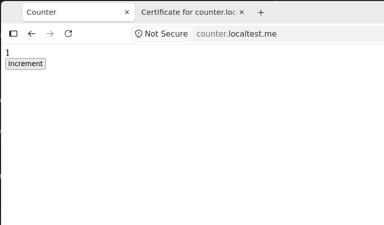
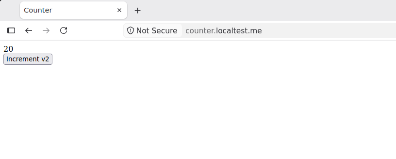

# Домашнее задание № 4. Задания 1–4: counter, PostgreSQL, эксплуатация и Helm

## Результат и материалы

В локальном Kubernetes-кластере `kind-course` развёрнуто приложение counter: Python-backend и Next.js-frontend. Внешняя точка входа — `https://counter.localtest.me`. Traefik направляет `/api` в backend, а `/` — во frontend. Backend переведён с порта `8081` на `8082` без пересборки образа. Настроены startup/readiness/liveness-пробы, requests/limits, постепенное обновление и история ревизий; выполнены эксперименты с неготовой репликой, тремя backend-репликами, новой версией frontend, сломанной выкаткой и откатом.

Отчёт охватывает **задание 1 «Приложение»** (пункты 1.1–1.6 и три вопроса), **задание 2 «База данных»** (пункты 2.1–2.3 и два вопроса), **задание 3 «Эксплуатация»** (пункты 3.1–3.2) и **задание 4 «Поставка через Helm»** (пункты 4.1–4.2). Материалы PostgreSQL приведены в разделах 12–22, эксплуатации — в разделах 23–30, Helm — в разделах 31–39. Дополнительное задание с PostgreSQL в чарте не выполнялось. Backend к PostgreSQL не подключался, как и предусмотрено заданием 2.

Источники фактических команд и результатов:

- [полная исходная запись терминала](logs/task1-session.txt);
- [полная исходная запись выполнения задания 2](logs/task2-session.txt);
- [полная исходная запись выполнения задания 3](logs/task3-session.txt);
- [полная исходная запись выполнения задания 4](logs/task4-session.txt);
- [HTTP-проверки во время readiness-эксперимента](logs/readiness-traffic.txt);
- [HTTP-проверки во время выкатки и отката](logs/rollout-traffic.txt);
- [итоговые манифесты](manifests/), [настройки кластера](infra/) и [скрипт проверки трафика](scripts/check-traffic.sh);
- [снимок рабочего frontend Deployment перед сломанной выкаткой](snapshots/frontend-deployment-v2.yaml);
- [скриншот первой версии](screen/1.png) и [скриншот версии v2](screen/2.png).
- [манифесты PostgreSQL и клиентского пода](manifests/postgres/).
- [манифесты node-exporter, RBAC и CronJob](manifests/ops/).
- [Helm-чарт counter](charts/counter/) и [параметры окружений](environments/).

Все команды выполнялись в **Ubuntu WSL2**, рабочий каталог — `/home/rkart/projects/hw4`. Сессия задания 1 записана **24.10.2026 с 16:37:08 до 21:49:42, UTC+03:00**; сессия задания 2 — **с 23:55:30 24.10.2026 до 00:55:40 25.10.2026, UTC+03:00**. Временные метки сертификатов, HTTP-заголовков и PostgreSQL ниже приведены так, как их вывели программы: в GMT/UTC. Например, `2026-10-24 21:08:25 UTC` в логе БД соответствует `25.10.2026 00:08:25` по Москве.

Сессия задания 3 записана **25.10.2026 с 01:27:22 до 01:49:24, UTC+03:00**. Она содержит исходную неудачную попытку запуска Job, диагностику, исправление и два успешных ручных запуска вне расписания.

Сессия задания 4 записана **25.10.2026 с 02:29:47 до 02:49:40, UTC+03:00**. Подтверждены два одновременно установленных релиза, автоматические и ручные проверки, обновление конфигурации без пересборки и откат.


| Пункт | Реализация и подтверждение |
|---|---|
| 1.1 | Собственный CA и сертификат с SAN, проверенный `curl` без `-k`, GET/POST счётчика, скриншоты интерфейса — раздел 4. |
| 1.2 | Внутренние ClusterIP Service, маршрутизация backend только через `/api` на общем HTTPS-адресе — раздел 5. |
| 1.3 | ConfigMap, смена `8081 → 8082`, одинаковый runtime `imageID` до и после изменения — раздел 6. |
| 1.4 | Три вида проб, под `Running`, но `Ready=false`, исключение endpoint из готовых и непрерывные HTTP-проверки — раздел 7. |
| 1.5 | CPU/memory requests и limits контейнеров, подтверждённый QoS `Burstable` — раздел 8. |
| 1.6 | RollingUpdate, действительная frontend v2, несуществующий образ, сохранение рабочих реплик, rollback и история причин — раздел 9. |
| 2.1 | Значение `42` сохранилось после удаления пода и пересоздания StatefulSet; UID PVC и имя PV не изменились — разделы 18–19. |
| 2.2 | Постоянное DNS-имя пода БД; разрешение имени и SQL-запросы из отдельного клиентского пода до и после пересоздания — разделы 17 и 19. |
| 2.3 | Автоматическое выполнение `01-init.sql`, исходная строка `1 / 0`, генерация случайного пароля вне проекта и ссылки на Secret вместо пароля в YAML — разделы 14–17. |
| 3.1 | DaemonSet с тремя готовыми агентами, включая control-plane; метрики с каждой ноды, ограниченные ресурсы и набор сборщиков — разделы 24–25. Новая нода в приложенной сессии не добавлялась. |
| 3.2 | Два CronJob с московским временем, ServiceAccount с узкой Role, разрешающий и запрещающие ответы RBAC, успешные Job и переход frontend `2 → 3 → 1` — разделы 26–29. |
| 4.1 | Чарт с параметрами, установка каждого релиза одной командой, `alpha` и `beta` одновременно в одном namespace, разные HTTPS-адреса и независимые счётчики; произвольные имя и namespace проверены рендерингом — разделы 31–34. |
| 4.2 | Автоматические hook Job после установки/обновления/отката; checksum, смена UID без изменения imageID, `helm test`, история и rollback с возвратом порта — разделы 35–38. |

## 1. Окружение и схема решения

Версии установленных компонентов подтверждены исходным логом:

```bash
docker version
kubectl version --client
kind version
helm version
openssl version
```

Существенные строки вывода:

```text
Version:           29.1.3
OS/Arch:           linux/amd64
Context:           default
Client Version: v1.37.1
Kustomize Version: v5.8.1
kind v0.34.0-alpha+2b29bebb68be83 go1.27.3 linux/amd64
version.BuildInfo{Version:"v3.22.1", GitCommit:"d6c1a0e4027caa6abc7892e7ea9f0cda7447baa3", GitTreeState:"clean", GoVersion:"go1.26.9"}
OpenSSL 3.5.5 27 Jan 2026 (Library: OpenSSL 3.5.5 27 Jan 2026)
```

Итоговая схема:

```text
https://counter.localtest.me:443
                   |
            Traefik + TLS Secret
                   |
          Ingress /           /api
                  |            |
       counter-frontend    counter-backend
       ClusterIP :80       ClusterIP :80
                  |            |
       frontend pods       backend pod
             :8080             :8082
```

**Обоснование.** Frontend и backend управляются Deployment: нужны восстановление подов, изменение числа реплик и постепенная замена версий. Service отделяет постоянный внутренний адрес от меняющихся IP подов. Один Ingress сохраняет общий origin страницы и API, поэтому frontend использует уже имеющийся относительный URL `/api/counter` без изменения логики запросов.

## 2. Локальный кластер и Ingress-контроллер

### 2.1. Освобождение порта и создание кластера

Порт 80 занимал контейнер `nginx-letsencrypt` из предыдущей работы. Он был остановлен:

```bash
docker stop nginx-letsencrypt
```

```text
nginx-letsencrypt
```

В [infra/kind-config.yaml](infra/kind-config.yaml) заданы три ноды и пробросы `127.0.0.1:80 → 30080` и `127.0.0.1:443 → 30443` на control-plane.

```bash
kind create cluster --name course --config infra/kind-config.yaml
kubectl config use-context kind-course
kubectl get nodes -o wide
```

Из вывода создания оставлены итоговые строки:

```text
Creating cluster "course" ...
Set kubectl context to "kind-course"
Switched to context "kind-course".
```

Из таблицы нод ниже оставлены колонки имени, состояния, роли и версии:

```text
NAME                   STATUS   ROLES           VERSION
course-control-plane   Ready    control-plane   v1.37.0
course-worker          Ready    <none>          v1.37.0
course-worker2         Ready    <none>          v1.37.0
```

Полный вывод также содержит ядро `6.6.87.2-microsoft-standard-WSL2` и runtime нод `containerd://2.3.4`.

### 2.2. Запуск Traefik

При первоначальной подготовке возникли `ImagePullBackOff` и ошибка импорта многоплатформенного образа. Публичный образ Traefik был скачан Docker, затем экспортирован только для `linux/amd64` и загружен архивом:

```bash
docker pull traefik:v3.7.16
```

Итог загрузки:

```text
Status: Downloaded newer image for traefik:v3.7.16
docker.io/library/traefik:v3.7.16
```

```bash
docker image save \
  --platform linux/amd64 \
  --output /tmp/traefik-v3.7.16-amd64.tar \
  traefik:v3.7.16

kind load image-archive /tmp/traefik-v3.7.16-amd64.tar --name course
docker exec course-worker crictl images | grep traefik
```

Первые две команды завершились без текстового вывода; наличие образа на ноде подтвердилось проверкой:

```text
docker.io/library/traefik                       v3.7.16              3733df53e74cd       55.4MB
```

Для установленного чарта `42.1.3` итоговая настройка типа Service находится в `service.spec.type`. Успешная команда установки после исправления [values-файла](infra/traefik-values.yaml):

```bash
helm upgrade --install traefik traefik/traefik \
  --namespace traefik \
  --version 42.1.3 \
  --values infra/traefik-values.yaml \
  --set service.spec.type=NodePort \
  --set image.pullPolicy=IfNotPresent \
  --wait \
  --timeout 180s
```

Существенные строки вывода:

```text
Release "traefik" has been upgraded. Happy Helming!
NAME: traefik
LAST DEPLOYED: Sat Oct 24 20:16:49 2026
NAMESPACE: traefik
STATUS: deployed
REVISION: 6
traefik with docker.io/traefik:v3.7.16 has been deployed successfully on traefik namespace!
```

```bash
kubectl -n traefik get pods,service
kubectl get ingressclass
```

```text
NAME                           READY   STATUS    RESTARTS   AGE
pod/traefik-5cc8f56f4c-djkz8   1/1     Running   0          16m

NAME              TYPE       CLUSTER-IP      EXTERNAL-IP   PORT(S)                      AGE
service/traefik   NodePort   10.96.141.170   <none>        80:30080/TCP,443:30443/TCP   3h3m

NAME                CONTROLLER                      PARAMETERS   AGE
traefik (default)   traefik.io/ingress-controller   <none>       3h3m
```

Helm здесь используется для инфраструктурного контроллера Traefik. Это не собственный чарт приложения из задания 4.

## 3. Сборка образов и первоначальное развёртывание

### 3.1. Собственные образы

Для backend использован проверенный в ДЗ 3 [Dockerfile.nonroot](app/backend/Dockerfile.nonroot), для frontend — [Dockerfile](app/frontend/Dockerfile) с многоступенчатой сборкой standalone-сервера Next.js.

```bash
docker build \
  -f app/backend/Dockerfile.nonroot \
  -t counter-backend:hw4-v1 \
  app/backend

docker build -t counter-frontend:hw4-v1 app/frontend

docker image inspect counter-backend:hw4-v1 \
  --format 'image={{.Id}} user={{.Config.User}}'

docker image inspect counter-frontend:hw4-v1 \
  --format 'image={{.Id}} user={{.Config.User}}'
```

Вместо повторяющегося прогресса сборки приведены результаты проверки готовых образов:

```text
image=sha256:7312e0705c787923ec7bd67cae10b345a5615db332cd452ac8e2a7ff0036a8b6 user=appuser
image=sha256:6ef8b4f284c197f8f49328f1f03d22c7e9d3a689f0a10f06d764c0a1698aebe8 user=node
```

Оба приложения запускаются непривилегированными пользователями. Собственные образы не публиковались в публичном реестре, а загружались в локальные ноды:

```bash
kind load docker-image \
  counter-backend:hw4-v1 \
  counter-frontend:hw4-v1 \
  --name course
```

Пример строк вывода; аналогичные строки есть для обеих worker-нод:

```text
Image: "counter-backend:hw4-v1" with ID "sha256:7312e0705c787923ec7bd67cae10b345a5615db332cd452ac8e2a7ff0036a8b6" not yet present on node "course-control-plane", loading...
Image: "counter-frontend:hw4-v1" with ID "sha256:6ef8b4f284c197f8f49328f1f03d22c7e9d3a689f0a10f06d764c0a1698aebe8" not yet present on node "course-control-plane", loading...
```

В обоих Deployment задано `imagePullPolicy: Never`: запускаются заранее загруженные локальные образы.

### 3.2. Namespace, конфигурация и Deployment

```bash
kubectl apply -f /home/rkart/projects/hw4/manifests/namespace.yaml
kubectl apply -f /home/rkart/projects/hw4/manifests/backend-configmap.yaml
kubectl apply -f /home/rkart/projects/hw4/manifests/backend-deployment.yaml
kubectl apply -f /home/rkart/projects/hw4/manifests/frontend-deployment.yaml
```

```text
namespace/counter created
configmap/counter-backend-config created
deployment.apps/counter-backend created
deployment.apps/counter-frontend created
```

```bash
kubectl -n counter rollout status deployment/counter-backend --timeout=180s
kubectl -n counter rollout status deployment/counter-frontend --timeout=180s
kubectl -n counter get deployments
```

```text
deployment "counter-backend" successfully rolled out
deployment "counter-frontend" successfully rolled out
NAME               READY   UP-TO-DATE   AVAILABLE   AGE
counter-backend    1/1     1            1           36s
counter-frontend   2/2     2            2           35s
```

Первоначальная проверка backend на нестандартном порту:

```bash
kubectl -n counter exec deployment/counter-backend -- printenv PORT
```

```text
8081
```

```bash
kubectl -n counter exec deployment/counter-backend -- \
  python -c 'import urllib.request; print(urllib.request.urlopen("http://127.0.0.1:8081/api/counter").read().decode())'
```

```text
{"count": 0}
```

## 4. Требование 1.1: HTTPS и работа счётчика

### 4.1. Собственный CA и сертификат сайта

Ключи создавались в `/home/rkart/.local/share/hw4-tls`, за пределами проекта:

```bash
export TLS_DIR="$HOME/.local/share/hw4-tls"
mkdir -p "$TLS_DIR"
chmod 700 "$TLS_DIR"

openssl req -x509 -newkey rsa:3072 -nodes \
  -keyout "$TLS_DIR/ca.key" \
  -out "$TLS_DIR/ca.crt" \
  -sha256 -days 365 \
  -subj "/CN=HW4 Local CA" \
  -addext "basicConstraints=critical,CA:TRUE" \
  -addext "keyUsage=critical,keyCertSign,cRLSign"

openssl req -new -newkey rsa:2048 -nodes \
  -keyout "$TLS_DIR/counter.key" \
  -out "$TLS_DIR/counter.csr" \
  -subj "/CN=counter.localtest.me" \
  -addext "subjectAltName=DNS:counter.localtest.me" \
  -addext "basicConstraints=critical,CA:FALSE" \
  -addext "keyUsage=critical,digitalSignature,keyEncipherment" \
  -addext "extendedKeyUsage=serverAuth"

openssl x509 -req \
  -in "$TLS_DIR/counter.csr" \
  -CA "$TLS_DIR/ca.crt" \
  -CAkey "$TLS_DIR/ca.key" \
  -CAcreateserial \
  -out "$TLS_DIR/counter.crt" \
  -days 90 -sha256 \
  -copy_extensions copy

chmod 600 "$TLS_DIR/ca.key" "$TLS_DIR/counter.key"
```

Прогресс генерации RSA опущен. При подписании получено:

```text
Certificate request self-signature ok
subject=CN=counter.localtest.me
```

```bash
openssl x509 -in "$TLS_DIR/counter.crt" \
  -noout -subject -issuer -dates -ext subjectAltName

openssl verify -CAfile "$TLS_DIR/ca.crt" "$TLS_DIR/counter.crt"
```

```text
subject=CN=counter.localtest.me
issuer=CN=HW4 Local CA
notBefore=Oct 24 18:02:31 2026 GMT
notAfter=Jan 22 18:02:31 2027 GMT
X509v3 Subject Alternative Name:
    DNS:counter.localtest.me
/home/rkart/.local/share/hw4-tls/counter.crt: OK
```

Сертификат содержит нужное DNS-имя в SAN и подписан собственным CA.

### 4.2. Доверие и TLS Secret

```bash
sudo install -m 0644 "$TLS_DIR/ca.crt" \
  /usr/local/share/ca-certificates/hw4-local-ca.crt
sudo update-ca-certificates
```

Существенные строки:

```text
Updating certificates in /etc/ssl/certs...
1 added, 0 removed; done.
Running hooks in /etc/ca-certificates/update.d...
done.
```

```bash
kubectl -n counter create secret tls counter-tls \
  --cert="$TLS_DIR/counter.crt" \
  --key="$TLS_DIR/counter.key"

kubectl -n counter get secret counter-tls
```

```text
secret/counter-tls created
NAME          TYPE                DATA   AGE
counter-tls   kubernetes.io/tls   2      9s
```

В записи также есть импорт корневого сертификата в хранилище текущего пользователя Windows, вызванный из WSL:

```bash
certutil.exe -user -addstore Root "$(wslpath -w "$TLS_DIR/ca.crt")"
```

```text
Root "Доверенные корневые центры сертификации"
Подпись соответствует открытому ключу
Сертификат "HW4 Local CA" добавлен в хранилище.
CertUtil: -addstore — команда успешно выполнена.
```

**Обоснование.** Собственный CA подходит для локального домена и позволяет проверять сертификат обычным `curl` с включённой верификацией. TLS завершается на Ingress-контроллере, поэтому приложение не получает закрытые ключи и продолжает работать по HTTP внутри кластера.

### 4.3. Проверка HTTPS без отключения верификации

После создания Ingress выполнено:

```bash
curl --noproxy '*' -v -o /dev/null https://counter.localtest.me/
```

Существенные строки фактического вывода:

```text
Note: Read config file from '/home/rkart/.curlrc'
*   CAfile: /etc/ssl/certs/ca-certificates.crt
*   CApath: /etc/ssl/certs
* SSL connection using TLSv1.2 / ECDHE-RSA-AES128-GCM-SHA256 / x25519 / RSASSA-PSS
* Server certificate:
*   subject: CN=counter.localtest.me
*   start date: Oct 24 18:02:31 2026 GMT
*   expire date: Jan 22 18:02:31 2027 GMT
*   issuer: CN=HW4 Local CA
*   subjectAltName: "counter.localtest.me" matches cert's "counter.localtest.me"
* SSL certificate verified via OpenSSL.
* Established connection to counter.localtest.me (127.0.0.1 port 443) from 127.0.0.1 port 57256
* using HTTP/2
< HTTP/2 200
< content-type: text/html; charset=utf-8
```

Параметр `-k` не использовался. Проверены и цепочка доверия, и соответствие DNS-имени. В начале полного вывода есть неудачная попытка подключения к `::1`; затем `curl` успешно подключился к `127.0.0.1`, на котором опубликован порт кластера.

### 4.4. GET и POST через внешний адрес

```bash
curl --noproxy '*' -fsS https://counter.localtest.me/api/counter
echo
```

```text
{"count": 1}
```

```bash
curl --noproxy '*' -fsS -X POST https://counter.localtest.me/api/counter
echo
```

```text
{"count": 2}
```

```bash
curl --noproxy '*' -fsS https://counter.localtest.me/api/counter
echo
```

```text
{"count": 2}
```

POST увеличил значение на единицу; последующий GET вернул то же значение.

Первая версия интерфейса, значение счётчика `1`:



## 5. Требование 1.2: backend доступен снаружи через /api

Созданы два внутренних Service:

```bash
kubectl apply -f manifests/backend-service.yaml
kubectl apply -f manifests/frontend-service.yaml
kubectl -n counter get services
```

```text
service/counter-backend created
service/counter-frontend created
NAME               TYPE        CLUSTER-IP      EXTERNAL-IP   PORT(S)   AGE
counter-backend    ClusterIP   10.96.162.181   <none>        80/TCP    64s
counter-frontend   ClusterIP   10.96.1.172     <none>        80/TCP    8s
```

В [backend Service](manifests/backend-service.yaml) и [frontend Service](manifests/frontend-service.yaml) заданы `type: ClusterIP`, внутренний порт `80` и `targetPort: http`. У приложений нет NodePort или LoadBalancer; в описании контейнеров также зафиксирован `Host Port: 0/TCP`.

```bash
kubectl apply -f manifests/ingress.yaml
kubectl -n counter get ingress
kubectl -n counter describe ingress counter
```

```text
ingress.networking.k8s.io/counter created
NAME      CLASS     HOSTS                  ADDRESS   PORTS     AGE
counter   traefik   counter.localtest.me             80, 443   9s
```

Существенная часть описания Ingress при первоначальном порте backend `8081`:

```text
Ingress Class:    traefik
TLS:
  counter-tls terminates counter.localtest.me
Rules:
  Host                  Path  Backends
  ----                  ----  --------
  counter.localtest.me
                        /api   counter-backend:http (10.244.2.3:8081)
                        /      counter-frontend:http (10.244.2.4:8080,10.244.1.3:8080)
Annotations:            traefik.ingress.kubernetes.io/router.entrypoints: websecure
                        traefik.ingress.kubernetes.io/router.tls: true
```

**Обоснование.** Наружу опубликован контроллер Traefik, а не Service приложений. Backend подключён к внешнему адресу только правилом `/api` на том же хосте; переписывание пути не нужно, поскольку backend уже реализует `/api/counter`. Доступ администратора через Kubernetes API не используется как пользовательская точка входа.

## 6. Требование 1.3: смена порта без пересборки

Backend читает `PORT` из ConfigMap при запуске процесса. Сначала зафиксированы порт и runtime `imageID` пода:

```bash
kubectl -n counter exec deployment/counter-backend -- printenv PORT

kubectl -n counter get pods -l app=counter-backend \
  -o jsonpath='{range .items[*]}{.metadata.name}{"\t"}{.status.containerStatuses[0].imageID}{"\n"}{end}'
```

```text
8081
counter-backend-794646d6fc-dnzwm	docker.io/library/import-2026-10-24@sha256:12160d60ebe8abe681708e8a0134fae3a5eee66ad9e3a865932008c80689c143
```

В [ConfigMap](manifests/backend-configmap.yaml) значение изменено на `PORT: "8082"` и применено отдельно:

```bash
kubectl apply -f manifests/backend-configmap.yaml
kubectl -n counter exec deployment/counter-backend -- printenv PORT
```

```text
configmap/counter-backend-config configured
8081
```

Работающий контейнер сохранил прежнее окружение. Затем в [Deployment](manifests/backend-deployment.yaml) изменён `containerPort` именованного порта `http` на `8082`, а причина зафиксирована аннотацией:

```yaml
kubernetes.io/change-cause: "Change backend port from 8081 to 8082 without rebuilding"
```

Образ остался `counter-backend:hw4-v1`.

```bash
kubectl apply -f manifests/backend-deployment.yaml
kubectl -n counter rollout status deployment/counter-backend --timeout=180s
kubectl -n counter exec deployment/counter-backend -- printenv PORT

kubectl -n counter get pods -l app=counter-backend \
  -o jsonpath='{range .items[*]}{.metadata.name}{"\t"}{.status.containerStatuses[0].imageID}{"\n"}{end}'
```

```text
deployment.apps/counter-backend configured
deployment "counter-backend" successfully rolled out
8082
counter-backend-bb478879d-kghn5	docker.io/library/import-2026-10-24@sha256:12160d60ebe8abe681708e8a0134fae3a5eee66ad9e3a865932008c80689c143
```

Runtime `imageID` до и после замены пода **совпадает**. Команды сборки backend между этими проверками не выполнялись. Service не менялся: именованный `targetPort: http` указывает на соответствующий порт каждого пода.

Внешний API после перехода на `8082`:

```bash
curl --noproxy '*' -fsS https://counter.localtest.me/api/counter
echo
```

```text
{"count": 0}
```

Обнуление ожидаемо: новый процесс создал новый объект `State` в памяти. Этот запрос к API завершился успешно; сброс значения показывает ограничение текущей реализации хранения состояния.

## 7. Требование 1.4: готовность и проверки здоровья

### 7.1. Настройка проб

В обоих Deployment предусмотрены три проверки. У backend startup/liveness обращаются по HTTP к `/api/counter`, у frontend — к `/`. Именованный порт `http` соответствует текущему порту контейнера.

| Проба | Настройка backend | Назначение |
|---|---|---|
| Startup | HTTP, каждые 2 с, timeout 2 с, 30 неудач | Даёт приложению время запуститься; до её успеха остальные пробы не выполняются. |
| Readiness | Python exec: HTTP-запрос и проверка отсутствия `/tmp/force-unready`, каждые 5 с | Неготовый под перестаёт участвовать в обслуживании Service без перезапуска процесса. |
| Liveness | HTTP, каждые 10 с, timeout 2 с, 3 неудачи | При повторных неудачах инициирует перезапуск контейнера, в том числе если HTTP-процесс завис. |

Readiness проверяет настоящий HTTP-ответ приложения; файл используется только как управляемый способ воспроизвести неготовность. Зависание процесса отдельно не инъецировалось: эксперимент ниже проверяет именно readiness, а liveness подтверждена конфигурацией и выводом `describe`.

### 7.2. Исключение одной реплики из обслуживания

Чтобы после исключения одной реплики оставался готовый backend, число реплик увеличено до двух:

```bash
kubectl -n counter scale deployment/counter-backend --replicas=2
kubectl -n counter rollout status deployment/counter-backend --timeout=180s
```

```text
deployment.apps/counter-backend scaled
deployment "counter-backend" successfully rolled out
```

Под выбран командой:

```bash
POD=$(
  kubectl -n counter get pods -l app=counter-backend \
    -o jsonpath='{.items[0].metadata.name}'
)
echo "$POD"
```

```text
counter-backend-bb478879d-kghn5
```

Проверка выполнена дважды. Ниже приведён повторный эксперимент, который по времени пересекается с приложенным журналом HTTP-трафика.

```bash
kubectl -n counter exec "$POD" -- touch /tmp/force-unready
kubectl -n counter get pods -o wide

kubectl -n counter get endpointslices \
  -l kubernetes.io/service-name=counter-backend \
  -o jsonpath='{range .items[*].endpoints[*]}{.targetRef.name}{"\t"}{.addresses[0]}{"\tready="}{.conditions.ready}{"\n"}{end}'
```

Строки backend из вывода подов:

```text
NAME                               READY   STATUS    RESTARTS   AGE     IP           NODE             NOMINATED NODE   READINESS GATES
counter-backend-bb478879d-kghn5    0/1     Running   0          9m25s   10.244.1.4   course-worker2   <none>           <none>
counter-backend-bb478879d-ph6wr    1/1     Running   0          4m41s   10.244.2.5   course-worker    <none>           <none>
```

EndpointSlice:

```text
counter-backend-bb478879d-kghn5	10.244.1.4	ready=false
counter-backend-bb478879d-ph6wr	10.244.2.5	ready=true
```

```bash
kubectl -n counter describe pod "$POD"
```

Существенные строки описания и событий:

```text
Ready:          False
Restart Count:  0
Liveness:   http-get http://:http/api/counter delay=0s timeout=2s period=10s successThreshold=1 failureThreshold=3
Startup:  http-get http://:http/api/counter delay=0s timeout=2s period=2s successThreshold=1 failureThreshold=30
Warning  Unhealthy  1s (x16 over 2m12s)  kubelet  spec.containers{backend}: Readiness probe failed:
```

Endpoint не обязательно удаляется из EndpointSlice физически: существенен переход его условия в `ready=false`. Под остаётся запущенным, но не выбирается как готовая цель для новых пользовательских запросов.

Восстановление:

```bash
kubectl -n counter exec "$POD" -- rm /tmp/force-unready

kubectl -n counter wait --for=condition=Ready "pod/$POD" --timeout=60s
```

```text
pod/counter-backend-bb478879d-kghn5 condition met
```

### 7.3. Что происходило с трафиком

Во втором терминале сохранялись результаты [check-traffic.sh](scripts/check-traffic.sh): последовательные HTTPS GET к `/` и `/api/counter` с паузой в одну секунду между циклами. Скрипт использует `--fail`, ограничение времени запроса и выводит `FAIL` при ошибке. Сам ввод команды во втором терминале не входит в основную запись `script`; его результаты находятся в [readiness-traffic.txt](logs/readiness-traffic.txt).

**Анализ приложенного журнала при подготовке отчёта:**

| Период, UTC+03:00 | Проверок `/` | Проверок `/api/counter` | Всего HTTP 200 | Строк FAIL |
|---|---:|---:|---:|---:|
| 21:28:12–21:29:24 | 70 | 70 | 140 | 0 |

Начало и конец файла:

```text
2026-10-24T21:28:12+03:00 path=/ HTTP=200 OK
2026-10-24T21:28:12+03:00 path=/api/counter HTTP=200 OK
...
2026-10-24T21:29:24+03:00 path=/ HTTP=200 OK
2026-10-24T21:29:24+03:00 path=/api/counter HTTP=200 OK
```

Во время наблюдаемого эксперимента один backend был неготов, но второй продолжал обслуживать API; неуспешных HTTP-проб в журнале нет. Это результат конкретного интервала наблюдения, а не утверждение о любых запросах вне измерений.

## 8. Требование 1.5: requests, limits и QoS

Настройки контейнеров приложения проверены командами:

```bash
kubectl -n counter describe deployment counter-backend
kubectl -n counter describe deployment counter-frontend
```

Backend, фрагмент фактического вывода:

```text
Image:      counter-backend:hw4-v1
Port:       8082/TCP (http)
Host Port:  0/TCP (http)
Limits:
  cpu:     250m
  memory:  128Mi
Requests:
  cpu:      50m
  memory:   64Mi
```

Frontend, фрагмент вывода до обновления на v2:

```text
Image:      counter-frontend:hw4-v1
Port:       8080/TCP (http)
Host Port:  0/TCP (http)
Limits:
  cpu:     500m
  memory:  512Mi
Requests:
  cpu:      100m
  memory:   128Mi
```

В итоговом frontend v2 значения ресурсов сохранены. Для самостоятельно установленного контроллера Traefik также заданы requests и лимит памяти:

| Контейнер | CPU request | Memory request | CPU limit | Memory limit |
|---|---:|---:|---:|---:|
| backend | 50m | 64Mi | 250m | 128Mi |
| frontend | 100m | 128Mi | 500m | 512Mi |
| Traefik | 100m | 64Mi | не задан | 256Mi |

Requests используются планировщиком при размещении. Memory limits ограничивают потребление памяти каждым контейнером приложения; при превышении возможно завершение процесса с `OOMKilled`. Нагрузочный эксперимент с исчерпанием памяти в этой работе не проводился.

QoS проверен отдельно:

```bash
kubectl -n counter get pods \
  -o custom-columns=NAME:.metadata.name,QOS:.status.qosClass
```

```text
NAME                               QOS
counter-backend-bb478879d-kghn5    Burstable
counter-frontend-8d58468cb-c8dns   Burstable
counter-frontend-8d58468cb-s4p42   Burstable
```

## 9. Требование 1.6: обновление, сломанная версия и откат

### 9.1. Стратегия выкатки

В обоих [Deployment](manifests/) заданы:

```yaml
revisionHistoryLimit: 5
minReadySeconds: 5
progressDeadlineSeconds: 120
strategy:
  type: RollingUpdate
  rollingUpdate:
    maxSurge: 1
    maxUnavailable: 0
```

Также заданы `terminationGracePeriodSeconds: 30` и `preStop` с `sleep 5`.

**Обоснование.** Новая реплика создаётся сверх желаемого числа; старая рабочая реплика сохраняется до готовности замены. `minReadySeconds` требует устойчивой готовности в течение пяти секунд, а `preStop` оставляет время на распространение исключения завершаемого пода из маршрутизации. `revisionHistoryLimit` сохраняет историю ReplicaSet для отката, а `kubernetes.io/change-cause` объясняет назначение изменений.

### 9.2. Сборка настоящей frontend v2

В [page.tsx](app/frontend/src/app/page.tsx) текст кнопки изменён с `Increment` на `Increment v2`. Обработчик POST сохранён.

```bash
docker build -t counter-frontend:hw4-v2 app/frontend
kind load docker-image counter-frontend:hw4-v2 --name course

docker image inspect counter-frontend:hw4-v1 --format '{{.Id}}'
docker image inspect counter-frontend:hw4-v2 --format '{{.Id}}'
```

Вывод двух проверок образов:

```text
sha256:6ef8b4f284c197f8f49328f1f03d22c7e9d3a689f0a10f06d764c0a1698aebe8
sha256:45fd13a6c67ffcc43930bedd29f6c8c4bcdfbbc680d39783c83df212c408a8f1
```

Идентификаторы различаются: новая версия действительно пересобрана из изменённых исходников, а не только получила другой тег.

В Deployment одновременно изменены образ на `counter-frontend:hw4-v2` и причина на `Frontend hw4-v2: change button label`.

```bash
kubectl apply -f manifests/frontend-deployment.yaml
kubectl -n counter rollout status deployment/counter-frontend --timeout=180s
```

Из повторяющихся сообщений ожидания оставлены одно промежуточное и итог:

```text
deployment.apps/counter-frontend configured
Waiting for deployment "counter-frontend" rollout to finish: 1 old replicas are pending termination...
deployment "counter-frontend" successfully rolled out
```

```bash
kubectl -n counter get pods,replicasets
```

Строки frontend из вывода:

```text
NAME                                    READY   STATUS    RESTARTS   AGE
pod/counter-frontend-6867fdc4f9-bl4ds   1/1     Running   0          23s
pod/counter-frontend-6867fdc4f9-mcfdj   1/1     Running   0          15s

NAME                                          DESIRED   CURRENT   READY   AGE
replicaset.apps/counter-frontend-6867fdc4f9   2         2         2       23s
replicaset.apps/counter-frontend-8d58468cb    0         0         0       51m
```

```bash
kubectl -n counter rollout history deployment/counter-frontend
```

```text
deployment.apps/counter-frontend
REVISION  CHANGE-CAUSE
1         Initial frontend hw4-v1
2         Frontend hw4-v2: change button label
```

Вторая версия интерфейса, значение `20` и изменённая кнопка:




### 9.3. Рабочая ревизия и заведомо сломанный образ

Рабочая конфигурация сохранена в [snapshots/frontend-deployment-v2.yaml](snapshots/frontend-deployment-v2.yaml). Номер ревизии получен из Deployment:

```bash
GOOD_REV=$(
  kubectl -n counter get deployment counter-frontend \
    -o jsonpath='{.metadata.annotations.deployment\.kubernetes\.io/revision}'
)
echo "Working revision: $GOOD_REV"
```

```text
Working revision: 2
```

Затем в манифесте установлен образ `counter-frontend:does-not-exist` и причина `Broken release: nonexistent frontend image`:

```bash
kubectl apply -f manifests/frontend-deployment.yaml
kubectl -n counter rollout status deployment/counter-frontend --timeout=30s
echo "rollout exit code: $?"
```

```text
deployment.apps/counter-frontend configured
Waiting for deployment "counter-frontend" rollout to finish: 1 out of 2 new replicas have been updated...
error: timed out waiting for the condition
rollout exit code: 1
```

```bash
kubectl -n counter get pods,replicasets
```

Состояние подов:

```text
NAME                                    READY   STATUS              RESTARTS   AGE
pod/counter-backend-bb478879d-kghn5     1/1     Running             0          26m
pod/counter-frontend-58db6675d6-d7t85   0/1     ErrImageNeverPull   0          60s
pod/counter-frontend-6867fdc4f9-bl4ds   1/1     Running             0          7m30s
pod/counter-frontend-6867fdc4f9-mcfdj   1/1     Running             0          7m22s
```

Новая реплика не запустилась, но обе старые frontend-реплики остались готовыми. Статус `ErrImageNeverPull` ожидаем: образа нет на ноде, а политика `Never` запрещает попытку загрузки из реестра.

```bash
kubectl -n counter rollout history deployment/counter-frontend
```

```text
deployment.apps/counter-frontend
REVISION  CHANGE-CAUSE
1         Initial frontend hw4-v1
2         Frontend hw4-v2: change button label
3         Broken release: nonexistent frontend image
```

Проверка страницы при сломанной выкатке:

```bash
curl --noproxy '*' -fsS -o /dev/null \
  -w 'HTTP %{http_code}\n' https://counter.localtest.me/
```

```text
HTTP 200
```

### 9.4. Откат и восстановление локального манифеста

```bash
kubectl -n counter rollout undo deployment/counter-frontend \
  --to-revision="$GOOD_REV"

kubectl -n counter rollout status deployment/counter-frontend --timeout=180s
kubectl -n counter get pods
```

Итоговые строки:

```text
deployment.apps/counter-frontend rolled back
deployment "counter-frontend" successfully rolled out
NAME                                READY   STATUS    RESTARTS   AGE
counter-backend-bb478879d-kghn5     1/1     Running   0          27m
counter-frontend-6867fdc4f9-bl4ds   1/1     Running   0          8m35s
counter-frontend-6867fdc4f9-mcfdj   1/1     Running   0          8m27s
```

`kubectl` дополнительно предупредил, что `rollout undo` не обновляет аннотацию `last-applied-configuration`. После отката восстановлен рабочий файл и повторно применён:

```bash
cp snapshots/frontend-deployment-v2.yaml manifests/frontend-deployment.yaml
kubectl apply -f manifests/frontend-deployment.yaml
kubectl -n counter rollout history deployment/counter-frontend
```

```text
deployment.apps/counter-frontend configured
deployment.apps/counter-frontend
REVISION  CHANGE-CAUSE
1         Initial frontend hw4-v1
3         Broken release: nonexistent frontend image
4         Frontend hw4-v2: change button label
```

Возврат к шаблону рабочей ревизии 2 отражён как ревизия 4. Причина рабочей конфигурации видна в истории; сломанная ревизия 3 также сохранена. Итоговый манифест содержит `counter-frontend:hw4-v2`, а не несуществующий тег.

### 9.5. Проверки доступности во время выкатки

Результаты второго терминала сохранены в [rollout-traffic.txt](logs/rollout-traffic.txt). Скрипт проверял и страницу, и API.

**Анализ приложенного журнала при подготовке отчёта:**

| Период, UTC+03:00 | Проверок `/` | Проверок `/api/counter` | Всего HTTP 200 | Строк FAIL |
|---|---:|---:|---:|---:|
| 21:36:53–21:48:07 | 643 | 643 | 1286 | 0 |

Начало и конец:

```text
2026-10-24T21:36:53+03:00 path=/ HTTP=200 OK
2026-10-24T21:36:53+03:00 path=/api/counter HTTP=200 OK
...
2026-10-24T21:48:07+03:00 path=/ HTTP=200 OK
2026-10-24T21:48:07+03:00 path=/api/counter HTTP=200 OK
```

Проверка, введённая в основной сессии после экспериментов:

```bash
grep -c 'FAIL' logs/rollout-traffic.txt
```

```text
0
```

В пределах этих измерений недоступность не обнаружена: все 1286 проверок страницы и API вернули HTTP 200. Проверки дискретные, примерно раз в секунду для каждого адреса, поэтому журнал не является непрерывным измерением каждого возможного запроса.

## 10. Ответы на вопросы задания 1

### Вопрос 1. Три backend-реплики: наблюдение, причина и изменения приложения

Выполнено:

```bash
kubectl -n counter scale deployment/counter-backend --replicas=3
kubectl -n counter rollout status deployment/counter-backend --timeout=180s
kubectl -n counter get pods -l app=counter-backend -o wide
```

```text
deployment.apps/counter-backend scaled
Waiting for deployment "counter-backend" rollout to finish: 2 of 3 updated replicas are available...
deployment "counter-backend" successfully rolled out
NAME                              READY   STATUS    RESTARTS   AGE     IP           NODE             NOMINATED NODE   READINESS GATES
counter-backend-bb478879d-bd6ps   1/1     Running   0          19s     10.244.2.6   course-worker    <none>           <none>
counter-backend-bb478879d-kghn5   1/1     Running   0          11m     10.244.1.4   course-worker2   <none>           <none>
counter-backend-bb478879d-ph6wr   1/1     Running   0          6m23s   10.244.2.5   course-worker    <none>           <none>
```

```bash
for i in $(seq 1 20); do
  printf 'request=%s ' "$i"
  curl --noproxy '*' -fsS -X POST https://counter.localtest.me/api/counter
  echo
done
```

Полный вывод серии из 20 запросов:

```text
request=1 {"count": 1}
request=2 {"count": 1}
request=3 {"count": 1}
request=4 {"count": 2}
request=5 {"count": 2}
request=6 {"count": 2}
request=7 {"count": 3}
request=8 {"count": 3}
request=9 {"count": 3}
request=10 {"count": 4}
request=11 {"count": 4}
request=12 {"count": 4}
request=13 {"count": 5}
request=14 {"count": 5}
request=15 {"count": 5}
request=16 {"count": 6}
request=17 {"count": 6}
request=18 {"count": 6}
request=19 {"count": 7}
request=20 {"count": 7}
```
Ответ: При трёх репликах ответы повторяются. Каждый процесс создаёт собственный счетчик и они независимы. Service и Ingress распределяют запросы, но не синхронизируют счетчики. Наблюдаемое поведение соответствует отдельному состоянию каждого пода.
Для корректного масштабирования состояние нужно вынести в общее хранилище. POST должен увеличивать общий счётчик атомарно, а GET — читать то же общее значение. Тогда изменение не потеряется при параллельных запросах и данные не исчезнут при перезапуске пода.

После эксперимента число backend-реплик возвращено к одной:

```bash
kubectl -n counter scale deployment/counter-backend --replicas=1
kubectl -n counter rollout status deployment/counter-backend --timeout=180s
```

```text
deployment.apps/counter-backend scaled
deployment "counter-backend" successfully rolled out
```

### Вопрос 2. Когда работающие экземпляры увидят изменения конфигурации?

PORT передаётся из ConfigMap как переменная окружения и считывается backend при запуске. После изменения ConfigMap на 8082 старый под продолжал показывать 8081. Значение 8082 появилось после замены пода при обновлении Deployment. Одно изменение ConfigMap само по себе не вызывает такую выкатку; при неизменном шаблоне её можно инициировать командой kubectl rollout restart.

Поведение подтверждено экспериментом из раздела 6.

### Вопрос 3. Какой QoS получен и почему выбраны такие ресурсы?
Все проверенные поды приложения получили QoS Burstable. У контейнеров заданы requests и limits, поэтому это не BestEffort; значения requests и limits по CPU и памяти различаются, поэтому условия Guaranteed не выполнены. Класс подтверждён выводом status.qosClass.
Backend запрашивает 50m CPU и 64Mi памяти, с лимитами 250m и 128Mi. Frontend запрашивает 100m и 128Mi, с лимитами 500m и 512Mi. Requests позволяют планировщику учитывать потребность подов, memory limits ограничивают память отдельного контейнера, а разница оставляет запас для кратковременных пиков. Для Next.js оставлен больший запас памяти. Это стартовые настройки учебного стенда, а не результат нагрузочного профилирования: в эксплуатации их следует уточнять по измерениям потребления и времени ответа.


## 11. Итоговое состояние задания 1 и границы подтверждения

- Backend: одна реплика `counter-backend:hw4-v1`, порт `8082`, конфигурация через ConfigMap.
- Frontend: две реплики `counter-frontend:hw4-v2`, порт `8080`, кнопка `Increment v2`.
- Оба Service — ClusterIP, внешний доступ организован через Traefik и Ingress.
- Собственный сертификат проверен `curl` по HTTPS без `-k`.
- Readiness-эксперимент показал исключение одной реплики из готовых endpoint без перезапуска контейнера.
- У контейнеров приложения заданы requests/limits, поды получили `Burstable`.
- Успешная выкатка, сломанный образ и возврат рабочей версии отражены в истории с причинами.
- В приложенных журналах readiness и rollout все 1426 суммарных HTTP-проверок имеют код 200; `FAIL` не обнаружены.

## 12. Задание 2. Результат, схема и файлы

В существующем namespace `counter` развёрнут PostgreSQL `18.6-bookworm`: один экземпляр под управлением StatefulSet, отдельный постоянный том и headless Service. Создана база `counterdb`, пользователь `counteradmin` и таблица `public.counters`. Другой под, `counter-postgres-client`, подключается к БД по постоянному DNS-имени и выполняет запросы. После установки контрольного значения `42` оно сохранилось в обоих экспериментах: при удалении пода и при удалении с повторным созданием StatefulSet.

Схема подключения и хранения:

```text
counter-postgres-client
  psql: PGHOST=counter-postgres-0.counter-postgres.counter.svc.cluster.local
                         |
          headless Service counter-postgres :5432
                         |
          StatefulSet counter-postgres, replicas=1
                         |
                 counter-postgres-0
                         |
            PVC data-counter-postgres-0
                         |
       PV pvc-e521c24f-173d-497f-a021-87e449c90cc7
                         |
           local-path на ноде course-worker2
```

Ресурсы описаны в следующих файлах. Пути относительно рабочего каталога `/home/rkart/projects/hw4`:

| Файл | Назначение |
|---|---|
| [manifests/postgres/01-init-configmap.yaml](manifests/postgres/01-init-configmap.yaml) | SQL автоматического создания таблицы и начальной строки. |
| [manifests/postgres/02-headless-service.yaml](manifests/postgres/02-headless-service.yaml) | Headless Service `counter-postgres`, порт `5432`. |
| [manifests/postgres/03-statefulset.yaml](manifests/postgres/03-statefulset.yaml) | Под БД, PVC-шаблон, пробы, requests/limits и подключение Secret. |
| [manifests/postgres/04-client-pod.yaml](manifests/postgres/04-client-pod.yaml) | Отдельный под с `psql`, DNS-именем БД и паролем из Secret. |
| [logs/task2-session.txt](logs/task2-session.txt) | Неизменённая исходная запись терминала с командами и результатами. |

Ниже из исходной сессии убраны управляющие последовательности терминала, повторные эхо вставленных команд, полноэкранное редактирование и прогресс скачивания. Существенные результаты, ошибки и исправление сохранены. Пропуски в длинных выводах обозначены `...` или прямо описаны перед блоком; ожидаемый вывод не выдаётся за фактический.

## 13. Окружение и загрузка образа PostgreSQL

### 13.1. Проверка существующего кластера

```bash
kubectl config current-context
kubectl get nodes
kubectl get namespace counter
kubectl get storageclass
```

```text
kind-course
NAME                   STATUS   ROLES           AGE     VERSION
course-control-plane   Ready    control-plane   6h57m   v1.37.0
course-worker          Ready    <none>          6h57m   v1.37.0
course-worker2         Ready    <none>          6h57m   v1.37.0
NAME      STATUS   AGE
counter   Active   3h9m
NAME                 PROVISIONER             RECLAIMPOLICY   VOLUMEBINDINGMODE      ALLOWVOLUMEEXPANSION   AGE
standard (default)   rancher.io/local-path   Delete          WaitForFirstConsumer   false                  6h57m
```

Использован уже имеющийся StorageClass `standard` с provisioner `rancher.io/local-path`. У него `reclaimPolicy: Delete`; это важно для ответа об удалении namespace в разделе 21.

### 13.2. Официальный образ и загрузка на ноды kind

```bash
docker pull --platform linux/amd64 postgres:18.6-bookworm
```

Итоговые строки загрузки:

```text
Status: Downloaded newer image for postgres:18.6-bookworm
docker.io/library/postgres:18.6-bookworm
```

```bash
docker image save \
  --platform linux/amd64 \
  --output /tmp/hw4-postgres-18.6-amd64.tar \
  postgres:18.6-bookworm

kind load image-archive \
  /tmp/hw4-postgres-18.6-amd64.tar \
  --name course
```

Обе команды завершились без текстового вывода. Последующий запуск БД и клиента с `imagePullPolicy: Never` подтверждает наличие образа на нужных нодах. Используется официальный `postgres`, а не `bitnami/*`.

## 14. Случайный пароль и Secret без пароля в манифестах

Успешная последовательность команд из сессии:

```bash
mkdir -p /home/rkart/.local/share/hw4-secrets
chmod 700 /home/rkart/.local/share/hw4-secrets
umask 077
openssl rand -hex 32 \
  > /home/rkart/.local/share/hw4-secrets/postgres-password
chmod 600 /home/rkart/.local/share/hw4-secrets/postgres-password

kubectl -n counter create secret generic counter-postgres-secret \
  --from-file=password=/home/rkart/.local/share/hw4-secrets/postgres-password

kubectl -n counter get secret counter-postgres-secret
```

```text
secret/counter-postgres-secret created
NAME                      TYPE     DATA   AGE
counter-postgres-secret   Opaque   1      11s
```

Команды создания каталога, ограничения доступа и генерации не выводили пароль: результат OpenSSL перенаправлен в файл **вне** `/home/rkart/projects/hw4`. В переданных материалах файла с паролем нет; в четырёх манифестах БД присутствуют только путь к смонтированному файлу и ссылки на Secret, а не его значение. Это проверка предоставленных материалов, а не аудит всей истории Git.

В StatefulSet пароль подключён как файл; существенный фрагмент [манифеста](manifests/postgres/03-statefulset.yaml):

```yaml
env:
  - name: POSTGRES_PASSWORD_FILE
    value: /run/secrets/postgres/password
volumeMounts:
  - name: postgres-password
    mountPath: /run/secrets/postgres
    readOnly: true
```

В клиентском поде используется ссылка, а не открытый пароль:

```yaml
- name: PGPASSWORD
  valueFrom:
    secretKeyRef:
      name: counter-postgres-secret
      key: password
```

Первоначальный файл OpenSSL содержал завершающий перевод строки. Он попал в Secret и потребовал нормализации; выполненное исправление приведено в разделе 16. Сам пароль ни до, ни после исправления в отчёте не раскрывается.

## 15. Автоматическая инициализация, StatefulSet и постоянный том

### 15.1. SQL первого запуска

Полный SQL из [ConfigMap](manifests/postgres/01-init-configmap.yaml):

```sql
CREATE TABLE public.counters (
  id INTEGER PRIMARY KEY CHECK (id = 1),
  value BIGINT NOT NULL DEFAULT 0 CHECK (value >= 0)
);

INSERT INTO public.counters (id, value)
VALUES (1, 0);
```

ConfigMap смонтирован в `/docker-entrypoint-initdb.d`, данные — в `/var/lib/postgresql`, а `PGDATA` задан как `/var/lib/postgresql/18/docker`. Инициализация выполняется при первом запуске на пустом каталоге данных. Повторная инициализация существующей БД в экспериментах не выполнялась, что согласуется с сохранением значения `42` вместо начального `0`.

В [StatefulSet](manifests/postgres/03-statefulset.yaml) заданы:

```yaml
serviceName: counter-postgres
replicas: 1
persistentVolumeClaimRetentionPolicy:
  whenDeleted: Retain
  whenScaled: Retain
```

И шаблон постоянного тома:

```yaml
volumeClaimTemplates:
  - metadata:
      name: data
    spec:
      accessModes:
        - ReadWriteOnce
      storageClassName: standard
      resources:
        requests:
          storage: 1Gi
```

PVC `data-counter-postgres-0` создан контроллером автоматически. PostgreSQL получил requests `100m / 128Mi`, limits `500m / 512Mi`; клиент — `10m / 32Mi` и `100m / 128Mi`. У БД настроены startup/readiness/liveness-пробы через `pg_isready` по TCP `127.0.0.1:5432`. Результат реальной аутентификации проверяется отдельно через `psql`, а не только пробой доступности.

### 15.2. Применение и готовность ресурсов

```bash
kubectl apply \
  -f /home/rkart/projects/hw4/manifests/postgres/

kubectl -n counter rollout status \
  statefulset/counter-postgres \
  --timeout=180s

kubectl -n counter wait \
  --for=condition=Ready \
  pod/counter-postgres-client \
  --timeout=180s
```

```text
configmap/counter-postgres-init created
service/counter-postgres created
statefulset.apps/counter-postgres created
pod/counter-postgres-client created
Waiting for 1 pods to be ready...
partitioned roll out complete: 1 new pods have been updated...
pod/counter-postgres-client condition met
```

Проверка подов и Service:

```bash
kubectl -n counter get statefulset counter-postgres
kubectl -n counter get pods -l app=counter-postgres -o wide
kubectl -n counter get pod counter-postgres-client
kubectl -n counter get service counter-postgres
```

```text
NAME               READY   AGE
counter-postgres   1/1     34s
NAME                 READY   STATUS    RESTARTS   AGE   IP           NODE             NOMINATED NODE   READINESS GATES
counter-postgres-0   1/1     Running   0          39s   10.244.1.7   course-worker2   <none>           <none>
NAME                      READY   STATUS    RESTARTS   AGE
counter-postgres-client   1/1     Running   0          46s
NAME               TYPE        CLUSTER-IP   EXTERNAL-IP   PORT(S)    AGE
counter-postgres   ClusterIP   None         <none>        5432/TCP   52s
```

`CLUSTER-IP=None` подтверждает headless Service. Постоянное имя отдельного экземпляра — `counter-postgres-0.counter-postgres.counter.svc.cluster.local`. Снаружи кластера БД не публикуется.

Проверка хранилища:

```bash
kubectl -n counter get pvc
kubectl get pv
```

```text
NAME                      STATUS   VOLUME                                     CAPACITY   ACCESS MODES   STORAGECLASS   VOLUMEATTRIBUTESCLASS   AGE
data-counter-postgres-0   Bound    pvc-e521c24f-173d-497f-a021-87e449c90cc7   1Gi        RWO            standard       <unset>                 63s
NAME                                       CAPACITY   ACCESS MODES   RECLAIM POLICY   STATUS   CLAIM                             STORAGECLASS   VOLUMEATTRIBUTESCLASS   REASON   AGE
pvc-e521c24f-173d-497f-a021-87e449c90cc7   1Gi        RWO            Delete           Bound    counter/data-counter-postgres-0   standard       <unset>                          70s
```

## 16. Обнаруженная ошибка аутентификации и исправление

При первых попытках подключения из клиента запросы завершались ошибкой:

```bash
kubectl -n counter exec counter-postgres-client -- \
  psql -X -v ON_ERROR_STOP=1 \
  -c 'SELECT current_database(), current_user, inet_server_addr(), inet_server_port();' \
  -c '\dt public.*' \
  -c 'SELECT * FROM public.counters;'
```

```text
psql: error: connection to server at "counter-postgres-0.counter-postgres.counter.svc.cluster.local" (10.244.1.7), port 5432 failed: FATAL:  password authentication failed for user "counteradmin"
command terminated with exit code 2
```

Простое пересоздание клиентского пода ошибку не устранило. Диагностика показала, что в значении `PGPASSWORD` присутствуют завершающие переводы строк. Проверка выполнялась без вывода значения пароля:

```bash
kubectl -n counter exec counter-postgres-client -- \
  sh -eu -c '
    cleaned="$(printf "%s" "$PGPASSWORD")"

    if [ "$PGPASSWORD" = "$cleaned" ]; then
      printf "Завершающих переводов строк нет\n"
    else
      printf "Найдены завершающие переводы строк\n"
    fi

    PGPASSWORD="$cleaned"
    export PGPASSWORD

    exec psql -X -w -v ON_ERROR_STOP=1 \
      -c "SELECT current_database(), current_user;" \
      -c "\dt public.*" \
      -c "SELECT * FROM public.counters;"
  '
```

```text
Найдены завершающие переводы строк
 current_database | current_user
------------------+--------------
 counterdb        | counteradmin
(1 row)

              List of tables
 Schema |   Name   | Type  |    Owner
--------+----------+-------+--------------
 public | counters | table | counteradmin
(1 row)

 id | value
----+-------
  1 |     0
(1 row)
```

Причина: генератор `openssl rand -hex 32` завершает вывод переводом строки. Secret, созданный через `--from-file`, сохранил этот байт. При чтении `POSTGRES_PASSWORD_FILE` entrypoint образа использует подстановку команды, которая удаляет завершающие переводы строк; переменная окружения клиента из Secret сохранила их. Такое чтение видно в [исходном коде официального entrypoint](https://github.com/docker-library/postgres/blob/master/docker-entrypoint.sh). Успешный запрос с нормализованным `PGPASSWORD` подтвердил диагноз.

Secret исправлен без раскрытия пароля: JSON-патч передан по pipe непосредственно в `kubectl`, а не записан в проект или напечатан в терминале:

```bash
kubectl -n counter exec counter-postgres-client -- \
  sh -eu -c '
    cleaned="$(printf "%s" "$PGPASSWORD")"
    [ -n "$cleaned" ]
    encoded="$(printf "%s" "$cleaned" | base64 | tr -d "\n")"
    printf "{\"data\":{\"password\":\"%s\"}}\n" "$encoded"
  ' |
kubectl -n counter patch secret counter-postgres-secret \
  --type=merge --patch-file=/dev/stdin
```

```text
secret/counter-postgres-secret patched
```

Чтобы клиент получил обновлённую переменную окружения из Secret, он пересоздан:

```bash
kubectl -n counter delete pod counter-postgres-client &&
kubectl -n counter apply -f manifests/postgres/04-client-pod.yaml &&
kubectl -n counter wait --for=condition=Ready \
  pod/counter-postgres-client --timeout=120s
```

```text
pod "counter-postgres-client" deleted from counter namespace
pod/counter-postgres-client created
pod/counter-postgres-client condition met
```

Дальнейшие обычные команды `psql` без оболочки для очистки пароля успешно выполнялись, в том числе после обоих экспериментов с пересозданием БД. База и PVC при исправлении аутентификации не удалялись, SQL-пароль пользователя не менялся.

**Граница воспроизводимости:** в логе нормализован Secret, но нет команды перезаписи исходного файла `/home/rkart/.local/share/hw4-secrets/postgres-password`. При повторном создании Secret из этого файла нужно предварительно убрать завершающий перевод строки, иначе ошибка клиента может повториться. Это замечание для повторного развёртывания, а не утверждение о дополнительном выполненном действии.

## 17. Стабильный DNS, запрос из другого пода и автоматическое создание таблицы

Разрешение имени из клиентского пода:

```bash
kubectl -n counter exec counter-postgres-client -- \
  getent hosts counter-postgres-0.counter-postgres.counter.svc.cluster.local
```

```text
10.244.1.7      counter-postgres-0.counter-postgres.counter.svc.cluster.local
```

После исправления Secret обычный запрос из отдельного пода:

```bash
kubectl -n counter exec counter-postgres-client -- \
  psql -X -v ON_ERROR_STOP=1 \
  -c 'SELECT current_database(), current_user, inet_server_addr(), inet_server_port();' \
  -c '\dt public.*' \
  -c 'SELECT * FROM public.counters;'
```

```text
 current_database | current_user | inet_server_addr | inet_server_port
------------------+--------------+------------------+------------------
 counterdb        | counteradmin | 10.244.1.7       |             5432
(1 row)

              List of tables
 Schema |   Name   | Type  |    Owner
--------+----------+-------+--------------
 public | counters | table | counteradmin
(1 row)

 id | value
----+-------
  1 |     0
(1 row)
```

Адрес назначения передан через `PGHOST` в [манифесте клиента](manifests/postgres/04-client-pod.yaml), а не указан IP-адресом в SQL-команде. В логе показаны совпадающий адрес БД и реальный результат запроса. Это подтверждает пункт 2.2.

Для проверки автоматической инициализации просмотрен журнал БД:

```bash
kubectl -n counter logs counter-postgres-0
```

Существенные строки первоначального запуска, без промежуточных служебных сообщений:

```text
fixing permissions on existing directory /var/lib/postgresql/18/docker ... ok
CREATE DATABASE
...
/usr/local/bin/docker-entrypoint.sh: running /docker-entrypoint-initdb.d/01-init.sql
CREATE TABLE
INSERT 0 1
...
PostgreSQL init process complete; ready for start up.
...
2026-10-24 21:08:26.065 UTC [1] LOG:  database system is ready to accept connections
```

До контрольного `UPDATE` таблица уже существовала и содержала начальное значение `0`. В сессии нет ручного создания этой таблицы через клиент: `CREATE TABLE` выполнен скриптом `01-init.sql` при инициализации. Вместе с созданием Secret из случайного пароля это подтверждает пункт 2.3.

## 18. Сохранение данных после удаления пода БД

### 18.1. Контрольная запись и исходные идентификаторы

```bash
kubectl -n counter exec counter-postgres-client -- \
  psql -X -v ON_ERROR_STOP=1 \
  -c 'UPDATE public.counters SET value = 42 WHERE id = 1;' \
  -c 'SELECT * FROM public.counters;'
```

```text
UPDATE 1
 id | value
----+-------
  1 |    42
(1 row)
```

Сохранены UID пода, StatefulSet и PVC, а также имя PV:

```bash
OLD_POD_UID=$(kubectl -n counter get pod counter-postgres-0 \
  -o jsonpath='{.metadata.uid}')

OLD_STS_UID=$(kubectl -n counter get statefulset counter-postgres \
  -o jsonpath='{.metadata.uid}')

OLD_PVC_UID=$(kubectl -n counter get pvc data-counter-postgres-0 \
  -o jsonpath='{.metadata.uid}')

OLD_PV_NAME=$(kubectl -n counter get pvc data-counter-postgres-0 \
  -o jsonpath='{.spec.volumeName}')

printf 'Pod UID: %s\nStatefulSet UID: %s\nPVC UID: %s\nPV: %s\n' \
  "$OLD_POD_UID" "$OLD_STS_UID" "$OLD_PVC_UID" "$OLD_PV_NAME"
```

```text
Pod UID: 193688ec-7574-4511-84f9-bb0ed195f675
StatefulSet UID: d6d153b5-0adc-48fc-9360-3b9877e19028
PVC UID: e521c24f-173d-497f-a021-87e449c90cc7
PV: pvc-e521c24f-173d-497f-a021-87e449c90cc7
```

### 18.2. Удаление и восстановление пода

```bash
kubectl -n counter delete pod counter-postgres-0

kubectl -n counter wait \
  --for=create \
  pod/counter-postgres-0 \
  --timeout=60s

kubectl -n counter wait \
  --for=condition=Ready \
  pod/counter-postgres-0 \
  --timeout=180s

kubectl -n counter get pod counter-postgres-0 -o wide
```

```text
pod "counter-postgres-0" deleted from counter namespace
pod/counter-postgres-0 condition met
pod/counter-postgres-0 condition met
NAME                 READY   STATUS    RESTARTS   AGE   IP           NODE             NOMINATED NODE   READINESS GATES
counter-postgres-0   1/1     Running   0          26s   10.244.1.8   course-worker2   <none>           <none>
```

StatefulSet автоматически создал под с тем же именем; IP изменился с `10.244.1.7` на `10.244.1.8`. Смена UID доказывает именно пересоздание объекта:

```bash
NEW_POD_UID=$(kubectl -n counter get pod counter-postgres-0 \
  -o jsonpath='{.metadata.uid}')

printf 'Pod UID до:    %s\nPod UID после: %s\n' \
  "$OLD_POD_UID" "$NEW_POD_UID"

test "$OLD_POD_UID" != "$NEW_POD_UID" \
  && printf 'OK: под пересоздан.\n'
```

```text
Pod UID до:    193688ec-7574-4511-84f9-bb0ed195f675
Pod UID после: 5ff72c8b-17a1-4b89-af52-099d976e0a4b
OK: под пересоздан.
```

### 18.3. Проверка записи и прежнего PVC

```bash
kubectl -n counter exec counter-postgres-client -- \
  psql -X -v ON_ERROR_STOP=1 \
  -c 'SELECT * FROM public.counters;'
```

```text
 id | value
----+-------
  1 |    42
(1 row)
```

```bash
CURRENT_PVC_UID=$(kubectl -n counter get pvc data-counter-postgres-0 \
  -o jsonpath='{.metadata.uid}')

test "$OLD_PVC_UID" = "$CURRENT_PVC_UID" \
  && printf 'OK: используется прежний PVC.\n'
```

```text
OK: используется прежний PVC.
```

**Результат:** под заменён, но значение осталось `42`; использован тот же PVC. Первая часть требования 2.1 подтверждена.

## 19. Сохранение данных после удаления и повторного создания StatefulSet

### 19.1. Удаление управляющего объекта без удаления PVC

```bash
kubectl -n counter delete statefulset counter-postgres \
  --cascade=foreground \
  --wait=true
```

```text
statefulset.apps "counter-postgres" deleted from counter namespace
```

Проверка после удаления:

```bash
kubectl -n counter get statefulset counter-postgres
kubectl -n counter get pods -l app=counter-postgres
kubectl -n counter get pvc data-counter-postgres-0
kubectl get pv "$OLD_PV_NAME"
```

```text
Error from server (NotFound): statefulsets.apps "counter-postgres" not found
No resources found in counter namespace.
NAME                      STATUS   VOLUME                                     CAPACITY   ACCESS MODES   STORAGECLASS   VOLUMEATTRIBUTESCLASS   AGE
data-counter-postgres-0   Bound    pvc-e521c24f-173d-497f-a021-87e449c90cc7   1Gi        RWO            standard       <unset>                 41m
NAME                                       CAPACITY   ACCESS MODES   RECLAIM POLICY   STATUS   CLAIM                             STORAGECLASS   VOLUMEATTRIBUTESCLASS   REASON   AGE
pvc-e521c24f-173d-497f-a021-87e449c90cc7   1Gi        RWO            Delete           Bound    counter/data-counter-postgres-0   standard       <unset>                          41m
```

`NotFound` здесь ожидаем: StatefulSet действительно удалён. Строка `No resources found` относится к выборке подов с `app=counter-postgres`, а не к отсутствию всех ресурсов namespace. PVC и PV сохранились в состоянии `Bound`.

### 19.2. Повторное создание и сравнение идентификаторов

```bash
kubectl apply \
  -f /home/rkart/projects/hw4/manifests/postgres/03-statefulset.yaml

kubectl -n counter rollout status \
  statefulset/counter-postgres \
  --timeout=180s
```

```text
statefulset.apps/counter-postgres created
partitioned roll out complete: 1 new pods have been updated...
```

```bash
NEW_STS_UID=$(kubectl -n counter get statefulset counter-postgres \
  -o jsonpath='{.metadata.uid}')

CURRENT_PVC_UID=$(kubectl -n counter get pvc data-counter-postgres-0 \
  -o jsonpath='{.metadata.uid}')

CURRENT_PV_NAME=$(kubectl -n counter get pvc data-counter-postgres-0 \
  -o jsonpath='{.spec.volumeName}')

printf 'StatefulSet UID до:    %s\nStatefulSet UID после: %s\n' \
  "$OLD_STS_UID" "$NEW_STS_UID"

test "$OLD_STS_UID" != "$NEW_STS_UID" \
  && printf 'OK: StatefulSet создан заново.\n'

test "$OLD_PVC_UID" = "$CURRENT_PVC_UID" \
  && printf 'OK: PVC сохранился.\n'

test "$OLD_PV_NAME" = "$CURRENT_PV_NAME" \
  && printf 'OK: используется прежний PV.\n'
```

```text
StatefulSet UID до:    d6d153b5-0adc-48fc-9360-3b9877e19028
StatefulSet UID после: 435f9cc5-a81a-44f4-80d7-a3c938485c4e
OK: StatefulSet создан заново.
OK: PVC сохранился.
OK: используется прежний PV.
```

### 19.3. Запрос по прежнему DNS-имени

```bash
kubectl -n counter exec counter-postgres-client -- \
  getent hosts counter-postgres-0.counter-postgres.counter.svc.cluster.local
```

```text
10.244.1.9      counter-postgres-0.counter-postgres.counter.svc.cluster.local
```

```bash
kubectl -n counter exec counter-postgres-client -- \
  psql -X -v ON_ERROR_STOP=1 \
  -c 'SELECT * FROM public.counters;'
```

```text
 id | value
----+-------
  1 |    42
(1 row)
```

**Результат:** UID StatefulSet изменился, UID PVC остался прежним, привязка к PV сохранилась. IP нового пода стал `10.244.1.9`, но клиент использовал то же DNS-имя и прочитал прежнее значение `42`. Подтверждены вторая часть пункта 2.1 и сохранение сетевой идентичности по пункту 2.2.

## 20. Физическое расположение данных

```bash
PV_NAME=$(kubectl -n counter get pvc data-counter-postgres-0 \
  -o jsonpath='{.spec.volumeName}')

kubectl get pv "$PV_NAME" -o yaml
```

Ниже из YAML оставлены только существенные поля; служебные metadata и часть `claimRef` опущены:

```yaml
spec:
  claimRef:
    name: data-counter-postgres-0
    namespace: counter
    uid: e521c24f-173d-497f-a021-87e449c90cc7
  hostPath:
    path: /var/local-path-provisioner/pvc-e521c24f-173d-497f-a021-87e449c90cc7_counter_data-counter-postgres-0
    type: DirectoryOrCreate
  nodeAffinity:
    required:
      nodeSelectorTerms:
      - matchExpressions:
        - key: kubernetes.io/hostname
          operator: In
          values:
          - course-worker2
  persistentVolumeReclaimPolicy: Delete
  storageClassName: standard
```

Отдельно получен путь:

```bash
kubectl get pv "$PV_NAME" \
  -o jsonpath='{.spec.hostPath.path}{"\n"}'
```

```text
/var/local-path-provisioner/pvc-e521c24f-173d-497f-a021-87e449c90cc7_counter_data-counter-postgres-0
```

Проверено наличие каталога и файлов внутри Docker-контейнера ноды:

```bash
DB_NODE=$(kubectl -n counter get pod counter-postgres-0 \
  -o jsonpath='{.spec.nodeName}')

PV_PATH=$(kubectl get pv "$PV_NAME" \
  -o jsonpath='{.spec.hostPath.path}')

printf 'Нода: %s\nКаталог тома: %s\n' "$DB_NODE" "$PV_PATH"

docker exec "$DB_NODE" ls -ld "$PV_PATH"
docker exec "$DB_NODE" ls -la "$PV_PATH/18/docker"
```

Существенные строки; из длинного списка файлов оставлены несколько характерных:

```text
Нода: course-worker2
Каталог тома: /var/local-path-provisioner/pvc-e521c24f-173d-497f-a021-87e449c90cc7_counter_data-counter-postgres-0
drwxrwxrwx 3 root root 4096 Oct 24 21:08 /var/local-path-provisioner/pvc-e521c24f-173d-497f-a021-87e449c90cc7_counter_data-counter-postgres-0
...
-rw-------  1  999 systemd-journal     3 Oct 24 21:08 PG_VERSION
drwx------  6  999 systemd-journal  4096 Oct 24 21:08 base
-rw-------  1  999 systemd-journal  5753 Oct 24 21:08 pg_hba.conf
drwx------  4  999 systemd-journal  4096 Oct 24 21:08 pg_wal
-rw-------  1  999 systemd-journal 32657 Oct 24 21:08 postgresql.conf
```

Таким образом, каталог данных PostgreSQL внутри контейнера БД — `/var/lib/postgresql/18/docker`, а соответствующий каталог ноды — `$PV_PATH/18/docker`. Данные находятся не в каталоге проекта и не в writable layer пода PostgreSQL. Точный Windows-путь дискового хранилища Docker этой сессией не определялся.

## 21. Ответы на вопросы задания 2

Ответы выделены красным на SVG-карточках, чтобы цвет сохранялся и при просмотре Markdown на GitHub. Под каждой карточкой есть тот же текст для копирования.

### Вопрос 1. Почему выбран именно этот способ запуска БД в Kubernetes?

PostgreSQL запущен через StatefulSet, потому что БД нужны постоянное хранилище и стабильная идентичность экземпляра. StatefulSet задаёт предсказуемое имя пода counter-postgres-0; headless Service даёт ему постоянное DNS-имя. Шаблон volumeClaimTemplates создаёт отдельный PVC, а whenDeleted: Retain и whenScaled: Retain сохраняют его при удалении StatefulSet или уменьшении числа реплик. Повторно созданный StatefulSet с тем же именем и шаблоном тома использовал прежний PVC. Это подтверждено неизменным UID PVC, прежним PV и значением 42 после обоих экспериментов. Одной реплики достаточно для задания; это не отказоустойчивый PostgreSQL-кластер, а увеличение replicas само по себе не настраивает репликацию.

### Вопрос 2. Где физически лежат данные БД? Что будет при удалении namespace целиком?

В контейнере PostgreSQL каталог данных — /var/lib/postgresql/18/docker. Он находится на PVC data-counter-postgres-0. Local-path provisioner хранит том на ноде course-worker2 в каталоге /var/local-path-provisioner/pvc-e521c24f-173d-497f-a021-87e449c90cc7_counter_data-counter-postgres-0; сами файлы БД находятся в его подкаталоге 18/docker. Нода kind — Docker-контейнер, поэтому данные размещены в хранилище Docker, а не в папке исходников проекта. Это подтверждено полями hostPath и nodeAffinity PV и командой docker exec с просмотром каталога.

Удаление namespace удалит его ресурсы, включая под БД, StatefulSet, Secret и PVC. PV является ресурсом уровня кластера, но у нашего тома задана persistentVolumeReclaimPolicy: Delete: после удаления PVC provisioner удалит PV и каталог с данными. Retain в настройке StatefulSet сохраняет PVC при удалении StatefulSet, но не защищает сам PVC от удаления вместе с namespace. Для сохранения после удаления namespace нужны другая политика возврата тома и процедура восстановления либо резервная копия. Удаление namespace в этой работе не выполнялось: вывод о последствиях основан на зафиксированной политике Delete, а не на разрушительном эксперименте.

## 22. Итог задания 2 и границы подтверждения

Итоги по требованиям:

- **2.1:** значение `42` пережило удаление пода и удаление с повторным созданием StatefulSet; UID PVC и имя PV сохранились.
- **2.2:** отдельный клиентский под выполнил запрос по постоянному DNS-имени. Адрес изменился с `10.244.1.7` на `10.244.1.9`, имя осталось прежним.
- **2.3:** таблица и начальная строка созданы автоматически SQL-скриптом первого запуска. Пароль сгенерирован OpenSSL вне проекта, передан через Secret; в предоставленных манифестах и выводах его значения нет. Ошибка завершающего перевода строки исправлена и отражена в отчёте.
- Backend к БД пока не подключён. Не заявляются репликация, высокая доступность, резервное копирование или сохранность при удалении ноды/кластера.
- Удаление namespace не выполнялось; его последствия объяснены по настройке тома. Подготовка отчёта не меняла состояние кластера и не повторяла эксперименты: приведённые результаты взяты из приложенной сессии.

## 23. Задание 3. Результат и материалы

На каждой из трёх нод кластера, включая `course-control-plane`, запущен node-exporter `v1.12.1`. Размещение обеспечивает DaemonSet в namespace `monitoring`. Из каждого пода через Kubernetes API прочитаны метрики памяти ноды и сведения о её ОС и имени.

В namespace `counter` созданы два CronJob: `frontend-scale-up` устанавливает три реплики frontend в 09:00, `frontend-scale-down` — одну в 18:00. Оба используют `Europe/Moscow` и ServiceAccount `frontend-scaler`. Его Role разрешает только `patch` подресурса `deployments/scale` для `counter-frontend` в этом namespace. После исправления параметров запуска контейнера оба шаблона проверены ручными Job: frontend последовательно достиг состояний `3/3` и `1/1`.

| Файл | Назначение |
|---|---|
| [manifests/ops/01-node-exporter.yaml](manifests/ops/01-node-exporter.yaml) | Namespace `monitoring`, DaemonSet, доступ к системным путям ноды, tolerations и ресурсы агента. |
| [manifests/ops/02-frontend-scaler-rbac.yaml](manifests/ops/02-frontend-scaler-rbac.yaml) | ServiceAccount, Role и RoleBinding автоматики. |
| [manifests/ops/03-frontend-scale-up.yaml](manifests/ops/03-frontend-scale-up.yaml) | Расписание увеличения frontend до трёх реплик. |
| [manifests/ops/04-frontend-scale-down.yaml](manifests/ops/04-frontend-scale-down.yaml) | Расписание уменьшения frontend до одной реплики. |
| [logs/task3-session.txt](logs/task3-session.txt) | Исходная запись выполнения с выводами, диагностикой и успешными проверками. |

Ниже приведены существенные команды и фактические результаты из этой записи. Убраны повторные эхо вставленного текста, управляющие последовательности, полноэкранное редактирование и прогресс загрузки образов. Выборки из длинных результатов явно помечены. Манифесты отражают итоговую конфигурацию; неудачный первый запуск не скрыт.

## 24. Подготовка образов и node-exporter на всех нодах

### 24.1. Загрузка публичных образов в kind

```bash
docker pull --platform linux/amd64 \
  quay.io/prometheus/node-exporter:v1.12.1

docker pull --platform linux/amd64 \
  curlimages/curl:8.23.0
```

Итоговые строки загрузки:

```text
Status: Downloaded newer image for quay.io/prometheus/node-exporter:v1.12.1
quay.io/prometheus/node-exporter:v1.12.1
Status: Downloaded newer image for curlimages/curl:8.23.0
docker.io/curlimages/curl:8.23.0
```

Оба образа экспортированы в один архив и загружены на ноды существующего кластера:

```bash
docker image save --platform linux/amd64 \
  --output /tmp/hw4-ops-amd64.tar \
  quay.io/prometheus/node-exporter:v1.12.1 \
  curlimages/curl:8.23.0

kind load image-archive /tmp/hw4-ops-amd64.tar --name course
```

Команды завершились без текстового вывода. Наличие образов проверено на каждой ноде:

```bash
for node in $(kind get nodes --name course); do
  printf '\n=== %s ===\n' "$node"
  docker exec "$node" crictl images |
    grep -E 'node-exporter|curlimages/curl'
done
```

```text
=== course-control-plane ===
docker.io/curlimages/curl                       8.23.0               8fd1c0283b86a       10.9MB
quay.io/prometheus/node-exporter                v1.12.1              9bbbca8f5cb8e       13.4MB

=== course-worker2 ===
docker.io/curlimages/curl                       8.23.0               8fd1c0283b86a       10.9MB
quay.io/prometheus/node-exporter                v1.12.1              9bbbca8f5cb8e       13.4MB

=== course-worker ===
docker.io/curlimages/curl                       8.23.0               8fd1c0283b86a       10.9MB
quay.io/prometheus/node-exporter                v1.12.1              9bbbca8f5cb8e       13.4MB
```

Bitnami-образы не используются. В манифестах задано `IfNotPresent`: уже загруженный образ используется локально, а новая нода сможет скачать его, если у неё есть доступ к реестру.

### 24.2. Применение DaemonSet

```bash
kubectl apply -f manifests/ops/01-node-exporter.yaml

kubectl -n monitoring rollout status \
  daemonset/node-exporter --timeout=180s

kubectl get nodes

kubectl -n monitoring get daemonset node-exporter

kubectl -n monitoring get pods \
  -l app=node-exporter -o wide
```

```text
namespace/monitoring created
daemonset.apps/node-exporter created
Waiting for daemon set "node-exporter" rollout to finish: 0 of 3 updated pods are available...
Waiting for daemon set "node-exporter" rollout to finish: 1 of 3 updated pods are available...
Waiting for daemon set "node-exporter" rollout to finish: 2 of 3 updated pods are available...
daemon set "node-exporter" successfully rolled out
NAME                   STATUS   ROLES           AGE   VERSION
course-control-plane   Ready    control-plane   8h    v1.37.0
course-worker          Ready    <none>          8h    v1.37.0
course-worker2         Ready    <none>          8h    v1.37.0
NAME            DESIRED   CURRENT   READY   UP-TO-DATE   AVAILABLE   NODE SELECTOR            AGE
node-exporter   3         3         3       3            3           kubernetes.io/os=linux   14s
NAME                  READY   STATUS    RESTARTS   AGE   IP           NODE                   NOMINATED NODE   READINESS GATES
node-exporter-4vf5f   1/1     Running   0          14s   172.20.0.3   course-worker2         <none>           <none>
node-exporter-c5b8r   1/1     Running   0          14s   172.20.0.2   course-worker          <none>           <none>
node-exporter-l7bzs   1/1     Running   0          14s   172.20.0.4   course-control-plane   <none>           <none>
```

Значения `DESIRED=CURRENT=READY=3` и колонка `NODE` подтверждают наличие готового агента на каждой ноде, в том числе control-plane.

## 25. Метрики нод, автоматическое размещение и ресурсы агента

### 25.1. Чтение метрик каждого экземпляра

```bash
for pod in $(kubectl -n monitoring get pods \
  -l app=node-exporter \
  -o jsonpath='{.items[*].metadata.name}'); do

  printf '\n=== %s ===\n' "$pod"

  kubectl get --raw \
    "/api/v1/namespaces/monitoring/pods/${pod}:9100/proxy/metrics" |
    grep -E '^node_(uname_info|memory_MemTotal_bytes)(\{| )'
done
```

```text
=== node-exporter-4vf5f ===
node_memory_MemTotal_bytes 1.6624316416e+10
node_uname_info{domainname="localdomain",machine="x86_64",nodename="course-worker2",release="6.6.87.2-microsoft-standard-WSL2",sysname="Linux",version="#1 SMP PREEMPT_DYNAMIC Thu Jun  5 18:30:46 UTC 2025"} 1

=== node-exporter-c5b8r ===
node_memory_MemTotal_bytes 1.6624316416e+10
node_uname_info{domainname="localdomain",machine="x86_64",nodename="course-worker",release="6.6.87.2-microsoft-standard-WSL2",sysname="Linux",version="#1 SMP PREEMPT_DYNAMIC Thu Jun  5 18:30:46 UTC 2025"} 1

=== node-exporter-l7bzs ===
node_memory_MemTotal_bytes 1.6624316416e+10
node_uname_info{domainname="localdomain",machine="x86_64",nodename="course-control-plane",release="6.6.87.2-microsoft-standard-WSL2",sysname="Linux",version="#1 SMP PREEMPT_DYNAMIC Thu Jun  5 18:30:46 UTC 2025"} 1
```

Метрики действительно прочитаны с каждого из трёх подов, а `nodename` соответствует ноде размещения. `node_memory_MemTotal_bytes` — объём памяти **ноды**, не потребление exporter. Совпадающее значение на нодах kind не используется как доказательство затрат процесса агента.

Отдельные файлы `.prom` в переданном комплекте отсутствуют; подтверждение чтения метрик содержится непосредственно в терминальном логе. Установка Prometheus/Grafana в этом задании не выполнялась и не заявляется.

### 25.2. Почему агент покрывает control-plane и новые ноды

Существенные поля [манифеста](manifests/ops/01-node-exporter.yaml):

```yaml
kind: DaemonSet
```

```yaml
nodeSelector:
  kubernetes.io/os: linux

tolerations:
  - key: node-role.kubernetes.io/control-plane
    operator: Exists
    effect: NoSchedule
  - key: node-role.kubernetes.io/master
    operator: Exists
    effect: NoSchedule
```

Не используется Deployment с фиксированным числом реплик и нет списка разрешённых имён нод. DaemonSet автоматически создаёт под на новой подходящей Linux-ноде; tolerations разрешают размещение и на control-plane. Это свойство [контроллера DaemonSet](https://kubernetes.io/docs/concepts/workloads/controllers/daemonset/). Дополнительные нестандартные taint на новой ноде могут потребовать своих tolerations.

В приложенной сессии реальное присоединение новой ноды и эксперимент с удалением пода exporter **не выполнялись**. Поэтому автоматическое размещение на будущих нодах обосновано конфигурацией контроллера, а не представлено как отдельный выполненный эксперимент. Проверенное фактическое покрытие — три существующие ноды.

Для чтения системных данных заданы `hostNetwork: true`, `hostPID: true` и read-only монтирование корня ноды в `/host`; пути exporter направлены на `/host`, `/host/proc` и `/host/sys`. Токен ServiceAccount отключён, контейнер запускается от UID/GID `65534`, без дополнительных capabilities, с read-only корневой файловой системой.

### 25.3. Ограничение накладных расходов

В итоговом манифесте оставлен ограниченный набор сборщиков:

```yaml
args:
  - --path.rootfs=/host
  - --path.procfs=/host/proc
  - --path.sysfs=/host/sys
  - --collector.disable-defaults
  - --collector.cpu
  - --collector.meminfo
  - --collector.filesystem
  - --collector.netdev
  - --collector.loadavg
  - --collector.uname
  - --collector.filesystem.mount-points-exclude=^/(dev|proc|sys|var/lib/docker/.+|var/lib/kubelet/.+)($|/)
```

Установлены requests и limits:

```yaml
resources:
  requests:
    cpu: 10m
    memory: 32Mi
  limits:
    cpu: 100m
    memory: 64Mi
```

Запрос CPU равен `0,01` ядра, лимит — `0,1` ядра. Планировщик учитывает запросы, а лимиты ограничивают потребление контейнера. Для трёх экземпляров суммарные requests составляют `30m CPU / 96Mi`, суммарные limits — `300m / 192Mi` (расчёт по манифесту, не измерение фактического использования).

Снижение накладных расходов обеспечивается малым запросом ресурсов, ограничениями и отключением ненужных сборщиков. Замеров фактического CPU/RSS процесса exporter в приложенном логе нет, поэтому утверждение об измеренном минимальном потреблении не делается.

## 26. ServiceAccount и минимальные права масштабирования

Созданы отдельный ServiceAccount, Role и RoleBinding:

```bash
kubectl apply -f manifests/ops/02-frontend-scaler-rbac.yaml
```

```text
serviceaccount/frontend-scaler created
role.rbac.authorization.k8s.io/frontend-scaler created
rolebinding.rbac.authorization.k8s.io/frontend-scaler created
```

Правило Role из [итогового файла](manifests/ops/02-frontend-scaler-rbac.yaml):

```yaml
rules:
  - apiGroups:
      - apps
    resources:
      - deployments/scale
    resourceNames:
      - counter-frontend
    verbs:
      - patch
```

RoleBinding связывает эту Role только с `ServiceAccount/frontend-scaler` в namespace `counter`. Разрешается изменение масштаба конкретного frontend, но не всего Deployment, backend, Secret или подов. Подресурс записывается как `deployments/scale`, ограничение имени — через `resourceNames`; это соответствует [модели RBAC Kubernetes](https://kubernetes.io/docs/reference/access-authn-authz/rbac/#referring-to-resources).

### 26.1. Разрешённое действие

```bash
kubectl auth can-i patch deployments.apps/counter-frontend \
  --subresource=scale \
  --namespace=counter \
  --as=system:serviceaccount:counter:frontend-scaler
```

```text
yes
```

### 26.2. Запрет масштабирования backend

```bash
kubectl auth can-i patch deployments.apps/counter-backend \
  --subresource=scale \
  --namespace=counter \
  --as=system:serviceaccount:counter:frontend-scaler
```

```text
no
```

### 26.3. Запрет изменения основного объекта frontend

```bash
kubectl auth can-i patch deployments.apps/counter-frontend \
  --namespace=counter \
  --as=system:serviceaccount:counter:frontend-scaler
```

```text
no
```

Разрешение на подресурс `scale` не даёт права менять образ или шаблон контейнеров Deployment.

### 26.4. Запрет чтения Secret и удаления подов

```bash
kubectl auth can-i get secrets \
  --namespace=counter \
  --as=system:serviceaccount:counter:frontend-scaler

kubectl auth can-i delete pods \
  --namespace=counter \
  --as=system:serviceaccount:counter:frontend-scaler
```

```text
no
no
```

В записи представлены именно проверки авторизации `can-i`. Отдельный запрос `get secrets` с фактическим ответом `Forbidden`, проверка другого namespace и проверка создания подов в этой сессии отсутствуют; такие результаты не добавляются от имени выполненных действий.

**Граница ограничения:** RBAC разрешает только конкретное действие над конкретным ресурсом, но не ограничивает числовое значение `replicas` значениями `1` и `3` и не задаёт часы выполнения. Эти значения и расписания заданы в шаблонах CronJob. Отдельная admission-политика для проверки допустимых чисел не устанавливалась.

## 27. CronJob: расписание по Москве и обращение к API из кластера

Созданы два файла [увеличения](manifests/ops/03-frontend-scale-up.yaml) и [уменьшения](manifests/ops/04-frontend-scale-down.yaml) масштаба:

```bash
kubectl apply -f manifests/ops/03-frontend-scale-up.yaml
kubectl apply -f manifests/ops/04-frontend-scale-down.yaml
```

```text
cronjob.batch/frontend-scale-up created
cronjob.batch/frontend-scale-down created
```

Проверка расписания и часового пояса:

```bash
kubectl -n counter get cronjobs

kubectl -n counter get cronjobs \
  -o custom-columns='NAME:.metadata.name,SCHEDULE:.spec.schedule,TIMEZONE:.spec.timeZone,SUSPEND:.spec.suspend'
```

```text
NAME                  SCHEDULE     TIMEZONE        SUSPEND   ACTIVE   LAST SCHEDULE   AGE
frontend-scale-down   0 18 * * *   Europe/Moscow   False     0        <none>          7s
frontend-scale-up     0 9 * * *    Europe/Moscow   False     0        <none>          7s
NAME                  SCHEDULE     TIMEZONE        SUSPEND
frontend-scale-down   0 18 * * *   Europe/Moscow   false
frontend-scale-up     0 9 * * *    Europe/Moscow   false
```

Поле `spec.timeZone: Europe/Moscow` задаёт интерпретацию расписания по Москве независимо от локальной зоны контроллера; используется специальное [поле часового пояса CronJob](https://kubernetes.io/docs/concepts/workloads/controllers/cron-jobs/#time-zones).

Общие настройки обоих шаблонов:

- `concurrencyPolicy: Forbid` запрещает перекрывающиеся выполнения одного CronJob;
- `startingDeadlineSeconds: 300` ограничивает окно запуска пропущенного события;
- `activeDeadlineSeconds: 90` ограничивает длительность Job;
- `backoffLimit: 1`, `restartPolicy: Never` ограничивают повторы;
- сохраняются по три успешных и неуспешных Job;
- requests контейнера — `10m / 16Mi`, limits — `100m / 64Mi`;
- используется `serviceAccountName: frontend-scaler`, root filesystem read-only, capabilities сброшены.

Работа выполняется подом внутри кластера, а не внешним cron WSL. Используется официальный образ `curlimages/curl:8.23.0` и API-подресурс `scale`. Существенный фрагмент команды из манифестов:

```sh
case "$REPLICAS" in
  1|3) ;;
  *) echo "Invalid replica count"; exit 1 ;;
esac

sa=/var/run/secrets/kubernetes.io/serviceaccount

curl \
  --silent \
  --show-error \
  --fail-with-body \
  --connect-timeout 5 \
  --max-time 30 \
  --noproxy '*' \
  --cacert "$sa/ca.crt" \
  --header "Authorization: Bearer $(cat "$sa/token")" \
  --header "Content-Type: application/merge-patch+json" \
  --request PATCH \
  --data "{\"spec\":{\"replicas\":${REPLICAS}}}" \
  https://kubernetes.default.svc/apis/apps/v1/namespaces/counter/deployments/counter-frontend/scale

printf '\nRequested frontend replicas: %s\n' "$REPLICAS"
```

В утреннем шаблоне `REPLICAS="3"`, в вечернем — `"1"`. TLS проверяется по CA ServiceAccount; `-k` не используется. Токен читается из автоматически смонтированного файла и не печатается в логе. Задание устанавливает абсолютное желаемое число реплик, поэтому повторный запуск не увеличивает его ещё раз.

## 28. Неудачный первый Job и исправление UID/GID

### 28.1. Первый запуск и тайм-аут

```bash
scale_up_job="frontend-up-check-$(date +%s)"

kubectl -n counter create job "$scale_up_job" \
  --from=cronjob/frontend-scale-up

kubectl -n counter wait --for=condition=complete \
  "job/$scale_up_job" --timeout=180s

kubectl -n counter logs "job/$scale_up_job"
```

```text
job.batch/frontend-up-check-1792881335 created
error: timed out waiting for the condition on jobs/frontend-up-check-1792881335
error: timed out waiting for the condition
```

Состояние Job проверено отдельно:

```bash
kubectl -n counter get job frontend-up-check-1792881335 -o wide

kubectl -n counter get pods \
  -l job-name=frontend-up-check-1792881335 -o wide

kubectl -n counter describe pods \
  -l job-name=frontend-up-check-1792881335
```

```text
NAME                           STATUS   COMPLETIONS   DURATION   AGE     CONTAINERS   IMAGES                   SELECTOR
frontend-up-check-1792881335   Failed   0/1           5m41s      5m41s   scaler       curlimages/curl:8.23.0   batch.kubernetes.io/controller-uid=a772d8c4-4243-44bf-bd65-1ecf47191ebd
No resources found in counter namespace.
No resources found in counter namespace.
```

К моменту диагностики под первого Job уже удалён после истечения его предельного времени. Это не отсутствие всех подов namespace: команды выбирали только поды конкретного Job.

### 28.2. Причина в событиях Kubernetes

```bash
kubectl -n counter describe job frontend-up-check-1792881335

kubectl -n counter get events \
  --sort-by=.metadata.creationTimestamp | tail -n 60
```

Из событий оставлены строки с причиной ошибки и завершением Job:

```text
5m6s        Warning   Failed             pod/frontend-up-check-1792881335-t7hbt   Error: container has runAsNonRoot and image has non-numeric user (curl_user), cannot verify user is non-root (pod: "frontend-up-check-1792881335-t7hbt_counter(df031dd2-4303-45d1-863b-8f8e9ee265ee)", container: scaler)
5m1s        Warning   DeadlineExceeded   job/frontend-up-check-1792881335         Job was active longer than specified deadline
```

Проверка пользователя образа:

```bash
docker image inspect curlimages/curl:8.23.0 \
  --format '{{.Config.User}}'
```

```text
curl_user
```

В исходном шаблоне было `runAsNonRoot: true`, но не было числового `runAsUser`. Kubelet не смог подтвердить, что именованный пользователь образа не root, и не запустил контейнер. Это ошибка параметров запуска, а не отказ RBAC.

### 28.3. Фактическое исправление

В обоих итоговых манифестах добавлен одинаковый числовой UID/GID:

```yaml
securityContext:
  runAsNonRoot: true
  runAsUser: 10001
  runAsGroup: 10001
  seccompProfile:
    type: RuntimeDefault
```

Значения `10001` взяты из фактически переданных файлов. Это явно выбранный непривилегированный UID/GID для процесса, а не утверждение, что пользователь `curl_user` внутри образа имеет такой идентификатор. Успешные последующие Job подтверждают работоспособность этой настройки на стенде.

После редактирования оба CronJob обновлены:

```bash
kubectl apply -f manifests/ops/03-frontend-scale-up.yaml
kubectl apply -f manifests/ops/04-frontend-scale-down.yaml
```

```text
cronjob.batch/frontend-scale-up configured
cronjob.batch/frontend-scale-down configured
```

Затем созданы новые Job из исправленных шаблонов. Неудачный старый Job не выдаётся за исправленный или успешно выполненный.

## 29. Успешные запуски вне расписания: frontend 2 → 3 → 1

### 29.1. Увеличение до трёх реплик

```bash
scale_up_job="frontend-up-check-$(date +%s)"

kubectl -n counter create job "$scale_up_job" \
  --from=cronjob/frontend-scale-up

kubectl -n counter wait --for=condition=complete \
  "job/$scale_up_job" --timeout=180s

kubectl -n counter logs "job/$scale_up_job"
```

```text
job.batch/frontend-up-check-1792882079 created
job.batch/frontend-up-check-1792882079 condition met
```

Полный ответ API из лога Job:

```json
{
  "kind": "Scale",
  "apiVersion": "autoscaling/v1",
  "metadata": {
    "name": "counter-frontend",
    "namespace": "counter",
    "uid": "9dd2ad56-4eb2-4024-a700-4918d08bec1e",
    "resourceVersion": "52458",
    "creationTimestamp": "2026-10-24T17:46:49Z"
  },
  "spec": {
    "replicas": 3
  },
  "status": {
    "replicas": 2,
    "selector": "app=counter-frontend"
  }
}
```

```text
Requested frontend replicas: 3
```

`spec.replicas=3` подтверждает принятие нового желаемого масштаба; `status.replicas=2` в момент ответа ещё отражает прежнее состояние. Поэтому дополнительно выполнены ожидание Deployment и проверка готовых подов:

```bash
kubectl -n counter rollout status \
  deployment/counter-frontend --timeout=180s

kubectl -n counter get deployment counter-frontend

kubectl -n counter get pods \
  -l app=counter-frontend -o wide
```

```text
deployment "counter-frontend" successfully rolled out
NAME               READY   UP-TO-DATE   AVAILABLE   AGE
counter-frontend   3/3     3            3           5h1m
NAME                                READY   STATUS    RESTARTS   AGE     IP            NODE             NOMINATED NODE   READINESS GATES
counter-frontend-6867fdc4f9-bl4ds   1/1     Running   0          4h10m   10.244.2.7    course-worker    <none>           <none>
counter-frontend-6867fdc4f9-hczs8   1/1     Running   0          35s     10.244.2.14   course-worker    <none>           <none>
counter-frontend-6867fdc4f9-mcfdj   1/1     Running   0          4h10m   10.244.1.5    course-worker2   <none>           <none>
```

Готовы все три экземпляра; увеличением управлял Job, созданный из CronJob, а не внешняя команда `kubectl scale`.

### 29.2. Уменьшение до одной реплики

```bash
scale_down_job="frontend-down-check-$(date +%s)"

kubectl -n counter create job "$scale_down_job" \
  --from=cronjob/frontend-scale-down

kubectl -n counter wait --for=condition=complete \
  "job/$scale_down_job" --timeout=180s

kubectl -n counter logs "job/$scale_down_job"

kubectl -n counter rollout status \
  deployment/counter-frontend --timeout=180s

kubectl -n counter get deployment counter-frontend

kubectl -n counter get pods \
  -l app=counter-frontend -o wide
```

```text
job.batch/frontend-down-check-1792882127 created
job.batch/frontend-down-check-1792882127 condition met
```

Полный ответ API из лога второго Job:

```json
{
  "kind": "Scale",
  "apiVersion": "autoscaling/v1",
  "metadata": {
    "name": "counter-frontend",
    "namespace": "counter",
    "uid": "9dd2ad56-4eb2-4024-a700-4918d08bec1e",
    "resourceVersion": "52591",
    "creationTimestamp": "2026-10-24T17:46:49Z"
  },
  "spec": {
    "replicas": 1
  },
  "status": {
    "replicas": 3,
    "selector": "app=counter-frontend"
  }
}
```

```text
Requested frontend replicas: 1
deployment "counter-frontend" successfully rolled out
NAME               READY   UP-TO-DATE   AVAILABLE   AGE
counter-frontend   1/1     1            1           5h2m
NAME                                READY   STATUS        RESTARTS   AGE     IP            NODE             NOMINATED NODE   READINESS GATES
counter-frontend-6867fdc4f9-bl4ds   1/1     Terminating   0          4h10m   10.244.2.7    course-worker    <none>           <none>
counter-frontend-6867fdc4f9-hczs8   1/1     Terminating   0          51s     10.244.2.14   course-worker    <none>           <none>
counter-frontend-6867fdc4f9-mcfdj   1/1     Running       0          4h10m   10.244.1.5    course-worker2   <none>           <none>
```

Желаемый масштаб стал равен одному; Deployment показывает одну готовую и доступную реплику. Два лишних пода в момент проверки завершались (`Terminating`), а не считались рабочими репликами.

### 29.3. Почему это запуск вне расписания

Имена Job сформированы командой `date +%s`. При подготовке отчёта соответствующие Unix-метки переведены в московское время:

| Job | Время формирования имени, UTC+03:00 | Результат |
|---|---|---|
| `frontend-up-check-1792882079` | 25.10.2026 01:47:59 | Job завершён, frontend `3/3`. |
| `frontend-down-check-1792882127` | 25.10.2026 01:48:47 | Job завершён, frontend `1/1`. |

Это вычисление из меток в исходном логе, не дополнительная команда измерения времени, выполненная в пользовательской сессии. Оба запуска также находятся внутри записанного интервала `01:27:22–01:49:24`, то есть заведомо не в 09:00 и не в 18:00. Шаблоны запущены вручную через `create job --from=cronjob`, но само изменение масштаба выполнили поды внутри Kubernetes с заданным ServiceAccount.

Автоматический запуск непосредственно в 09:00 и 18:00 в этой сессии не наблюдался: подтверждены настройки расписания и выполнение тех же шаблонов вне расписания.

## 30. Итог задания 3 и границы подтверждения

- **3.1 — фактически проверено:** три готовых exporter, включая control-plane; успешное чтение метрик каждой ноды; в манифесте ограничены ресурсы и включены только шесть сборщиков.
- **3.1 — обосновано конфигурацией:** автоматическое размещение на новой подходящей ноде обеспечивает DaemonSet. Реального присоединения новой ноды в логе нет. Измерения фактического CPU/RSS агента также не представлены; requests/limits не выдаются за такие измерения.
- **3.2 — расписание:** два активных CronJob заданы на 09:00 и 18:00 с `Europe/Moscow`; Bitnami не используется.
- **3.2 — права:** проверка разрешает `patch deployments/scale` только для frontend и запрещает масштабирование backend, изменение основного объекта frontend, чтение Secret и удаление подов.
- **3.2 — выполнение:** после исправления UID/GID оба ручных Job успешно завершились, а frontend достиг `3/3`, затем `1/1`. Это итоговое число реплик на конец сессии задания 3; две реплики из раздела 11 относятся к более раннему завершению задания 1.
- Первый Failed Job и его причина сохранены в отчёте. Дополнительный сквозной HTTP-тест приложения после масштабирования в логе задания 3 отсутствует и не заявляется.
- При подготовке отчёта эксперименты не повторялись и ресурсы кластера не изменялись. Все фактические результаты взяты из скопированного лога и итоговых YAML-файлов.

## 31. Задание 4. Результат и структура Helm-чарта

Разработан собственный чарт `counter` версии `0.1.0`, `appVersion: hw4-v2`. В существующем кластере `kind-course` установлены два релиза — `alpha` и `beta` — в одном namespace `hw4-helm`. Каждый имеет свои Deployment, Service, ConfigMap, Ingress, TLS Secret и проверяющий Job. Адреса — `https://alpha.localtest.me` и `https://beta.localtest.me`.

Старое приложение в namespace `counter` не принималось под управление Helm. Traefik использован как ранее подготовленная инфраструктура. Чарт переносит ресурсы приложения из задания 1, а не устанавливает заново весь кластер или Ingress-контроллер. БД из задания 2 и CronJob из задания 3 в чарт не включены.

Основные файлы:

| Файл | Назначение |
|---|---|
| [Chart.yaml](charts/counter/Chart.yaml), [values.yaml](charts/counter/values.yaml) | Метаданные чарта и параметры по умолчанию: образы, порты, реплики, ресурсы, выкатка, Ingress, TLS и тесты. |
| [_helpers.tpl](charts/counter/templates/_helpers.tpl) | Имена и метки, зависящие от имени релиза. |
| [backend-configmap.yaml](charts/counter/templates/backend-configmap.yaml), [frontend-configmap.yaml](charts/counter/templates/frontend-configmap.yaml) | Переменные запуска приложений. |
| [backend-deployment.yaml](charts/counter/templates/backend-deployment.yaml), [frontend-deployment.yaml](charts/counter/templates/frontend-deployment.yaml) | Приложения с пробами, ресурсами, RollingUpdate и checksum конфигурации. |
| [services.yaml](charts/counter/templates/services.yaml), [ingress.yaml](charts/counter/templates/ingress.yaml) | Два ClusterIP Service и маршруты `/api` в backend, `/` во frontend. |
| [tls-secret.yaml](charts/counter/templates/tls-secret.yaml) | TLS Secret и ConfigMap с публичным CA для проверки HTTPS. |
| [smoke-test.yaml](charts/counter/templates/smoke-test.yaml), [NOTES.txt](charts/counter/templates/NOTES.txt) | Автоматическая проверка релиза и подсказки после установки. |
| [alpha.yaml](environments/alpha.yaml), [beta.yaml](environments/beta.yaml) | Различия двух окружений без изменения шаблонов. |
| [task4-session.txt](logs/task4-session.txt) | Исходная запись команд и результатов выполнения. |

Параметры двух установок:

| Параметр | alpha при установке | beta |
|---|---|---|
| Namespace | `hw4-helm` | `hw4-helm` |
| HTTPS host | `alpha.localtest.me` | `beta.localtest.me` |
| Backend replicas / PORT | `1 / 8082` | `1 / 8092` |
| Frontend replicas / PORT | `2 / 8080` | `1 / 8090` |
| Backend image | `counter-backend:hw4-v1` | `counter-backend:hw4-v1` |
| Frontend image | `counter-frontend:hw4-v2` | `counter-frontend:hw4-v2` |

Рабочий каталог сессии — `/home/rkart/projects/hw4`, терминал — Ubuntu WSL. Ниже убраны управляющие последовательности, повторное эхо вставок, редактирование в nano и прогресс генерации ключа. Существенные команды, результаты и возникшие ошибки сохранены; сокращения длинных выводов обозначены в тексте.

## 32. Подготовка, сертификат, lint и параметризация имён

### 32.1. Существующий кластер и образы

В начале сессии проверены контекст, ноды, Helm и Service Traefik:

```bash
kubectl config current-context
kubectl get nodes
helm version --short
kubectl -n traefik get service traefik
```

```text
kind-course
NAME                   STATUS   ROLES           AGE   VERSION
course-control-plane   Ready    control-plane   9h    v1.37.0
course-worker          Ready    <none>          9h    v1.37.0
course-worker2         Ready    <none>          9h    v1.37.0
v3.22.1+gd6c1a0e
NAME      TYPE       CLUSTER-IP      EXTERNAL-IP   PORT(S)                      AGE
traefik   NodePort   10.96.141.170   <none>        80:30080/TCP,443:30443/TCP   9h
```

Использованы уже собранные образы приложения. Они вместе с образом curl экспортированы и загружены в kind:

```bash
docker image save --platform linux/amd64 \
  --output /tmp/hw4-helm-images-amd64.tar \
  counter-backend:hw4-v1 \
  counter-frontend:hw4-v2 \
  curlimages/curl:8.23.0

kind load image-archive /tmp/hw4-helm-images-amd64.tar --name course
```

Обе команды завершились без текстового вывода. У приложения в values задано `pullPolicy: Never`: публикация собственных образов в реестр не нужна. У публичного образа теста — `IfNotPresent`.

### 32.2. Новый сертификат для двух адресов

Сертификат выпущен существующим CA из задания 1. Приватный ключ сохранён вне проекта, в `/home/rkart/.local/share/hw4-tls/helm/`:

```bash
umask 077

openssl req -new -newkey rsa:2048 -nodes \
  -keyout /home/rkart/.local/share/hw4-tls/helm/counter-helm.key \
  -out /home/rkart/.local/share/hw4-tls/helm/counter-helm.csr \
  -subj '/CN=alpha.localtest.me'

openssl x509 -req \
  -in /home/rkart/.local/share/hw4-tls/helm/counter-helm.csr \
  -CA /home/rkart/.local/share/hw4-tls/ca.crt \
  -CAkey /home/rkart/.local/share/hw4-tls/ca.key \
  -CAserial /home/rkart/.local/share/hw4-tls/helm/ca.srl \
  -CAcreateserial \
  -out /home/rkart/.local/share/hw4-tls/helm/counter-helm.crt \
  -days 90 -sha256 \
  -extfile /home/rkart/.local/share/hw4-tls/helm/extensions.cnf
```

Итоговые строки без прогресса генерации ключа:

```text
Certificate request self-signature ok
subject=CN=alpha.localtest.me
```

```bash
openssl verify \
  -CAfile /home/rkart/.local/share/hw4-tls/ca.crt \
  /home/rkart/.local/share/hw4-tls/helm/counter-helm.crt

openssl x509 \
  -in /home/rkart/.local/share/hw4-tls/helm/counter-helm.crt \
  -noout -subject -ext subjectAltName
```

```text
/home/rkart/.local/share/hw4-tls/helm/counter-helm.crt: OK
subject=CN=alpha.localtest.me
X509v3 Subject Alternative Name:
    DNS:alpha.localtest.me, DNS:beta.localtest.me
```

Настоящие PEM-данные переданы при установке через `--set-file`. В предоставленном `values.yaml` TLS-поля пустые; приватных ключей в переданных файлах чарта нет. Публичный CA подключается к тесту отдельно, закрытый ключ CA в Kubernetes не передаётся. Helm хранит значения релиза в Kubernetes Secret, поэтому полный вывод values/manifest с реальными TLS-данными в отчёт не включается.

### 32.3. Проверка чарта и безопасный preview

```bash
helm lint ./charts/counter \
  -f environments/alpha.yaml \
  --set-string tls.crt=preview-crt \
  --set-string tls.key=preview-key \
  --set-string tls.caCrt=preview-ca
```

```text
==> Linting ./charts/counter
[INFO] Chart.yaml: icon is recommended

1 chart(s) linted, 0 chart(s) failed
```

Сообщение об icon — рекомендация, не ошибка. Результат рендеринга с фиктивными TLS-значениями сохранён отдельно:

```bash
helm template alpha ./charts/counter \
  --namespace hw4-helm \
  -f environments/alpha.yaml \
  --set-string tls.crt=preview-crt \
  --set-string tls.key=preview-key \
  --set-string tls.caCrt=preview-ca \
  > logs/task4-rendered-preview.yaml
```

Вывод перенаправлен в [task4-rendered-preview.yaml](logs/task4-rendered-preview.yaml). Это проверочный рендер с заглушками, а не манифест фактической установки и не файл с реальным ключом.

Для проверки произвольных имени релиза и namespace выполнено:

```bash
helm template custom-name ./charts/counter \
  --namespace arbitrary-namespace \
  -f environments/beta.yaml \
  --set-string tls.crt=preview-crt \
  --set-string tls.key=preview-key \
  --set-string tls.caCrt=preview-ca \
  --show-only templates/services.yaml
```

Существенные поля результата для backend; остальные метки опущены:

```yaml
apiVersion: v1
kind: Service
metadata:
  name: custom-name-backend
  namespace: arbitrary-namespace
spec:
  type: ClusterIP
  selector:
    app.kubernetes.io/name: counter
    app.kubernetes.io/instance: custom-name
    app.kubernetes.io/component: backend
  ports:
    - name: http
      port: 80
      targetPort: 8092
```

Frontend аналогично получил имя `custom-name-frontend`, namespace `arbitrary-namespace`, instance `custom-name`, component `frontend`. Это проверка переносимости **рендерингом**; отдельная установка в `arbitrary-namespace` не выполнялась.

## 33. Установка двух релизов одной командой для каждого

### 33.1. Релиз alpha и автоматический тест установки

```bash
helm install alpha ./charts/counter \
  --namespace hw4-helm \
  --create-namespace \
  -f environments/alpha.yaml \
  --set-file tls.crt=/home/rkart/.local/share/hw4-tls/helm/counter-helm.crt \
  --set-file tls.key=/home/rkart/.local/share/hw4-tls/helm/counter-helm.key \
  --set-file tls.caCrt=/home/rkart/.local/share/hw4-tls/ca.crt \
  --description 'Initial alpha release: backend port 8082' \
  --atomic --wait --timeout 5m
```

Основная часть вывода, без повторяющихся NOTES:

```text
NAME: alpha
LAST DEPLOYED: Sun Oct 25 02:42:50 2026
NAMESPACE: hw4-helm
STATUS: deployed
REVISION: 1
TEST SUITE:     alpha-smoke
Last Started:   Sun Oct 25 02:42:54 2026
Last Completed: Sun Oct 25 02:42:58 2026
Phase:          Succeeded
```

До какого-либо ручного `helm test` Job уже завершился успешно. Команда установки создала TLS Secret и остальные ресурсы приложения; отдельно создавать их в namespace не потребовалось. Кластер, Traefik, образы и сертификат подготовлены заранее как инфраструктура и входные данные.

Лог автоматически запущенной проверки сохранён:

```bash
kubectl -n hw4-helm logs job/alpha-smoke \
  | tee logs/task4-alpha-install-test.txt
```

```text
PASS backend Service: {"count": 0}
PASS frontend Service
PASS HTTPS frontend: alpha.localtest.me
PASS HTTPS API: {"count": 0}
PASS release smoke test
```

Исходный файл: [task4-alpha-install-test.txt](logs/task4-alpha-install-test.txt).

### 33.2. Релиз beta в том же namespace

```bash
helm install beta ./charts/counter \
  --namespace hw4-helm \
  --create-namespace \
  -f environments/beta.yaml \
  --set-file tls.crt=/home/rkart/.local/share/hw4-tls/helm/counter-helm.crt \
  --set-file tls.key=/home/rkart/.local/share/hw4-tls/helm/counter-helm.key \
  --set-file tls.caCrt=/home/rkart/.local/share/hw4-tls/ca.crt \
  --description 'Independent beta release: backend port 8092' \
  --atomic --wait --timeout 5m
```

```text
NAME: beta
LAST DEPLOYED: Sun Oct 25 02:43:39 2026
NAMESPACE: hw4-helm
STATUS: deployed
REVISION: 1
TEST SUITE:     beta-smoke
Last Started:   Sun Oct 25 02:43:43 2026
Last Completed: Sun Oct 25 02:43:47 2026
Phase:          Succeeded
```

```bash
kubectl -n hw4-helm logs job/beta-smoke \
  | tee logs/task4-beta-install-test.txt
```

```text
PASS backend Service: {"count": 0}
PASS frontend Service
PASS HTTPS frontend: beta.localtest.me
PASS HTTPS API: {"count": 0}
PASS release smoke test
```

Исходный файл: [task4-beta-install-test.txt](logs/task4-beta-install-test.txt).

### 33.3. Одновременная работа и selectors

```bash
helm list -n hw4-helm
kubectl -n hw4-helm get deploy,svc,ingress
```

```text
NAME  NAMESPACE REVISION UPDATED                                 STATUS   CHART         APP VERSION
alpha hw4-helm  1        2026-10-25 02:42:50.685688116 +0300 MSK deployed counter-0.1.0 hw4-v2
beta  hw4-helm  1        2026-10-25 02:43:39.366761122 +0300 MSK deployed counter-0.1.0 hw4-v2
NAME                             READY   UP-TO-DATE   AVAILABLE   AGE
deployment.apps/alpha-backend    1/1     1            1           70s
deployment.apps/alpha-frontend   2/2     2            2           70s
deployment.apps/beta-backend     1/1     1            1           21s
deployment.apps/beta-frontend    1/1     1            1           21s

NAME                     TYPE        CLUSTER-IP     EXTERNAL-IP   PORT(S)   AGE
service/alpha-backend    ClusterIP   10.96.163.56   <none>        80/TCP    70s
service/alpha-frontend   ClusterIP   10.96.188.85   <none>        80/TCP    70s
service/beta-backend     ClusterIP   10.96.171.91   <none>        80/TCP    21s
service/beta-frontend    ClusterIP   10.96.254.40   <none>        80/TCP    21s

NAME                                      CLASS     HOSTS                ADDRESS   PORTS     AGE
ingress.networking.k8s.io/alpha-ingress   traefik   alpha.localtest.me             80, 443   70s
ingress.networking.k8s.io/beta-ingress    traefik   beta.localtest.me              80, 443   21s
```

Пробельное выравнивание таблицы Helm нормализовано, значения сохранены. Разделение Service подтверждено отдельно:

```bash
kubectl -n hw4-helm get svc alpha-backend beta-backend \
  -o custom-columns='NAME:.metadata.name,RELEASE:.spec.selector.app\.kubernetes\.io/instance,COMPONENT:.spec.selector.app\.kubernetes\.io/component'
```

```text
NAME            RELEASE   COMPONENT
alpha-backend   alpha     backend
beta-backend    beta      backend
```

В `_helpers.tpl` используются `.Release.Name` и `.Release.Namespace` в шаблонах ресурсов, а selectors включают `app.kubernetes.io/name`, `instance` и `component`. Версия образа в selector не включена. Поэтому два релиза не выбирают чужие поды даже внутри одного namespace. Это разделение ресурсов и маршрутов, а не отдельная сетевая изоляция через NetworkPolicy.

## 34. HTTPS и независимость состояния двух релизов

### 34.1. Внешний доступ с проверкой сертификата

```bash
curl --noproxy '*' \
  --resolve alpha.localtest.me:443:127.0.0.1 \
  --cacert /home/rkart/.local/share/hw4-tls/ca.crt \
  -fsS -o /dev/null -w 'alpha frontend HTTP=%{http_code}\n' \
  https://alpha.localtest.me/

curl --noproxy '*' \
  --resolve beta.localtest.me:443:127.0.0.1 \
  --cacert /home/rkart/.local/share/hw4-tls/ca.crt \
  -fsS -o /dev/null -w 'beta frontend HTTP=%{http_code}\n' \
  https://beta.localtest.me/
```

```text
alpha frontend HTTP=200
beta frontend HTTP=200
```

`--resolve` задаёт IP для локальной проверки, не отключая проверку CA, имени сертификата или SNI. Флаг `-k` не использовался.

### 34.2. Изменение одного счётчика не меняет другой

В сессии объявлена функция запросов:

```bash
api_request() {
  local host="$1"
  local method="${2:-GET}"
  curl --noproxy '*' \
    --resolve "${host}:443:127.0.0.1" \
    --cacert /home/rkart/.local/share/hw4-tls/ca.crt \
    -fsS -X "$method" "https://${host}/api/counter"
  printf '\n'
}
```

```bash
printf 'Initial alpha: '
api_request alpha.localtest.me
printf 'Initial beta: '
api_request beta.localtest.me

printf 'POST alpha #1: '
api_request alpha.localtest.me POST
printf 'POST alpha #2: '
api_request alpha.localtest.me POST
printf 'POST alpha #3: '
api_request alpha.localtest.me POST

printf 'Beta after alpha changes: '
api_request beta.localtest.me

printf 'POST beta: '
api_request beta.localtest.me POST
printf 'Alpha after beta change: '
api_request alpha.localtest.me
```

```text
Initial alpha: {"count": 0}
Initial beta: {"count": 0}
POST alpha #1: {"count": 1}
POST alpha #2: {"count": 2}
POST alpha #3: {"count": 3}
Beta after alpha changes: {"count": 0}
POST beta: {"count": 1}
Alpha after beta change: {"count": 3}
```

Оба направления проверены: три POST к alpha не изменили beta; POST к beta не изменил alpha. У каждого релиза одна backend-реплика со своим счётчиком в памяти. Тесты установки выполняют GET и не увеличивают значения.

## 35. Автоматическая проверка релиза

Проверка описана Job в [smoke-test.yaml](charts/counter/templates/smoke-test.yaml). Существенные поля:

```yaml
annotations:
  helm.sh/hook: post-install,post-upgrade,post-rollback,test
  helm.sh/hook-weight: "10"
  helm.sh/hook-delete-policy: before-hook-creation
```

Hook `post-install` запускает проверку сразу после установки, `post-upgrade` — после обновления, `post-rollback` — после отката, `test` — по `helm test`. Одного `test` для автоматического запуска после install было бы недостаточно; события различаются в [документации Helm 3](https://helm.sh/docs/v3/topics/charts_hooks/).

Job последовательно проверяет:

1. GET `/api/counter` через backend Service и наличие числового поля `count`.
2. GET `/` через frontend Service.
3. HTTPS `/` через Traefik с проверкой CA и имени хоста.
4. HTTPS `/api/counter` через Traefik и корректную структуру ответа.

Для HTTPS используется `--connect-to` на внутренний Service Traefik при сохранении доменного имени релиза в URL/SNI и `--cacert` с публичным CA. Это не отключение проверки TLS. При неудаче запроса или проверки JSON скрипт завершается с ненулевым кодом; временные ошибки соединения допускают повтор через `curl --retry`.

Тестовый контейнер работает с UID/GID `10001`, read-only root filesystem, сброшенными capabilities, без токена Kubernetes API. Его requests — `10m / 16Mi`, limits — `100m / 64Mi`. Поэтому исправление non-root запуска из задания 3 учтено и здесь.

Автоматичность подтверждается не только аннотациями: в выводе **самих команд install** уже видны `Phase: Succeeded` и время выполнения hook до первого ручного `helm test`. Логи установки, обновления и отката сохранены отдельными файлами; последующий запуск hook пересоздаёт Job, поэтому эти копии нужны для истории доказательств.

## 36. Обновление конфигурации без пересборки образа

### 36.1. Механизм автоматической выкатки

В [backend Deployment](charts/counter/templates/backend-deployment.yaml) задано:

```yaml
annotations:
  checksum/config: {{ include (print $.Template.BasePath "/backend-configmap.yaml") . | sha256sum | quote }}
```

Аннотация находится в `spec.template.metadata.annotations`, поэтому изменение содержимого ConfigMap меняет шаблон пода и запускает RollingUpdate. У frontend аналогично считается checksum его ConfigMap. Такой механизм соответствует [рекомендации Helm 3](https://helm.sh/docs/v3/howto/charts_tips_and_tricks/#automatically-roll-deployments).

Для чистоты эксперимента у backend нет фиксированного `containerPort`: процесс берёт `PORT` из ConfigMap, все пробы читают `PORT` из окружения, а Service использует числовой `targetPort` из values. При изменении порта в шаблоне backend-пода меняется checksum, а не прямое поле порта контейнера. Ручной `rollout restart` не выполнялся.

### 36.2. Исходное состояние

Для выбора единственного готового backend без завершающегося старого пода использована функция:

```bash
backend_pod() {
  kubectl -n hw4-helm get pods \
    -l "app.kubernetes.io/instance=$1,app.kubernetes.io/component=backend" \
    -o json |
    python3 -c '
import json
import sys
pods = [
    p for p in json.load(sys.stdin)["items"]
    if not p["metadata"].get("deletionTimestamp")
    and any(c.get("type") == "Ready" and c.get("status") == "True"
            for c in p.get("status", {}).get("conditions", []))
]
if len(pods) != 1:
    raise SystemExit("Expected exactly one non-terminating ready backend pod")
print(pods[0]["metadata"]["name"])
'
}

ALPHA_POD_BEFORE=$(backend_pod alpha)
ALPHA_UID_BEFORE=$(kubectl -n hw4-helm get pod "$ALPHA_POD_BEFORE" \
  -o jsonpath='{.metadata.uid}')
ALPHA_IMAGE_BEFORE=$(kubectl -n hw4-helm get pod "$ALPHA_POD_BEFORE" \
  -o jsonpath='{.status.containerStatuses[0].imageID}')
BETA_POD_BEFORE=$(backend_pod beta)
BETA_UID_BEFORE=$(kubectl -n hw4-helm get pod "$BETA_POD_BEFORE" \
  -o jsonpath='{.metadata.uid}')
ALPHA_HASH_BEFORE=$(kubectl -n hw4-helm get deployment alpha-backend \
  -o jsonpath='{.spec.template.metadata.annotations.checksum\/config}')

printf 'Alpha pod: %s\nAlpha UID: %s\nAlpha imageID: %s\nAlpha checksum: %s\nBeta UID: %s\n' \
  "$ALPHA_POD_BEFORE" "$ALPHA_UID_BEFORE" "$ALPHA_IMAGE_BEFORE" \
  "$ALPHA_HASH_BEFORE" "$BETA_UID_BEFORE"

kubectl -n hw4-helm get configmap alpha-backend-config beta-backend-config \
  -o custom-columns='NAME:.metadata.name,PORT:.data.PORT'
```

```text
Alpha pod: alpha-backend-86598df987-xt7wv
Alpha UID: 5411caab-b3b3-485c-b20f-9b224d442254
Alpha imageID: docker.io/library/import-2026-10-24@sha256:12160d60ebe8abe681708e8a0134fae3a5eee66ad9e3a865932008c80689c143
Alpha checksum: 70eaf36e67901bcca961f3017b9306bea43300bfb823c0b3cf7dc35762d1924c
Beta UID: 27be2457-2d09-48de-a817-41bb420fce9c
NAME                   PORT
alpha-backend-config   8082
beta-backend-config    8092
```

### 36.3. Upgrade только параметра backend.port

```bash
helm upgrade alpha ./charts/counter \
  --namespace hw4-helm \
  -f environments/alpha.yaml \
  --set backend.port=8083 \
  --set-file tls.crt=/home/rkart/.local/share/hw4-tls/helm/counter-helm.crt \
  --set-file tls.key=/home/rkart/.local/share/hw4-tls/helm/counter-helm.key \
  --set-file tls.caCrt=/home/rkart/.local/share/hw4-tls/ca.crt \
  --description 'Change alpha backend port 8082 to 8083 without image rebuild' \
  --atomic --wait --timeout 5m
```

```text
Release "alpha" has been upgraded. Happy Helming!
NAME: alpha
LAST DEPLOYED: Sun Oct 25 02:45:17 2026
NAMESPACE: hw4-helm
STATUS: deployed
REVISION: 2
TEST SUITE:     alpha-smoke
Last Started:   Sun Oct 25 02:45:21 2026
Last Completed: Sun Oct 25 02:45:25 2026
Phase:          Succeeded
```

Выполнен автоматический post-upgrade тест:

```bash
kubectl -n hw4-helm logs job/alpha-smoke \
  | tee logs/task4-alpha-upgrade-test.txt
```

```text
PASS backend Service: {"count": 0}
PASS frontend Service
PASS HTTPS frontend: alpha.localtest.me
PASS HTTPS API: {"count": 0}
PASS release smoke test
```

Исходный файл: [task4-alpha-upgrade-test.txt](logs/task4-alpha-upgrade-test.txt).

### 36.4. Смена UID/checksum, прежний imageID и неизменность beta

```bash
ALPHA_POD_AFTER=$(backend_pod alpha)
ALPHA_UID_AFTER=$(kubectl -n hw4-helm get pod "$ALPHA_POD_AFTER" \
  -o jsonpath='{.metadata.uid}')
ALPHA_IMAGE_AFTER=$(kubectl -n hw4-helm get pod "$ALPHA_POD_AFTER" \
  -o jsonpath='{.status.containerStatuses[0].imageID}')
ALPHA_HASH_AFTER=$(kubectl -n hw4-helm get deployment alpha-backend \
  -o jsonpath='{.spec.template.metadata.annotations.checksum\/config}')
BETA_POD_AFTER=$(backend_pod beta)
BETA_UID_AFTER=$(kubectl -n hw4-helm get pod "$BETA_POD_AFTER" \
  -o jsonpath='{.metadata.uid}')

printf 'Alpha UID before: %s\nAlpha UID after: %s\n' \
  "$ALPHA_UID_BEFORE" "$ALPHA_UID_AFTER"
printf 'Checksum before: %s\nChecksum after: %s\n' \
  "$ALPHA_HASH_BEFORE" "$ALPHA_HASH_AFTER"

test "$ALPHA_UID_BEFORE" != "$ALPHA_UID_AFTER" \
  && printf 'OK: alpha backend pod replaced automatically\n'
test "$ALPHA_HASH_BEFORE" != "$ALPHA_HASH_AFTER" \
  && printf 'OK: configuration checksum changed\n'
test "$ALPHA_IMAGE_BEFORE" = "$ALPHA_IMAGE_AFTER" \
  && printf 'OK: backend imageID unchanged\n'
test "$BETA_UID_BEFORE" = "$BETA_UID_AFTER" \
  && printf 'OK: beta backend pod unchanged\n'

kubectl -n hw4-helm exec "$ALPHA_POD_AFTER" -- printenv PORT
api_request alpha.localtest.me
api_request beta.localtest.me
```

```text
Alpha UID before: 5411caab-b3b3-485c-b20f-9b224d442254
Alpha UID after: e8196139-6718-491b-9dd5-f5d6a89b69a1
Checksum before: 70eaf36e67901bcca961f3017b9306bea43300bfb823c0b3cf7dc35762d1924c
Checksum after: 02ed522f85c100aa4746dd18f629d5924a26157429d5708ac64337fcbcdab1d0
OK: alpha backend pod replaced automatically
OK: configuration checksum changed
OK: backend imageID unchanged
OK: beta backend pod unchanged
8083
{"count": 0}
{"count": 1}
```

Новый процесс alpha действительно получил `8083`, backend imageID совпал, pod UID beta не изменился. Alpha после замены процесса вернулся к `count=0`, beta сохранил `count=1`: счётчик пока находится в памяти, и сохранность его значения при перезапуске приложения не заявляется.

## 37. Ручные Helm-тесты и ошибка получения логов

### 37.1. Тесты успешны, но --logs вернул ошибку

Первоначально выполнено:

```bash
helm test alpha -n hw4-helm --logs --timeout 5m
helm test beta -n hw4-helm --logs --timeout 5m
```

Существенные строки вывода alpha:

```text
TEST SUITE:     alpha-smoke
Last Started:   Sun Oct 25 02:46:07 2026
Last Completed: Sun Oct 25 02:46:10 2026
Phase:          Succeeded
Error: unable to get pod logs for alpha-smoke: pods "alpha-smoke" not found
```

И beta:

```text
TEST SUITE:     beta-smoke
Last Started:   Sun Oct 25 02:46:10 2026
Last Completed: Sun Oct 25 02:46:15 2026
Phase:          Succeeded
Error: unable to get pod logs for beta-smoke: pods "beta-smoke" not found
```

Проверки завершились успешно; ошибка возникла на этапе вывода логов. В Helm `3.22.1` функция `GetPodLogs` обращается к Pod с именем hook, а у нас hook — Job, создающий под с дополнительным суффиксом. Это подтверждается [исходным кодом этой версии Helm](https://github.com/helm/helm/blob/v3.22.1/pkg/action/release_testing.go#L119). Полная команда с `--logs` завершалась ошибкой, поэтому она не представлена как полностью успешная операция.

Логи прочитаны через Job и сохранены отдельно:

```bash
kubectl -n hw4-helm logs job/alpha-smoke \
  | tee logs/task4-alpha-manual-test.txt

kubectl -n hw4-helm logs job/beta-smoke \
  | tee logs/task4-beta-manual-test.txt
```

В [alpha manual log](logs/task4-alpha-manual-test.txt) все проверки имеют `PASS`, значение — `count=0`; в [beta manual log](logs/task4-beta-manual-test.txt) также все проверки `PASS`, значение — `count=1`.

### 37.2. Повторная проверка без --logs

```bash
helm test alpha -n hw4-helm --timeout 5m
kubectl -n hw4-helm logs job/alpha-smoke

helm test beta -n hw4-helm --timeout 5m
kubectl -n hw4-helm logs job/beta-smoke
```

Для alpha, без повторяющихся NOTES:

```text
NAME: alpha
LAST DEPLOYED: Sun Oct 25 02:45:17 2026
NAMESPACE: hw4-helm
STATUS: deployed
REVISION: 2
TEST SUITE:     alpha-smoke
Last Started:   Sun Oct 25 02:48:31 2026
Last Completed: Sun Oct 25 02:48:34 2026
Phase:          Succeeded
...
PASS backend Service: {"count": 0}
PASS frontend Service
PASS HTTPS frontend: alpha.localtest.me
PASS HTTPS API: {"count": 0}
PASS release smoke test
```

Для beta:

```text
NAME: beta
LAST DEPLOYED: Sun Oct 25 02:43:39 2026
NAMESPACE: hw4-helm
STATUS: deployed
REVISION: 1
TEST SUITE:     beta-smoke
Last Started:   Sun Oct 25 02:48:34 2026
Last Completed: Sun Oct 25 02:48:37 2026
Phase:          Succeeded
...
PASS backend Service: {"count": 1}
PASS frontend Service
PASS HTTPS frontend: beta.localtest.me
PASS HTTPS API: {"count": 1}
PASS release smoke test
```

Обе команды тестирования без `--logs` завершились успешно, а вывод Job получен отдельно. Новых ревизий приложения ручное тестирование не создало. В поставленном `NOTES.txt` ещё остаётся подсказка с `--logs`; для использованного Job-hook и этой версии Helm корректен показанный раздельный способ. Файлы чарта при подготовке отчёта не исправлялись.

## 38. История и rollback на предыдущую конфигурацию

Перед откатом история содержала две ревизии с описаниями изменений:

```bash
helm history alpha -n hw4-helm
```

```text
REVISION UPDATED                  STATUS     CHART         APP VERSION DESCRIPTION
1        Sun Oct 25 02:42:50 2026 superseded counter-0.1.0 hw4-v2      Initial alpha release: backend port 8082
2        Sun Oct 25 02:45:17 2026 deployed   counter-0.1.0 hw4-v2      Change alpha backend port 8082 to 8083 without image rebuild
```

Выполнен именно откат Helm, не применение старых Kubernetes-манифестов:

```bash
helm rollback alpha 1 \
  --namespace hw4-helm \
  --wait --timeout 5m
```

```text
Rollback was a success! Happy Helming!
```

Проверки после отката:

```bash
helm history alpha -n hw4-helm
helm status alpha -n hw4-helm

kubectl -n hw4-helm logs job/alpha-smoke \
  | tee logs/task4-alpha-rollback-test.txt

kubectl -n hw4-helm get configmap alpha-backend-config beta-backend-config \
  -o custom-columns='NAME:.metadata.name,PORT:.data.PORT'

kubectl -n hw4-helm get deployment alpha-backend beta-backend
```

История и статус без NOTES:

```text
REVISION UPDATED                  STATUS     CHART         APP VERSION DESCRIPTION
1        Sun Oct 25 02:42:50 2026 superseded counter-0.1.0 hw4-v2      Initial alpha release: backend port 8082
2        Sun Oct 25 02:45:17 2026 superseded counter-0.1.0 hw4-v2      Change alpha backend port 8082 to 8083 without image rebuild
3        Sun Oct 25 02:48:58 2026 deployed   counter-0.1.0 hw4-v2      Rollback to 1
NAME: alpha
LAST DEPLOYED: Sun Oct 25 02:48:58 2026
NAMESPACE: hw4-helm
STATUS: deployed
REVISION: 3
TEST SUITE:     alpha-smoke
Last Started:   Sun Oct 25 02:49:02 2026
Last Completed: Sun Oct 25 02:49:08 2026
Phase:          Succeeded
```

Откат создал ревизию `3`, восстановив конфигурацию ревизии `1`; прежние записи не удалены. Версия чарта и appVersion остались прежними: обновлялись параметры релиза, а не тег образа.

Полный сохранённый [post-rollback log](logs/task4-alpha-rollback-test.txt):

```text
curl: (7) Failed to connect to alpha-backend:80 after 0 ms: Could not connect to server
PASS backend Service: {"count": 0}
PASS frontend Service
PASS HTTPS frontend: alpha.localtest.me
PASS HTTPS API: {"count": 0}
PASS release smoke test
```

Первая попытка соединения не удалась, после предусмотренного повтора запросы прошли и Job завершился успешно. Эта строка не скрыта. Измерения непрерывной доступности при Helm-откате в сессии нет; утверждение о полном отсутствии временных ошибок или простоя не делается.

Конфигурация и готовность backend:

```text
NAME                   PORT
alpha-backend-config   8082
beta-backend-config    8092
NAME            READY   UP-TO-DATE   AVAILABLE   AGE
alpha-backend   1/1     1            1           6m28s
beta-backend    1/1     1            1           5m39s
```

Проверен не только ConfigMap, но и порт работающего процесса:

```bash
ALPHA_POD_ROLLBACK=$(backend_pod alpha)
kubectl -n hw4-helm exec "$ALPHA_POD_ROLLBACK" -- printenv PORT
api_request alpha.localtest.me
api_request beta.localtest.me
```

```text
8082
{"count": 0}
{"count": 1}
```

После отката alpha обслуживает запросы на исходной конфигурации, beta продолжает отвечать с прежним значением счётчика.

## 39. Итог задания 4 и границы подтверждения

- **4.1:** каждый релиз приложения установлен одной командой Helm с параметрами окружения и TLS-файлами. Два релиза одновременно работают в одном namespace, имеют разные имена ресурсов и HTTPS-адреса. Разделение selectors и независимость счётчиков проверены фактически.
- **4.1 — переносимость:** имена ресурсов и namespace параметризованы через `.Release`; произвольные `custom-name` / `arbitrary-namespace` проверены рендерингом. Фактические установки выполнены для `alpha` и `beta` в `hw4-helm`, не во всех возможных namespace.
- **4.2:** post-install проверки обоих релизов прошли автоматически. После изменения `backend.port` через `helm upgrade` checksum и UID alpha изменились, imageID сохранился; beta не была заменена. Post-upgrade тест успешен.
- **4.2 — тесты и откат:** повторные `helm test` без `--logs` успешны; ошибка получения логов с `--logs` описана отдельно. История содержит причины обновления и отката. Rollback создал ревизию `3`, вернул alpha к `8082`, post-rollback тест прошёл после повтора соединения.
- В переданных материалах нет новых скриншотов страниц alpha/beta; подтверждение их HTTPS-доступности здесь — команды curl и автоматические тесты. Скриншоты раздела 4 относятся к более раннему заданию 1 и не выдаются за скриншоты новых релизов.
- Дополнительное задание с PostgreSQL в чарте не выполнялось. Сохранность счётчика приложения после перезапуска не заявляется: он остаётся в памяти backend.
- Приватные ключи в отчёт не включены; preview использует фиктивный TLS-ключ. Подготовка этого раздела не выполняла install/upgrade/rollback повторно и не изменяла состояние кластера: результаты взяты из загруженной записи и файлов решения.
